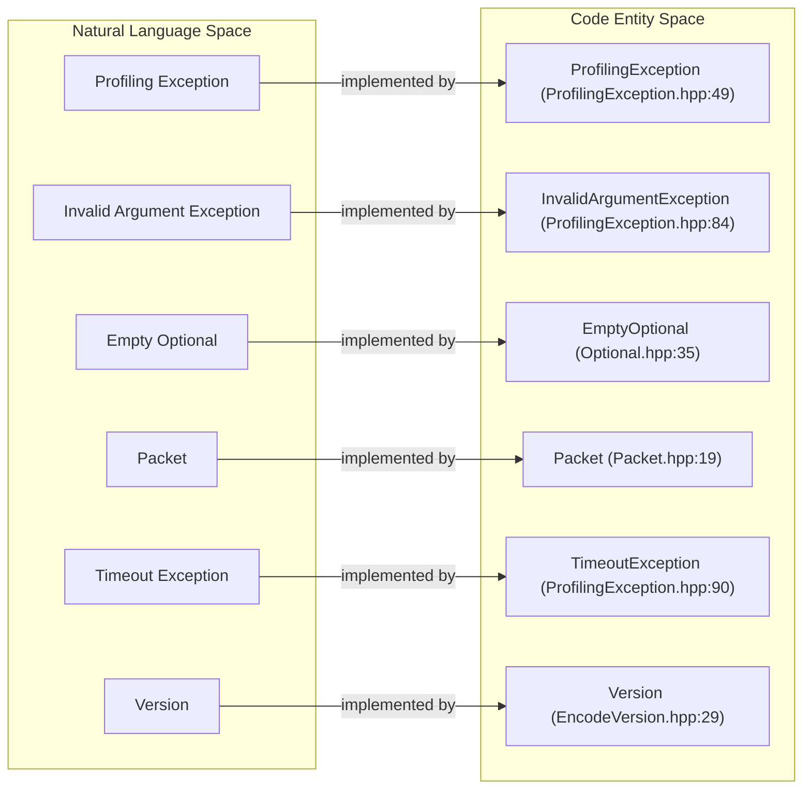
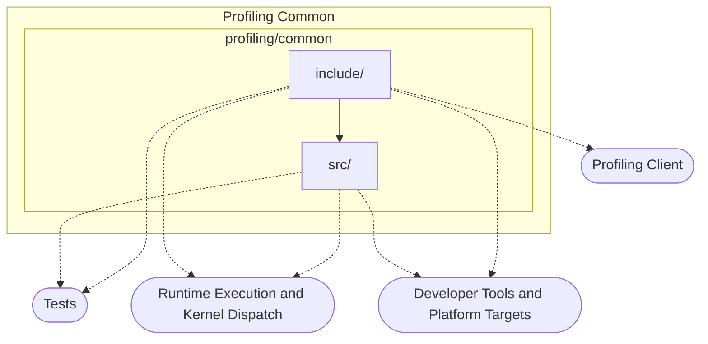
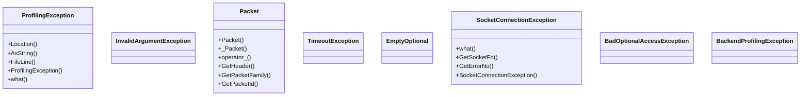
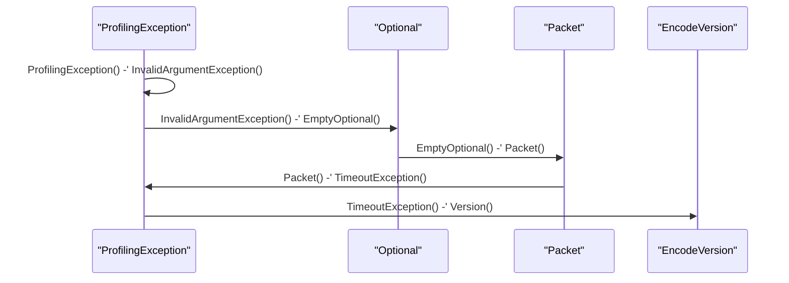

# Profiling Common

↑ [[6-developer-tools-and-platform-targets|Developer Tools and Platform Targets]]

> Profiling Common subsystem (`profiling/common`), covering 28 files and 244 symbols. Key symbols include `IgnoreUnused`, `ProfilingException`, `CentreAlignFormatting`, `InvalidArgumentException`.

<details>
<summary>Relevant source files</summary>

The following files were used as context for generating this wiki page:

- [profiling/common/include/ProfilingException.hpp](profiling/common/include/ProfilingException.hpp)
- [profiling/common/include/Packet.hpp](profiling/common/include/Packet.hpp)
- [profiling/common/include/Optional.hpp](profiling/common/include/Optional.hpp)
- [profiling/common/include/EncodeVersion.hpp](profiling/common/include/EncodeVersion.hpp)
- [profiling/common/include/CounterDirectory.hpp](profiling/common/include/CounterDirectory.hpp)
- [profiling/common/include/Logging.hpp](profiling/common/include/Logging.hpp)
- [profiling/common/src/CommonProfilingUtils.cpp](profiling/common/src/CommonProfilingUtils.cpp)
- [profiling/common/include/CommandHandlerFunctor.hpp](profiling/common/include/CommandHandlerFunctor.hpp)
- [profiling/common/include/CommandHandlerRegistry.hpp](profiling/common/include/CommandHandlerRegistry.hpp)
- [profiling/common/include/CommandHandlerKey.hpp](profiling/common/include/CommandHandlerKey.hpp)
- [profiling/common/include/ICounterDirectory.hpp](profiling/common/include/ICounterDirectory.hpp)
- [profiling/common/include/Counter.hpp](profiling/common/include/Counter.hpp)
- [profiling/common/include/IgnoreUnused.hpp](profiling/common/include/IgnoreUnused.hpp)
- [profiling/common/include/ProfilingGuid.hpp](profiling/common/include/ProfilingGuid.hpp)
- [profiling/common/src/Logging.cpp](profiling/common/src/Logging.cpp)
- [profiling/common/src/CounterDirectory.cpp](profiling/common/src/CounterDirectory.cpp)
- [profiling/common/include/ICounterRegistry.hpp](profiling/common/include/ICounterRegistry.hpp)
- [profiling/common/include/SwTrace.hpp](profiling/common/include/SwTrace.hpp)
- [profiling/common/include/IProfilingGuidGenerator.hpp](profiling/common/include/IProfilingGuidGenerator.hpp)
- [profiling/common/include/SocketConnectionException.hpp](profiling/common/include/SocketConnectionException.hpp)
- [profiling/common/include/LabelsAndEventClasses.hpp](profiling/common/include/LabelsAndEventClasses.hpp)
- [profiling/common/include/PacketVersionResolver.hpp](profiling/common/include/PacketVersionResolver.hpp)
- [profiling/common/include/ProfilingGuidGenerator.hpp](profiling/common/include/ProfilingGuidGenerator.hpp)
- [profiling/common/src/CommandHandlerKey.cpp](profiling/common/src/CommandHandlerKey.cpp)
- [profiling/common/src/NetworkSockets.cpp](profiling/common/src/NetworkSockets.cpp)
- [profiling/common/include/NumericCast.hpp](profiling/common/include/NumericCast.hpp)
- [profiling/common/src/PacketVersionResolver.cpp](profiling/common/src/PacketVersionResolver.cpp)
- [profiling/common/src/CommandHandlerRegistry.cpp](profiling/common/src/CommandHandlerRegistry.cpp)

</details>

## Purpose and Scope

Profiling Common subsystem (`profiling/common`), covering 28 files and 244 symbols. Key symbols include `IgnoreUnused`, `ProfilingException`, `CentreAlignFormatting`, `InvalidArgumentException`.

Primary code entities analyzed on this page include `ProfilingException` ([profiling/common/include/ProfilingException.hpp:49-65]()), `InvalidArgumentException` ([profiling/common/include/ProfilingException.hpp:84-88]()), `EmptyOptional` ([profiling/common/include/Optional.hpp:35-35]()), `Packet` ([profiling/common/include/Packet.hpp:19-88]()), `TimeoutException` ([profiling/common/include/ProfilingException.hpp:90-94]()).

For the parent architectural layer, see [[6-developer-tools-and-platform-targets|Developer Tools and Platform Targets]]. Related sibling subsystems: [[6.2-profiling-client|Profiling Client]], [[6.3-profiling-server|Profiling Server]], [[6.4-profiling|Profiling]].

Sources: [profiling/common/include/ProfilingException.hpp:49-65](), [profiling/common/include/ProfilingException.hpp:84-88](), [profiling/common/include/Optional.hpp:35-35](), [profiling/common/include/Packet.hpp:19-88]()

---

## 1. High-Level Architecture and Data Flow

### Natural Language Space to Code Entity Space Mapping

The following diagram maps domain concepts in this subsystem to their concrete code entities:



### Subsystem Component & Dependency Flow



Cross-subsystem call and import edges connect **Profiling Common** with [[2.1-build-infrastructure|Build Infrastructure]] (coupling `85.0`), [[2-build-system-and-infrastructure|Build System and Infrastructure]] (coupling `80.0`), [[6.2-profiling-client|Profiling Client]] (coupling `75.0`), [[6.3-profiling-server|Profiling Server]] (coupling `62.0`), [[7-glossary|Glossary]] (coupling `60.0`).

| Module Directory | Files | Primary Code Entities | Source Citations |
|---|---|---|---|
| `profiling/common/include` | 21 | `ProfilingException`, `InvalidArgumentException`, `EmptyOptional`, `Packet` | [profiling/common/include/ProfilingException.hpp:49-65]() [profiling/common/include/ProfilingException.hpp:84-88]() |
| `profiling/common/src` | 7 | `DebugOutputSink`, `StandardOutputColourSink`, `CentreAlignFormatting`, `PrintCounterDirectory` | [profiling/common/src/Logging.cpp:144-159]() [profiling/common/src/Logging.cpp:101-142]() |

Sources: [profiling/common/include/ProfilingException.hpp:49-65](), [profiling/common/include/ProfilingException.hpp:84-88](), [profiling/common/include/Optional.hpp:35-35](), [profiling/common/include/Packet.hpp:19-88](), [profiling/common/include/ProfilingException.hpp:90-94]()

---

## 2. Core Data Structures and Implementation Details

### Class and Entity Relationship Diagram



### `ProfilingException` (Class)

- **Source Location**: [profiling/common/include/ProfilingException.hpp:49-65]()
- **Declaration**: `Class ProfilingException`
- **Graph Centrality**: fan-in `32` callers, fan-out `0` callees
- **Responsibility**: /// General Exception class for Profiling code

```cpp
// profiling/common/include/ProfilingException.hpp:49-64
class ProfilingException : public std::exception
{
public:
    explicit ProfilingException(const std::string& message) : m_Message(message) {};

    explicit ProfilingException(const std::string& message,
                                const Location& location) : m_Message(message + location.AsString()) {};

    /// @return - Error message of ProfilingException
    virtual const char *what() const noexcept override
    {
         return m_Message.c_str();
    }

private:
    std::string m_Message;
```

### `InvalidArgumentException` (Class)

- **Source Location**: [profiling/common/include/ProfilingException.hpp:84-88]()
- **Declaration**: `Class InvalidArgumentException`
- **Graph Centrality**: fan-in `18` callers, fan-out `0` callees

```cpp
// profiling/common/include/ProfilingException.hpp:84-88
class InvalidArgumentException : public ProfilingException
{
public:
    using ProfilingException::ProfilingException;
};
```

### `EmptyOptional` (Class)

- **Source Location**: [profiling/common/include/Optional.hpp:35-35]()
- **Declaration**: `Class EmptyOptional`
- **Graph Centrality**: fan-in `4` callers, fan-out `0` callees
- **Responsibility**: /// EmptyOptional is used to initialize the Optional class in case we want /// to have default value for an Optional in a function declaration.

### `Packet` (Class)

- **Source Location**: [profiling/common/include/Packet.hpp:19-88]()
- **Declaration**: `Class Packet`
- **Graph Centrality**: fan-in `6` callers, fan-out `0` callees

```cpp
// profiling/common/include/Packet.hpp:19-34
class Packet
{
public:
    Packet()
        : m_Header(0)
        , m_PacketFamily(0)
        , m_PacketId(0)
        , m_Length(0)
        , m_Data(nullptr)
    {}

    Packet(uint32_t header)
        : m_Header(header)
        , m_Length(0)
        , m_Data(nullptr)
    {
```

### `TimeoutException` (Class)

- **Source Location**: [profiling/common/include/ProfilingException.hpp:90-94]()
- **Declaration**: `Class TimeoutException`
- **Graph Centrality**: fan-in `6` callers, fan-out `0` callees

### `IgnoreUnused` (Function)

- **Source Location**: [profiling/common/include/IgnoreUnused.hpp:15-16]()
- **Declaration**: `(Ts&&...)`
- **Graph Centrality**: fan-in `40` callers, fan-out `0` callees

Sources: [profiling/common/include/ProfilingException.hpp:49-65](), [profiling/common/include/ProfilingException.hpp:84-88](), [profiling/common/include/Optional.hpp:35-35](), [profiling/common/include/Packet.hpp:19-88](), [profiling/common/include/ProfilingException.hpp:90-94]()

---

## 3. Execution and Call Flow

The sequence diagram below traces the runtime/compile-time call chain across components in this module:



Sources: [profiling/common/include/ProfilingException.hpp:49-65](), [profiling/common/include/ProfilingException.hpp:84-88](), [profiling/common/include/Optional.hpp:35-35](), [profiling/common/include/Packet.hpp:19-88](), [profiling/common/include/ProfilingException.hpp:90-94]()

---

## 4. Key API and Symbol Reference

| Code Entity | Kind | Location | Fan-In / Out | Role & Signature |
|---|---|---|---|---|
| `ProfilingException` | Class | [profiling/common/include/ProfilingException.hpp:49-65]() | `32` / `0` | /// General Exception class for Profiling code |
| `InvalidArgumentException` | Class | [profiling/common/include/ProfilingException.hpp:84-88]() | `18` / `0` | — |
| `EmptyOptional` | Class | [profiling/common/include/Optional.hpp:35-35]() | `4` / `0` | /// EmptyOptional is used to initialize the Optional class in case we want |
| `Packet` | Class | [profiling/common/include/Packet.hpp:19-88]() | `6` / `0` | — |
| `TimeoutException` | Class | [profiling/common/include/ProfilingException.hpp:90-94]() | `6` / `0` | — |
| `Version` | Class | [profiling/common/include/EncodeVersion.hpp:29-73]() | `0` / `0` | // Encodes a semantic version https://semver.org/ into a 32 bit integer in the following fashion |
| `ConstructInPlace` | Class | [profiling/common/include/Optional.hpp:39-42]() | `0` / `0` | /// Disambiguation tag that can be passed to the constructor to indicate that |
| `OptionalBase` | Class | [profiling/common/include/Optional.hpp:48-76]() | `0` / `0` | /// OptionalBase is the common functionality between reference and non-reference |
| `BadOptionalAccessException` | Class | [profiling/common/include/ProfilingException.hpp:73-76]() | `2` / `0` | — |
| `ProfilingDynamicGuid` | Class | [profiling/common/include/ProfilingGuid.hpp:63-66]() | `0` / `0` | /// Strongly typed guids to distinguish between those generated at runtime, and those that are statically defi |
| `BackendProfilingException` | Class | [profiling/common/include/ProfilingException.hpp:67-71]() | `1` / `0` | — |
| `BufferExhaustion` | Class | [profiling/common/include/ProfilingException.hpp:78-82]() | `1` / `0` | — |
| `UnimplementedException` | Class | [profiling/common/include/ProfilingException.hpp:96-100]() | `1` / `0` | — |
| `Location` | Class | [profiling/common/include/ProfilingException.hpp:17-46]() | `0` / `0` | — |
| `Optional` | Class | [profiling/common/include/Optional.hpp:273-303]() | `0` / `0` | — |
| `OptionalReferenceSwitch` | Class | [profiling/common/include/Optional.hpp:84-186]() | `0` / `0` | — |
| `OptionalReferenceSwitch<true, T>` | Class | [profiling/common/include/Optional.hpp:194-270]() | `0` / `0` | — |
| `SocketConnectionException` | Class | [profiling/common/include/SocketConnectionException.hpp:20-72]() | `4` / `0` | — |
| `CounterDirectory` | Class | [profiling/common/include/CounterDirectory.hpp:23-99]() | `0` / `0` | — |
| `LogSink` | Class | [profiling/common/include/Logging.hpp:65-73]() | `0` / `0` | — |
| `ScopedRecord` | Class | [profiling/common/include/Logging.hpp:84-130]() | `0` / `0` | — |
| `SimpleLogger` | Class | [profiling/common/include/Logging.hpp:133-171]() | `0` / `0` | — |

Sources: [profiling/common/include/ProfilingException.hpp:49-65](), [profiling/common/include/ProfilingException.hpp:84-88](), [profiling/common/include/Optional.hpp:35-35](), [profiling/common/include/Packet.hpp:19-88](), [profiling/common/include/ProfilingException.hpp:90-94](), [profiling/common/include/EncodeVersion.hpp:29-73]()

---

## 5. Official Documentation and Design Context

The following linked documentation sections from `llm-wiki` (`raw/`) provide additional architectural context, tutorials, and design invariants for this subsystem:

- **Developer Tools and Platform Targets** ([wiki/6-developer-tools-and-platform-targets.md](), score `93.3919`) (sections: `Developer Tools and Platform Targets`, `Purpose and Scope`, `System Mapping: Natural Language Space to Code Entity Space`, `1. Profiling Common`): # Developer Tools and Platform Targets > Architectural overview of Developer Tools and Platform Targets, spanning 70 source files and 662 code symbols across 4 subsystems. <details> <summary>Relevant source files</summary> The following files were used as context for generating this wiki page: - [profiling/common/include/ProfilingException.hpp](profiling/common/include/ProfilingException.hpp) - [profiling/common/incl
- **Runtime Execution and Kernel Dispatch** ([wiki/5-runtime-execution-and-kernel-dispatch.md](), score `69.2498`) (sections: `Runtime Execution and Kernel Dispatch`, `Purpose and Scope`, `System Mapping: Natural Language Space to Code Entity Space`, `1. ArmNN`): # Runtime Execution and Kernel Dispatch > Architectural overview of Runtime Execution and Kernel Dispatch, spanning 157 source files and 3718 code symbols across 6 subsystems. <details> <summary>Relevant source files</summary> The following files were used as context for generating this wiki page: - [samples/common/include/Audio/DataStructures.hpp](samples/common/include/Audio/DataStructures.hpp) - [src/armnn/Tensor.
- **ArmNN DeepWiki** ([wiki/index.md](), score `64.5387`) (sections: `ArmNN DeepWiki`, `Pages`): # ArmNN DeepWiki Generated from `home-jason-Project-deepwiki-armnn` at commit `2b61cecc9df7` (2026-11-14T15:13:53+00:00). ## Pages - [[1-overview|Overview]] — End-to-end architecture overview of ArmNN: core subsystems, compilation/execution pipeline, entry points, and cross-module dependencies. - [[2-build-system-and-infrastructure|Build System and Infrastructure]] — Architectural overview of Build System and Infrast
- **Overview** ([wiki/1-overview.md](), score `63.1283`) (sections: `Overview`, `1. Architecture Overview & System Component Map`, `Core Concept to Code Entity Mapping`, `Core Compilation & Runtime Class Hierarchy`): # Overview > End-to-end architecture overview of ArmNN: core subsystems, compilation/execution pipeline, entry points, and cross-module dependencies. <details> <summary>Relevant source files</summary> The following files were used as context for generating this wiki page: - [src/armnn/Tensor.cpp](src/armnn/Tensor.cpp) - [include/armnn/Exceptions.hpp](include/armnn/Exceptions.hpp) - [include/armnn/Tensor.hpp](include/

Sources: [wiki/6-developer-tools-and-platform-targets.md](), [wiki/5-runtime-execution-and-kernel-dispatch.md](), [wiki/index.md](), [wiki/1-overview.md]()

## Related pages

- [[6-developer-tools-and-platform-targets|Developer Tools and Platform Targets]]
- [[3-backend-delegation-and-hardware-providers|Backend Delegation and Hardware Providers]]
- [[3.1-backends-backendscommon|Backends Backendscommon]]
- [[3.2-backends-reference|Backends Reference]]
- [[3.3-backends-opencl|Backends OpenCL]]
- [[3.4-backends-aclcommon|Backends Aclcommon]]
- [[3.6-other-backends|Other Backends]]
- [[5-runtime-execution-and-kernel-dispatch|Runtime Execution and Kernel Dispatch]]

## Related documents

- `wiki/6-developer-tools-and-platform-targets.md` — Developer Tools and Platform Targets (score 93.3919, via bm25)
- `wiki/5-runtime-execution-and-kernel-dispatch.md` — Runtime Execution and Kernel Dispatch (score 69.2498, via bm25)
- `wiki/index.md` — ArmNN DeepWiki (score 64.5387, via bm25)
- `wiki/1-overview.md` — Overview (score 63.1283, via bm25)
- `wiki/5.2-armnn.md` — ArmNN (score 63.0373, via bm25)

## Sources

- [`profiling/common/include/ProfilingException.hpp`](https://github.com/ARM-software/armnn/blob/branches/armnn_24_11/profiling/common/include/ProfilingException.hpp)
- [`profiling/common/include/Packet.hpp`](https://github.com/ARM-software/armnn/blob/branches/armnn_24_11/profiling/common/include/Packet.hpp)
- [`profiling/common/include/Optional.hpp`](https://github.com/ARM-software/armnn/blob/branches/armnn_24_11/profiling/common/include/Optional.hpp)
- [`profiling/common/include/EncodeVersion.hpp`](https://github.com/ARM-software/armnn/blob/branches/armnn_24_11/profiling/common/include/EncodeVersion.hpp)
- [`profiling/common/include/CounterDirectory.hpp`](https://github.com/ARM-software/armnn/blob/branches/armnn_24_11/profiling/common/include/CounterDirectory.hpp)
- [`profiling/common/include/Logging.hpp`](https://github.com/ARM-software/armnn/blob/branches/armnn_24_11/profiling/common/include/Logging.hpp)
- [`profiling/common/src/CommonProfilingUtils.cpp`](https://github.com/ARM-software/armnn/blob/branches/armnn_24_11/profiling/common/src/CommonProfilingUtils.cpp)
- [`profiling/common/include/CommandHandlerFunctor.hpp`](https://github.com/ARM-software/armnn/blob/branches/armnn_24_11/profiling/common/include/CommandHandlerFunctor.hpp)
- [`profiling/common/include/CommandHandlerRegistry.hpp`](https://github.com/ARM-software/armnn/blob/branches/armnn_24_11/profiling/common/include/CommandHandlerRegistry.hpp)
- [`profiling/common/include/CommandHandlerKey.hpp`](https://github.com/ARM-software/armnn/blob/branches/armnn_24_11/profiling/common/include/CommandHandlerKey.hpp)
- [`profiling/common/include/ICounterDirectory.hpp`](https://github.com/ARM-software/armnn/blob/branches/armnn_24_11/profiling/common/include/ICounterDirectory.hpp)
- [`profiling/common/include/Counter.hpp`](https://github.com/ARM-software/armnn/blob/branches/armnn_24_11/profiling/common/include/Counter.hpp)
- [`profiling/common/include/IgnoreUnused.hpp`](https://github.com/ARM-software/armnn/blob/branches/armnn_24_11/profiling/common/include/IgnoreUnused.hpp)
- [`profiling/common/include/ProfilingGuid.hpp`](https://github.com/ARM-software/armnn/blob/branches/armnn_24_11/profiling/common/include/ProfilingGuid.hpp)
- [`profiling/common/src/Logging.cpp`](https://github.com/ARM-software/armnn/blob/branches/armnn_24_11/profiling/common/src/Logging.cpp)
- [`profiling/common/src/CounterDirectory.cpp`](https://github.com/ARM-software/armnn/blob/branches/armnn_24_11/profiling/common/src/CounterDirectory.cpp)
- [`profiling/common/include/ICounterRegistry.hpp`](https://github.com/ARM-software/armnn/blob/branches/armnn_24_11/profiling/common/include/ICounterRegistry.hpp)
- [`profiling/common/include/SwTrace.hpp`](https://github.com/ARM-software/armnn/blob/branches/armnn_24_11/profiling/common/include/SwTrace.hpp)
- [`profiling/common/include/IProfilingGuidGenerator.hpp`](https://github.com/ARM-software/armnn/blob/branches/armnn_24_11/profiling/common/include/IProfilingGuidGenerator.hpp)
- [`profiling/common/include/SocketConnectionException.hpp`](https://github.com/ARM-software/armnn/blob/branches/armnn_24_11/profiling/common/include/SocketConnectionException.hpp)
- [`profiling/common/include/LabelsAndEventClasses.hpp`](https://github.com/ARM-software/armnn/blob/branches/armnn_24_11/profiling/common/include/LabelsAndEventClasses.hpp)
- [`profiling/common/include/PacketVersionResolver.hpp`](https://github.com/ARM-software/armnn/blob/branches/armnn_24_11/profiling/common/include/PacketVersionResolver.hpp)
- [`profiling/common/include/ProfilingGuidGenerator.hpp`](https://github.com/ARM-software/armnn/blob/branches/armnn_24_11/profiling/common/include/ProfilingGuidGenerator.hpp)
- [`profiling/common/src/CommandHandlerKey.cpp`](https://github.com/ARM-software/armnn/blob/branches/armnn_24_11/profiling/common/src/CommandHandlerKey.cpp)
- [`profiling/common/src/NetworkSockets.cpp`](https://github.com/ARM-software/armnn/blob/branches/armnn_24_11/profiling/common/src/NetworkSockets.cpp)
- [`profiling/common/include/NumericCast.hpp`](https://github.com/ARM-software/armnn/blob/branches/armnn_24_11/profiling/common/include/NumericCast.hpp)
- [`profiling/common/src/PacketVersionResolver.cpp`](https://github.com/ARM-software/armnn/blob/branches/armnn_24_11/profiling/common/src/PacketVersionResolver.cpp)
- [`profiling/common/src/CommandHandlerRegistry.cpp`](https://github.com/ARM-software/armnn/blob/branches/armnn_24_11/profiling/common/src/CommandHandlerRegistry.cpp)


## Dynamic Knowledge Links (Code Graph ↔ LLM-Wiki / RAG)

### Linked Architecture & Design Documents

| Document | Match Channel | Score | Shared Code Symbols |
|---|---|---|---|
| [[6-developer-tools-and-platform-targets|Developer Tools and Platform Targets]] | `bm25+entity(8)` | `105.392` | `BadOptionalAccessException`, `EmptyOptional`, `InvalidArgumentException`, `Optional`, `Packet` |
| [[5-runtime-execution-and-kernel-dispatch|Runtime Execution and Kernel Dispatch]] | `bm25+entity(3)` | `73.75` | `EmptyOptional`, `InvalidArgumentException`, `ProfilingException` |
| [[5.2-armnn|ArmNN]] | `bm25+entity(4)` | `69.037` | `EmptyOptional`, `InvalidArgumentException`, `ProfilingException`, `UnimplementedException` |
| [[index|ArmNN DeepWiki]] | `bm25+entity(1)` | `66.039` | `InvalidArgumentException` |
| [[1-overview|Overview]] | `bm25+entity(1)` | `64.628` | `InvalidArgumentException` |
| [[6.3-profiling-server|Profiling Server]] | `wikilink:6.1-profiling-common+entity(4)` | `59.345` | `InvalidArgumentException`, `Optional`, `Packet`, `ProfilingException` |

### High-Centrality Bridge Symbols (CBM Graph)

| Symbol | Kind | Source Location | Fan-In / Fan-Out |
|---|---|---|---|
| `ProfilingException` | Class | [profiling/common/include/ProfilingException.hpp:49-65]() | in: `32` / out: `0` |
| `InvalidArgumentException` | Class | [profiling/common/include/ProfilingException.hpp:84-88]() | in: `18` / out: `0` |
| `EmptyOptional` | Class | [profiling/common/include/Optional.hpp:35-35]() | in: `4` / out: `0` |
| `Packet` | Class | [profiling/common/include/Packet.hpp:19-88]() | in: `6` / out: `0` |
| `TimeoutException` | Class | [profiling/common/include/ProfilingException.hpp:90-94]() | in: `6` / out: `0` |
| `Version` | Class | [profiling/common/include/EncodeVersion.hpp:29-73]() | in: `0` / out: `0` |

Sources: [profiling/common/include/ProfilingException.hpp:49-65](), [profiling/common/include/ProfilingException.hpp:84-88](), [profiling/common/include/Optional.hpp:35-35](), [profiling/common/include/Packet.hpp:19-88]()

### Cross-Subsystem Coupling

- [[2.1-build-infrastructure|Build Infrastructure]] — call/import coupling weight `85.0`
- [[2-build-system-and-infrastructure|Build System and Infrastructure]] — call/import coupling weight `80.0`
- [[6.2-profiling-client|Profiling Client]] — call/import coupling weight `75.0`
- [[6.3-profiling-server|Profiling Server]] — call/import coupling weight `62.0`
- [[7-glossary|Glossary]] — call/import coupling weight `60.0`
- [[5-runtime-execution-and-kernel-dispatch|Runtime Execution and Kernel Dispatch]] — call/import coupling weight `41.0`
