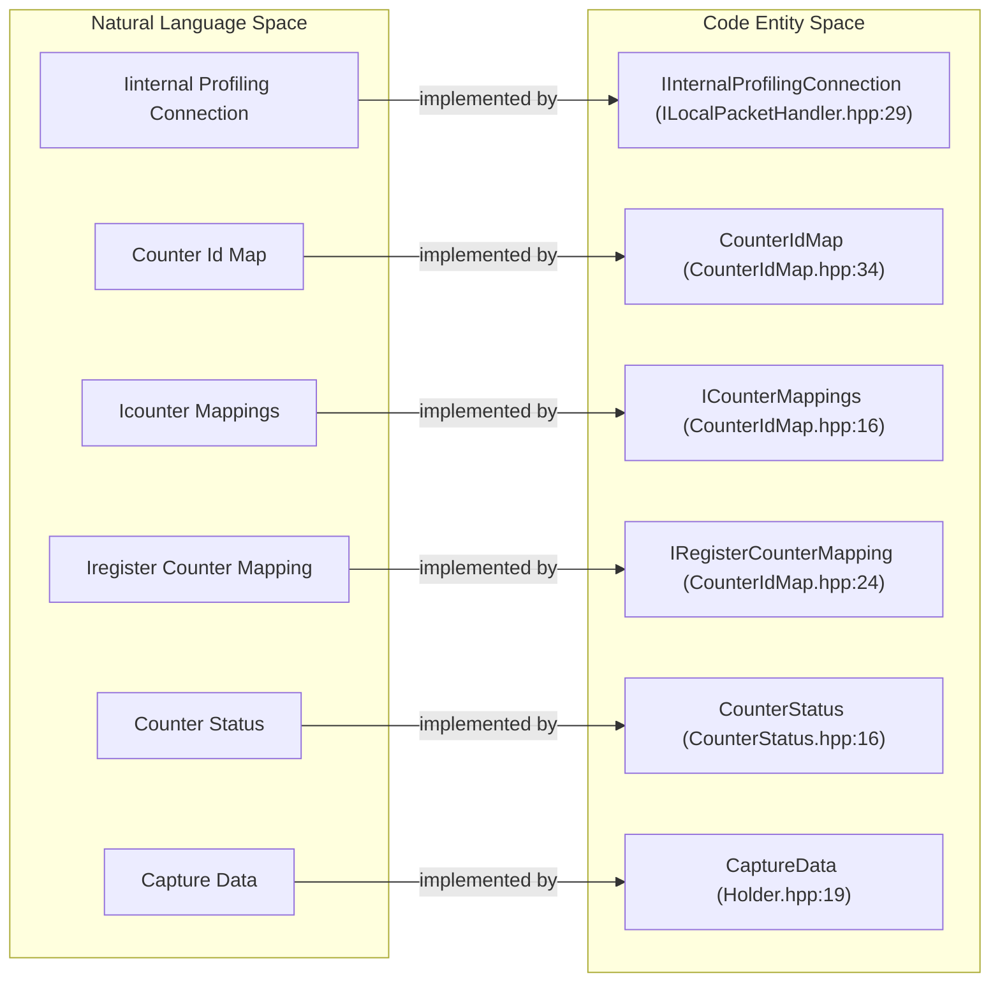
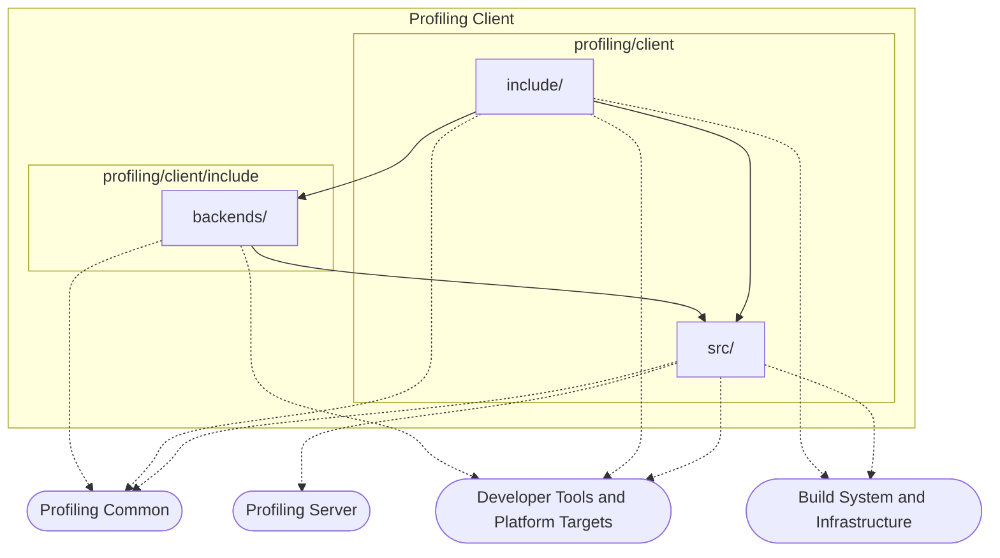
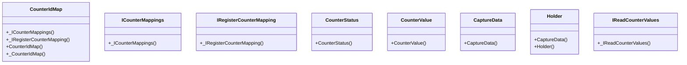
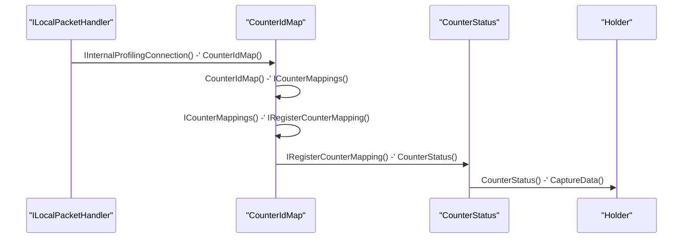

# Profiling Client

↑ [[6-developer-tools-and-platform-targets|Developer Tools and Platform Targets]]

> Profiling Client subsystem (`profiling/client`), covering 28 files and 340 symbols. Key symbols include `ReadUint32`, `GetCurrentState`, `WriteUint32`, `GetNextGuid`.

<details>
<summary>Relevant source files</summary>

The following files were used as context for generating this wiki page:

- [profiling/client/include/CounterIdMap.hpp](profiling/client/include/CounterIdMap.hpp)
- [profiling/client/include/CounterStatus.hpp](profiling/client/include/CounterStatus.hpp)
- [profiling/client/include/ICounterValues.hpp](profiling/client/include/ICounterValues.hpp)
- [profiling/client/include/Holder.hpp](profiling/client/include/Holder.hpp)
- [profiling/client/include/CounterValue.hpp](profiling/client/include/CounterValue.hpp)
- [profiling/client/include/ILocalPacketHandler.hpp](profiling/client/include/ILocalPacketHandler.hpp)
- [profiling/client/include/IInitialiseProfilingService.hpp](profiling/client/include/IInitialiseProfilingService.hpp)
- [profiling/client/include/IProfilingService.hpp](profiling/client/include/IProfilingService.hpp)
- [profiling/client/include/IProfilingServiceStatus.hpp](profiling/client/include/IProfilingServiceStatus.hpp)
- [profiling/client/include/IReportStructure.hpp](profiling/client/include/IReportStructure.hpp)
- [profiling/client/include/ISendCounterPacket.hpp](profiling/client/include/ISendCounterPacket.hpp)
- [profiling/client/include/TimelineUtilityMethods.hpp](profiling/client/include/TimelineUtilityMethods.hpp)
- [profiling/client/include/ISendTimelinePacket.hpp](profiling/client/include/ISendTimelinePacket.hpp)
- [profiling/client/include/ProfilingOptions.hpp](profiling/client/include/ProfilingOptions.hpp)
- [profiling/client/include/Timestamp.hpp](profiling/client/include/Timestamp.hpp)
- [profiling/client/src/CommandHandler.hpp](profiling/client/src/CommandHandler.hpp)
- [profiling/client/src/FileOnlyProfilingConnection.cpp](profiling/client/src/FileOnlyProfilingConnection.cpp)
- [profiling/client/src/ActivateTimelineReportingCommandHandler.hpp](profiling/client/src/ActivateTimelineReportingCommandHandler.hpp)
- [profiling/client/src/BufferManager.hpp](profiling/client/src/BufferManager.hpp)
- [profiling/client/include/backends/IBackendProfiling.hpp](profiling/client/include/backends/IBackendProfiling.hpp)
- [profiling/client/src/ConnectionAcknowledgedCommandHandler.hpp](profiling/client/src/ConnectionAcknowledgedCommandHandler.hpp)
- [profiling/client/src/ProfilingUtils.cpp](profiling/client/src/ProfilingUtils.cpp)
- [profiling/client/include/backends/IBackendProfilingContext.hpp](profiling/client/include/backends/IBackendProfilingContext.hpp)
- [profiling/client/src/BufferManager.cpp](profiling/client/src/BufferManager.cpp)
- [profiling/client/src/FileOnlyProfilingConnection.hpp](profiling/client/src/FileOnlyProfilingConnection.hpp)
- [profiling/client/src/DeactivateTimelineReportingCommandHandler.hpp](profiling/client/src/DeactivateTimelineReportingCommandHandler.hpp)
- [profiling/client/src/Holder.cpp](profiling/client/src/Holder.cpp)
- [profiling/client/src/IBufferManager.hpp](profiling/client/src/IBufferManager.hpp)

</details>

## Purpose and Scope

Profiling Client subsystem (`profiling/client`), covering 28 files and 340 symbols. Key symbols include `ReadUint32`, `GetCurrentState`, `WriteUint32`, `GetNextGuid`.

Primary code entities analyzed on this page include `IInternalProfilingConnection` ([profiling/client/include/ILocalPacketHandler.hpp:29-39]()), `CounterIdMap` ([profiling/client/include/CounterIdMap.hpp:34-49]()), `ICounterMappings` ([profiling/client/include/CounterIdMap.hpp:16-22]()), `IRegisterCounterMapping` ([profiling/client/include/CounterIdMap.hpp:24-32]()), `CounterStatus` ([profiling/client/include/CounterStatus.hpp:16-30]()).

For the parent architectural layer, see [[6-developer-tools-and-platform-targets|Developer Tools and Platform Targets]]. Related sibling subsystems: [[6.1-profiling-common|Profiling Common]], [[6.3-profiling-server|Profiling Server]], [[6.4-profiling|Profiling]].

Sources: [profiling/client/include/ILocalPacketHandler.hpp:29-39](), [profiling/client/include/CounterIdMap.hpp:34-49](), [profiling/client/include/CounterIdMap.hpp:16-22](), [profiling/client/include/CounterIdMap.hpp:24-32]()

---

## 1. High-Level Architecture and Data Flow

### Natural Language Space to Code Entity Space Mapping

The following diagram maps domain concepts in this subsystem to their concrete code entities:



### Subsystem Component & Dependency Flow



Cross-subsystem call and import edges connect **Profiling Client** with [[6.1-profiling-common|Profiling Common]] (coupling `75.0`), [[2.1-build-infrastructure|Build Infrastructure]] (coupling `60.0`), [[2-build-system-and-infrastructure|Build System and Infrastructure]] (coupling `59.0`), [[7-glossary|Glossary]] (coupling `44.0`), [[6-developer-tools-and-platform-targets|Developer Tools and Platform Targets]] (coupling `35.0`).

| Module Directory | Files | Primary Code Entities | Source Citations |
|---|---|---|---|
| `profiling/client/include` | 15 | `IInternalProfilingConnection`, `CounterIdMap`, `ICounterMappings`, `IRegisterCounterMapping` | [profiling/client/include/ILocalPacketHandler.hpp:29-39]() [profiling/client/include/CounterIdMap.hpp:34-49]() |
| `profiling/client/src` | 11 | `CommandHandler`, `ActivateTimelineReportingCommandHandler`, `BufferManager`, `ConnectionAcknowledgedCommandHandler` | [profiling/client/src/CommandHandler.hpp:24-62]() [profiling/client/src/ActivateTimelineReportingCommandHandler.hpp:24-55]() |
| `profiling/client/include/backends` | 2 | `IBackendProfiling`, `IRegisterBackendCounters`, `IBackendProfilingContext`, `~IBackendProfiling` | [profiling/client/include/backends/IBackendProfiling.hpp:58-82]() [profiling/client/include/backends/IBackendProfiling.hpp:28-56]() |

Sources: [profiling/client/include/ILocalPacketHandler.hpp:29-39](), [profiling/client/include/CounterIdMap.hpp:34-49](), [profiling/client/include/CounterIdMap.hpp:16-22](), [profiling/client/include/CounterIdMap.hpp:24-32](), [profiling/client/include/CounterStatus.hpp:16-30]()

---

## 2. Core Data Structures and Implementation Details

### Class and Entity Relationship Diagram



### `IInternalProfilingConnection` (Class)

- **Source Location**: [profiling/client/include/ILocalPacketHandler.hpp:29-39]()
- **Declaration**: `Class IInternalProfilingConnection`
- **Graph Centrality**: fan-in `0` callers, fan-out `0` callees
- **Responsibility**: // the handlers need to be able to do two // things to service the FileOnlyProfilingConnection // and any other implementation of IProfilingConnection // set the endianness and write a packet back i.e. // return a packet and close the connection

```cpp
// profiling/client/include/ILocalPacketHandler.hpp:29-39
class IInternalProfilingConnection
{
public:
    virtual ~IInternalProfilingConnection() {};

    virtual void SetEndianess(const TargetEndianness& endianness) = 0;

    virtual void ReturnPacket(Packet& packet) = 0;

    virtual void Close() = 0;
};
```

### `CounterIdMap` (Class)

- **Source Location**: [profiling/client/include/CounterIdMap.hpp:34-49]()
- **Declaration**: `Class CounterIdMap`
- **Graph Centrality**: fan-in `0` callers, fan-out `0` callees

```cpp
// profiling/client/include/CounterIdMap.hpp:34-49
class CounterIdMap : public ICounterMappings, public IRegisterCounterMapping
{

public:
    CounterIdMap() = default;
    virtual ~CounterIdMap() {}
    void RegisterMapping(uint16_t globalCounterId,
                         uint16_t backendCounterId,
                         const std::string& backendId) override;
    void Reset() override;
    uint16_t GetGlobalId(uint16_t backendCounterId, const std::string& backendId) const override;
    const std::pair<uint16_t, std::string>& GetBackendId(uint16_t globalCounterId) const override;
private:
    std::map<uint16_t, std::pair<uint16_t, std::string>> m_GlobalCounterIdMap;
    std::map<std::pair<uint16_t, std::string>, uint16_t> m_BackendCounterIdMap;
};
```

### `ICounterMappings` (Class)

- **Source Location**: [profiling/client/include/CounterIdMap.hpp:16-22]()
- **Declaration**: `Class ICounterMappings`
- **Graph Centrality**: fan-in `0` callers, fan-out `0` callees

```cpp
// profiling/client/include/CounterIdMap.hpp:16-22
class ICounterMappings
{
public:
    virtual uint16_t GetGlobalId(uint16_t backendCounterId, const std::string& backendId) const = 0;
    virtual const std::pair<uint16_t, std::string>& GetBackendId(uint16_t globalCounterId) const = 0;
    virtual ~ICounterMappings() {}
};
```

### `IRegisterCounterMapping` (Class)

- **Source Location**: [profiling/client/include/CounterIdMap.hpp:24-32]()
- **Declaration**: `Class IRegisterCounterMapping`
- **Graph Centrality**: fan-in `0` callers, fan-out `0` callees

### `CounterStatus` (Class)

- **Source Location**: [profiling/client/include/CounterStatus.hpp:16-30]()
- **Declaration**: `Class CounterStatus`
- **Graph Centrality**: fan-in `0` callers, fan-out `0` callees

### `ReadUint32` (Function)

- **Source Location**: [profiling/client/src/ProfilingUtils.cpp:90-95]()
- **Declaration**: `(const IPacketBufferPtr& packetBuffer, unsigned int offset)`
- **Graph Centrality**: fan-in `21` callers, fan-out `0` callees

Sources: [profiling/client/include/ILocalPacketHandler.hpp:29-39](), [profiling/client/include/CounterIdMap.hpp:34-49](), [profiling/client/include/CounterIdMap.hpp:16-22](), [profiling/client/include/CounterIdMap.hpp:24-32](), [profiling/client/include/CounterStatus.hpp:16-30]()

---

## 3. Execution and Call Flow

The sequence diagram below traces the runtime/compile-time call chain across components in this module:



Sources: [profiling/client/include/ILocalPacketHandler.hpp:29-39](), [profiling/client/include/CounterIdMap.hpp:34-49](), [profiling/client/include/CounterIdMap.hpp:16-22](), [profiling/client/include/CounterIdMap.hpp:24-32](), [profiling/client/include/CounterStatus.hpp:16-30]()

---

## 4. Key API and Symbol Reference

| Code Entity | Kind | Location | Fan-In / Out | Role & Signature |
|---|---|---|---|---|
| `IInternalProfilingConnection` | Class | [profiling/client/include/ILocalPacketHandler.hpp:29-39]() | `0` / `0` | // the handlers need to be able to do two |
| `CounterIdMap` | Class | [profiling/client/include/CounterIdMap.hpp:34-49]() | `0` / `0` | — |
| `ICounterMappings` | Class | [profiling/client/include/CounterIdMap.hpp:16-22]() | `0` / `0` | — |
| `IRegisterCounterMapping` | Class | [profiling/client/include/CounterIdMap.hpp:24-32]() | `0` / `0` | — |
| `CounterStatus` | Class | [profiling/client/include/CounterStatus.hpp:16-30]() | `0` / `0` | — |
| `CaptureData` | Class | [profiling/client/include/Holder.hpp:19-49]() | `0` / `0` | — |
| `Holder` | Class | [profiling/client/include/Holder.hpp:51-66]() | `0` / `0` | — |
| `IReadCounterValues` | Class | [profiling/client/include/ICounterValues.hpp:16-26]() | `0` / `0` | — |
| `IReadWriteCounterValues` | Class | [profiling/client/include/ICounterValues.hpp:39-43]() | `0` / `0` | — |
| `IWriteCounterValues` | Class | [profiling/client/include/ICounterValues.hpp:28-37]() | `0` / `0` | — |
| `CounterValue` | Class | [profiling/client/include/CounterValue.hpp:14-20]() | `0` / `0` | — |
| `ILocalPacketHandler` | Class | [profiling/client/include/ILocalPacketHandler.hpp:41-61]() | `0` / `0` | — |
| `IInitialiseProfilingService` | Class | [profiling/client/include/IInitialiseProfilingService.hpp:17-22]() | `0` / `0` | — |
| `IProfilingService` | Class | [profiling/client/include/IProfilingService.hpp:33-79]() | `0` / `0` | — |
| `IProfilingServiceStatus` | Class | [profiling/client/include/IProfilingServiceStatus.hpp:20-26]() | `0` / `0` | — |
| `IReportStructure` | Class | [profiling/client/include/IReportStructure.hpp:16-21]() | `0` / `0` | — |
| `ISendCounterPacket` | Class | [profiling/client/include/ISendCounterPacket.hpp:18-37]() | `0` / `0` | — |
| `TimelineUtilityMethods` | Class | [profiling/client/include/TimelineUtilityMethods.hpp:17-94]() | `0` / `0` | — |
| `ISendTimelinePacket` | Class | [profiling/client/include/ISendTimelinePacket.hpp:27-58]() | `0` / `0` | — |
| `ProfilingOptions` | Class | [profiling/client/include/ProfilingOptions.hpp:20-41]() | `0` / `0` | — |
| `Timestamp` | Class | [profiling/client/include/Timestamp.hpp:16-20]() | `0` / `0` | — |
| `CommandHandler` | Class | [profiling/client/src/CommandHandler.hpp:24-62]() | `0` / `0` | — |

Sources: [profiling/client/include/ILocalPacketHandler.hpp:29-39](), [profiling/client/include/CounterIdMap.hpp:34-49](), [profiling/client/include/CounterIdMap.hpp:16-22](), [profiling/client/include/CounterIdMap.hpp:24-32](), [profiling/client/include/CounterStatus.hpp:16-30](), [profiling/client/include/Holder.hpp:19-49]()

---

## 5. Official Documentation and Design Context

The following linked documentation sections from `llm-wiki` (`raw/`) provide additional architectural context, tutorials, and design invariants for this subsystem:

- **Developer Tools and Platform Targets** ([wiki/6-developer-tools-and-platform-targets.md](), score `136.8091`) (sections: `Developer Tools and Platform Targets`, `Purpose and Scope`, `System Mapping: Natural Language Space to Code Entity Space`, `1. Profiling Common`): # Developer Tools and Platform Targets > Architectural overview of Developer Tools and Platform Targets, spanning 70 source files and 662 code symbols across 4 subsystems. <details> <summary>Relevant source files</summary> The following files were used as context for generating this wiki page: - [profiling/common/include/ProfilingException.hpp](profiling/common/include/ProfilingException.hpp) - [profiling/common/incl
- **Profiling Server** ([wiki/6.3-profiling-server.md](), score `95.718`) (sections: `Profiling Server`, `Purpose and Scope`, `1. High-Level Architecture and Data Flow`, `Natural Language Space to Code Entity Space Mapping`): # Profiling Server ↑ [[6-developer-tools-and-platform-targets|Developer Tools and Platform Targets]] > Profiling Server subsystem (`profiling/server`), covering 13 files and 77 symbols. Key symbols include `ParseData`, `ReceivePacket`, `ReadCategoryRecords`, `ParseData`. <details> <summary>Relevant source files</summary> The following files were used as context for generating this wiki page: - [profiling/server/inclu
- **Profiling Common** ([wiki/6.1-profiling-common.md](), score `82.0331`) (sections: `Profiling Common`, `Purpose and Scope`, `1. High-Level Architecture and Data Flow`, `Natural Language Space to Code Entity Space Mapping`): # Profiling Common ↑ [[6-developer-tools-and-platform-targets|Developer Tools and Platform Targets]] > Profiling Common subsystem (`profiling/common`), covering 28 files and 244 symbols. Key symbols include `IgnoreUnused`, `ProfilingException`, `CentreAlignFormatting`, `InvalidArgumentException`. <details> <summary>Relevant source files</summary> The following files were used as context for generating this wiki page:
- **ArmNN DeepWiki** ([wiki/index.md](), score `57.1823`) (sections: `ArmNN DeepWiki`, `Pages`): # ArmNN DeepWiki Generated from `home-jason-Project-deepwiki-armnn` at commit `2b61cecc9df7` (2026-11-14T15:13:53+00:00). ## Pages - [[1-overview|Overview]] — End-to-end architecture overview of ArmNN: core subsystems, compilation/execution pipeline, entry points, and cross-module dependencies. - [[2-build-system-and-infrastructure|Build System and Infrastructure]] — Architectural overview of Build System and Infrast

Sources: [wiki/6-developer-tools-and-platform-targets.md](), [wiki/6.3-profiling-server.md](), [wiki/6.1-profiling-common.md](), [wiki/index.md]()

## Related pages

- [[6-developer-tools-and-platform-targets|Developer Tools and Platform Targets]]
- [[3-backend-delegation-and-hardware-providers|Backend Delegation and Hardware Providers]]
- [[3.1-backends-backendscommon|Backends Backendscommon]]
- [[3.2-backends-reference|Backends Reference]]
- [[3.3-backends-opencl|Backends OpenCL]]
- [[3.4-backends-aclcommon|Backends Aclcommon]]
- [[3.6-other-backends|Other Backends]]
- [[5-runtime-execution-and-kernel-dispatch|Runtime Execution and Kernel Dispatch]]

## Related documents

- `wiki/6-developer-tools-and-platform-targets.md` — Developer Tools and Platform Targets (score 136.8091, via bm25)
- `wiki/6.3-profiling-server.md` — Profiling Server (score 95.718, via bm25)
- `wiki/6.1-profiling-common.md` — Profiling Common (score 82.0331, via bm25)
- `wiki/index.md` — ArmNN DeepWiki (score 57.1823, via bm25)
- `wiki/1-overview.md` — Overview (score 56.5834, via bm25)

## Sources

- [`profiling/client/include/CounterIdMap.hpp`](https://github.com/ARM-software/armnn/blob/branches/armnn_24_11/profiling/client/include/CounterIdMap.hpp)
- [`profiling/client/include/CounterStatus.hpp`](https://github.com/ARM-software/armnn/blob/branches/armnn_24_11/profiling/client/include/CounterStatus.hpp)
- [`profiling/client/include/ICounterValues.hpp`](https://github.com/ARM-software/armnn/blob/branches/armnn_24_11/profiling/client/include/ICounterValues.hpp)
- [`profiling/client/include/Holder.hpp`](https://github.com/ARM-software/armnn/blob/branches/armnn_24_11/profiling/client/include/Holder.hpp)
- [`profiling/client/include/CounterValue.hpp`](https://github.com/ARM-software/armnn/blob/branches/armnn_24_11/profiling/client/include/CounterValue.hpp)
- [`profiling/client/include/ILocalPacketHandler.hpp`](https://github.com/ARM-software/armnn/blob/branches/armnn_24_11/profiling/client/include/ILocalPacketHandler.hpp)
- [`profiling/client/include/IInitialiseProfilingService.hpp`](https://github.com/ARM-software/armnn/blob/branches/armnn_24_11/profiling/client/include/IInitialiseProfilingService.hpp)
- [`profiling/client/include/IProfilingService.hpp`](https://github.com/ARM-software/armnn/blob/branches/armnn_24_11/profiling/client/include/IProfilingService.hpp)
- [`profiling/client/include/IProfilingServiceStatus.hpp`](https://github.com/ARM-software/armnn/blob/branches/armnn_24_11/profiling/client/include/IProfilingServiceStatus.hpp)
- [`profiling/client/include/IReportStructure.hpp`](https://github.com/ARM-software/armnn/blob/branches/armnn_24_11/profiling/client/include/IReportStructure.hpp)
- [`profiling/client/include/ISendCounterPacket.hpp`](https://github.com/ARM-software/armnn/blob/branches/armnn_24_11/profiling/client/include/ISendCounterPacket.hpp)
- [`profiling/client/include/TimelineUtilityMethods.hpp`](https://github.com/ARM-software/armnn/blob/branches/armnn_24_11/profiling/client/include/TimelineUtilityMethods.hpp)
- [`profiling/client/include/ISendTimelinePacket.hpp`](https://github.com/ARM-software/armnn/blob/branches/armnn_24_11/profiling/client/include/ISendTimelinePacket.hpp)
- [`profiling/client/include/ProfilingOptions.hpp`](https://github.com/ARM-software/armnn/blob/branches/armnn_24_11/profiling/client/include/ProfilingOptions.hpp)
- [`profiling/client/include/Timestamp.hpp`](https://github.com/ARM-software/armnn/blob/branches/armnn_24_11/profiling/client/include/Timestamp.hpp)
- [`profiling/client/src/CommandHandler.hpp`](https://github.com/ARM-software/armnn/blob/branches/armnn_24_11/profiling/client/src/CommandHandler.hpp)
- [`profiling/client/src/FileOnlyProfilingConnection.cpp`](https://github.com/ARM-software/armnn/blob/branches/armnn_24_11/profiling/client/src/FileOnlyProfilingConnection.cpp)
- [`profiling/client/src/ActivateTimelineReportingCommandHandler.hpp`](https://github.com/ARM-software/armnn/blob/branches/armnn_24_11/profiling/client/src/ActivateTimelineReportingCommandHandler.hpp)
- [`profiling/client/src/BufferManager.hpp`](https://github.com/ARM-software/armnn/blob/branches/armnn_24_11/profiling/client/src/BufferManager.hpp)
- [`profiling/client/include/backends/IBackendProfiling.hpp`](https://github.com/ARM-software/armnn/blob/branches/armnn_24_11/profiling/client/include/backends/IBackendProfiling.hpp)
- [`profiling/client/src/ConnectionAcknowledgedCommandHandler.hpp`](https://github.com/ARM-software/armnn/blob/branches/armnn_24_11/profiling/client/src/ConnectionAcknowledgedCommandHandler.hpp)
- [`profiling/client/src/ProfilingUtils.cpp`](https://github.com/ARM-software/armnn/blob/branches/armnn_24_11/profiling/client/src/ProfilingUtils.cpp)
- [`profiling/client/include/backends/IBackendProfilingContext.hpp`](https://github.com/ARM-software/armnn/blob/branches/armnn_24_11/profiling/client/include/backends/IBackendProfilingContext.hpp)
- [`profiling/client/src/BufferManager.cpp`](https://github.com/ARM-software/armnn/blob/branches/armnn_24_11/profiling/client/src/BufferManager.cpp)
- [`profiling/client/src/FileOnlyProfilingConnection.hpp`](https://github.com/ARM-software/armnn/blob/branches/armnn_24_11/profiling/client/src/FileOnlyProfilingConnection.hpp)
- [`profiling/client/src/DeactivateTimelineReportingCommandHandler.hpp`](https://github.com/ARM-software/armnn/blob/branches/armnn_24_11/profiling/client/src/DeactivateTimelineReportingCommandHandler.hpp)
- [`profiling/client/src/Holder.cpp`](https://github.com/ARM-software/armnn/blob/branches/armnn_24_11/profiling/client/src/Holder.cpp)
- [`profiling/client/src/IBufferManager.hpp`](https://github.com/ARM-software/armnn/blob/branches/armnn_24_11/profiling/client/src/IBufferManager.hpp)


## Dynamic Knowledge Links (Code Graph ↔ LLM-Wiki / RAG)

### Linked Architecture & Design Documents

| Document | Match Channel | Score | Shared Code Symbols |
|---|---|---|---|
| [[6-developer-tools-and-platform-targets|Developer Tools and Platform Targets]] | `bm25+entity(2)` | `139.809` | `ReadUint32`, `WriteUint32` |
| [[6.3-profiling-server|Profiling Server]] | `bm25+entity(2)` | `98.718` | `ReadUint32`, `WriteUint32` |
| [[6.4-profiling|Profiling]] | `wikilink:6.2-profiling-client` | `87.932` | *(lexical/graph match)* |
| [[2.1-build-infrastructure|Build Infrastructure]] | `wikilink:6.2-profiling-client` | `87.932` | *(lexical/graph match)* |
| [[2-build-system-and-infrastructure|Build System and Infrastructure]] | `wikilink:6.2-profiling-client` | `87.932` | *(lexical/graph match)* |
| [[6.1-profiling-common|Profiling Common]] | `bm25` | `82.033` | *(lexical/graph match)* |

### High-Centrality Bridge Symbols (CBM Graph)

| Symbol | Kind | Source Location | Fan-In / Fan-Out |
|---|---|---|---|
| `IInternalProfilingConnection` | Class | [profiling/client/include/ILocalPacketHandler.hpp:29-39]() | in: `0` / out: `0` |
| `CounterIdMap` | Class | [profiling/client/include/CounterIdMap.hpp:34-49]() | in: `0` / out: `0` |
| `ICounterMappings` | Class | [profiling/client/include/CounterIdMap.hpp:16-22]() | in: `0` / out: `0` |
| `IRegisterCounterMapping` | Class | [profiling/client/include/CounterIdMap.hpp:24-32]() | in: `0` / out: `0` |
| `CounterStatus` | Class | [profiling/client/include/CounterStatus.hpp:16-30]() | in: `0` / out: `0` |
| `CaptureData` | Class | [profiling/client/include/Holder.hpp:19-49]() | in: `0` / out: `0` |

Sources: [profiling/client/include/ILocalPacketHandler.hpp:29-39](), [profiling/client/include/CounterIdMap.hpp:34-49](), [profiling/client/include/CounterIdMap.hpp:16-22](), [profiling/client/include/CounterIdMap.hpp:24-32]()

### Cross-Subsystem Coupling

- [[6.1-profiling-common|Profiling Common]] — call/import coupling weight `75.0`
- [[2.1-build-infrastructure|Build Infrastructure]] — call/import coupling weight `60.0`
- [[2-build-system-and-infrastructure|Build System and Infrastructure]] — call/import coupling weight `59.0`
- [[7-glossary|Glossary]] — call/import coupling weight `44.0`
- [[6-developer-tools-and-platform-targets|Developer Tools and Platform Targets]] — call/import coupling weight `35.0`
- [[6.3-profiling-server|Profiling Server]] — call/import coupling weight `21.0`
