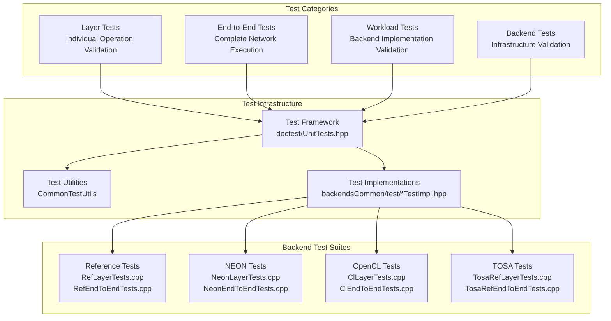
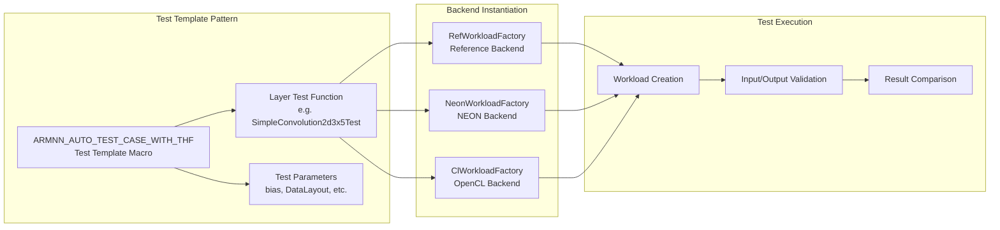
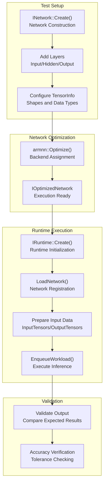
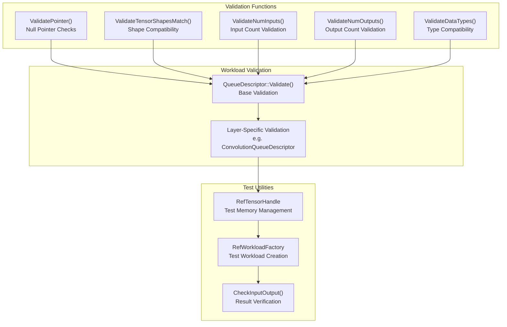
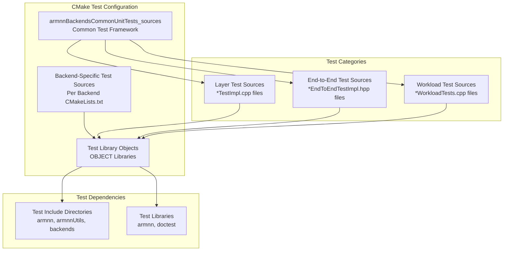

# Testing Framework

<details>
<summary>Relevant source files</summary>

The following files were used as context for generating this wiki page:

- [src/backends/backendsCommon/WorkloadData.cpp](src/backends/backendsCommon/WorkloadData.cpp)
- [src/backends/backendsCommon/common.mk](src/backends/backendsCommon/common.mk)
- [src/backends/backendsCommon/test/CMakeLists.txt](src/backends/backendsCommon/test/CMakeLists.txt)
- [src/backends/backendsCommon/test/EndToEndTestImpl.hpp](src/backends/backendsCommon/test/EndToEndTestImpl.hpp)
- [src/backends/backendsCommon/test/LayerTests.hpp](src/backends/backendsCommon/test/LayerTests.hpp)
- [src/backends/cl/test/ClEndToEndTests.cpp](src/backends/cl/test/ClEndToEndTests.cpp)
- [src/backends/neon/test/NeonEndToEndTests.cpp](src/backends/neon/test/NeonEndToEndTests.cpp)
- [src/backends/reference/RefLayerSupport.cpp](src/backends/reference/RefLayerSupport.cpp)
- [src/backends/reference/RefLayerSupport.hpp](src/backends/reference/RefLayerSupport.hpp)
- [src/backends/reference/RefWorkloadFactory.cpp](src/backends/reference/RefWorkloadFactory.cpp)
- [src/backends/reference/RefWorkloadFactory.hpp](src/backends/reference/RefWorkloadFactory.hpp)
- [src/backends/reference/backend.mk](src/backends/reference/backend.mk)
- [src/backends/reference/test/RefCreateWorkloadTests.cpp](src/backends/reference/test/RefCreateWorkloadTests.cpp)
- [src/backends/reference/test/RefEndToEndTests.cpp](src/backends/reference/test/RefEndToEndTests.cpp)
- [src/backends/reference/test/RefLayerTests.cpp](src/backends/reference/test/RefLayerTests.cpp)
- [src/backends/reference/workloads/CMakeLists.txt](src/backends/reference/workloads/CMakeLists.txt)
- [src/backends/reference/workloads/RefWorkloads.hpp](src/backends/reference/workloads/RefWorkloads.hpp)
- [src/backends/tosaCommon/TosaMappings.cpp](src/backends/tosaCommon/TosaMappings.cpp)
- [src/backends/tosaCommon/operatorMappings/CMakeLists.txt](src/backends/tosaCommon/operatorMappings/CMakeLists.txt)
- [src/backends/tosaCommon/operatorMappings/TosaCommonOperators.hpp](src/backends/tosaCommon/operatorMappings/TosaCommonOperators.hpp)
- [src/backends/tosaCommon/operatorMappings/TosaOperatorUtils.hpp](src/backends/tosaCommon/operatorMappings/TosaOperatorUtils.hpp)
- [src/backends/tosaCommon/test/OneToManyMappingTests.cpp](src/backends/tosaCommon/test/OneToManyMappingTests.cpp)
- [src/backends/tosaCommon/test/OneToOneMappingTests.cpp](src/backends/tosaCommon/test/OneToOneMappingTests.cpp)
- [src/backends/tosaCommon/test/TosaTestUtils.hpp](src/backends/tosaCommon/test/TosaTestUtils.hpp)
- [src/backends/tosaReference/TosaRefLayerSupport.cpp](src/backends/tosaReference/TosaRefLayerSupport.cpp)
- [src/backends/tosaReference/test/TosaRefEndToEndTests.cpp](src/backends/tosaReference/test/TosaRefEndToEndTests.cpp)
- [src/backends/tosaReference/test/TosaRefLayerSupportTests.cpp](src/backends/tosaReference/test/TosaRefLayerSupportTests.cpp)

</details>


The ArmNN Testing Framework provides comprehensive validation infrastructure for machine learning inference across multiple compute backends. This document covers the test architecture, layer validation, end-to-end testing, and backend-specific test implementations.

For information about building the test infrastructure, see [[6.1-build-system|Build System]]. For details about runtime profiling during testing, see [[6.3-profiling-system|Profiling System]].

## Test Architecture Overview

ArmNN's testing framework is organized into multiple layers of validation, from individual layer functionality to complete network execution across different backends.



Sources: [src/backends/reference/test/RefLayerTests.cpp:1-30](), [src/backends/backendsCommon/test/LayerTests.hpp:1-20](), [src/backends/backendsCommon/test/EndToEndTestImpl.hpp:1-25]()

## Layer Testing Framework

The layer testing framework validates individual neural network operations across all supported backends using a common test template system.

### Test Template System



The `ARMNN_AUTO_TEST_CASE_WITH_THF` macro creates test cases for each backend:

Sources: [src/backends/reference/test/RefLayerTests.cpp:25-50](), [src/backends/backendsCommon/test/LayerTests.hpp:8-85]()

### Layer Test Categories

| Test Category | Purpose | Example Tests |
|---------------|---------|---------------|
| **Convolution Tests** | Validate convolution operations | `SimpleConvolution2d3x5Test`, `DepthwiseConvolution2dTest` |
| **Pooling Tests** | Validate pooling operations | `SimpleMaxPooling2dTest`, `SimpleAveragePooling2dTest` |
| **Activation Tests** | Validate activation functions | `ActivationTest` with various functions |
| **Elementwise Tests** | Validate element-wise operations | `AdditionTest`, `MultiplicationTest` |
| **Normalization Tests** | Validate normalization layers | `BatchNormalizationTest`, `L2NormalizationTest` |

Sources: [src/backends/reference/test/RefLayerTests.cpp:24-600]()

## End-to-End Testing Framework

End-to-end tests validate complete network execution from model loading to inference results, testing the entire ArmNN pipeline.

### End-to-End Test Flow



Sources: [src/backends/reference/test/RefEndToEndTests.cpp:170-235](), [src/backends/backendsCommon/test/EndToEndTestImpl.hpp:32-80]()

### End-to-End Test Implementation

End-to-end tests use template functions for different data types and operations:

```cpp
// Example from EndToEndTestImpl.hpp
template<armnn::DataType ArmnnType>
INetworkPtr CreateNetwork(const TensorShape& inputShape, 
                         const TensorShape& outputShape,
                         const ActivationDescriptor& descriptor)
```

Key end-to-end test categories include:
- **Activation Tests**: `ActivationEndToEndTest` for various activation functions
- **Arithmetic Tests**: `AdditionEndToEnd`, `MultiplicationEndToEnd`
- **Convolution Tests**: `Convolution2dEndToEnd`, `DepthwiseConvolution2dEndToEnd`
- **Complex Operation Tests**: `BatchMatMulEndToEnd`, `QLstmEndToEnd`

Sources: [src/backends/reference/test/RefEndToEndTests.cpp:60-400]()

## Backend-Specific Testing

Each compute backend has its own test suite that validates backend-specific functionality and optimizations.

### Backend Test Organization

```mermaid
graph TD
    subgraph "Reference Backend Tests"
        RefLayerTests["RefLayerTests.cpp<br/>TEST_SUITE('Compute_Reference')"]
        RefEndToEndTests["RefEndToEndTests.cpp<br/>TEST_SUITE('RefEndToEnd')"]
        RefWorkloadTests["RefCreateWorkloadTests.cpp<br/>Workload Creation Tests"]
    end
    
    subgraph "NEON Backend Tests"
        NeonLayerTests["NeonLayerTests.cpp<br/>TEST_SUITE('Compute_CpuAcc')"]
        NeonEndToEndTests["NeonEndToEndTests.cpp<br/>TEST_SUITE('NeonEndToEnd')"]
    end
    
    subgraph "OpenCL Backend Tests"
        ClLayerTests["ClLayerTests.cpp<br/>TEST_SUITE('Compute_GpuAcc')"]
        ClEndToEndTests["ClEndToEndTests.cpp<br/>TEST_SUITE('ClEndToEnd')"]
    end
    
    subgraph "TOSA Backend Tests"
        TosaLayerTests["TosaRefLayerSupportTests.cpp<br/>Layer Support Validation"]
        TosaEndToEndTests["TosaRefEndToEndTests.cpp<br/>TEST_SUITE('TosaRefEndToEnd')"]
        TosaMappingTests["OneToOneMappingTests.cpp<br/>Operator Mapping Tests"]
    end
    
    subgraph "Common Test Infrastructure"
        LayerTestsHpp["LayerTests.hpp<br/>Common Test Definitions"]
        EndToEndTestImpl["EndToEndTestImpl.hpp<br/>Template Implementations"]
        WorkloadDataCpp["WorkloadData.cpp<br/>Validation Logic"]
    end
    
    RefLayerTests --> LayerTestsHpp
    NeonLayerTests --> LayerTestsHpp
    ClLayerTests --> LayerTestsHpp
    
    RefEndToEndTests --> EndToEndTestImpl
    NeonEndToEndTests --> EndToEndTestImpl
    ClEndToEndTests --> EndToEndTestImpl
    TosaEndToEndTests --> EndToEndTestImpl
    
    RefWorkloadTests --> WorkloadDataCpp
```



Sources: [src/backends/reference/test/RefLayerTests.cpp:14-20](), [src/backends/neon/test/NeonEndToEndTests.cpp:41-44](), [src/backends/cl/test/ClEndToEndTests.cpp:40-42](), [src/backends/tosaReference/test/TosaRefEndToEndTests.cpp:40-42]()

### Backend Test Configuration

Each backend test suite defines default backend configurations:

| Backend | Default Configuration | Test Suite |
|---------|----------------------|------------|
| **Reference** | `{armnn::Compute::CpuRef}` | `RefEndToEndTests` |
| **NEON** | `{armnn::Compute::CpuAcc}` | `NeonEndToEndTests` |
| **OpenCL** | `{armnn::Compute::GpuAcc}` | `ClEndToEndTests` |
| **TOSA** | `{"TosaRef"}` | `TosaRefEndToEndTests` |

Sources: [src/backends/reference/test/RefEndToEndTests.cpp:58](), [src/backends/neon/test/NeonEndToEndTests.cpp:43](), [src/backends/cl/test/ClEndToEndTests.cpp:42](), [src/backends/tosaReference/test/TosaRefEndToEndTests.cpp:42]()

## Test Infrastructure and Utilities

### Test Validation System

The testing framework includes comprehensive validation utilities for workload data and tensor operations:



Sources: [src/backends/backendsCommon/WorkloadData.cpp:61-276](), [src/backends/reference/test/RefCreateWorkloadTests.cpp:19-50]()

### Test Framework Macros

The framework provides several testing macros for different validation scenarios:

- `ARMNN_AUTO_TEST_CASE_WITH_THF`: Creates parameterized tests with test helper factories
- `TEST_CASE`: Standard doctest test case definition  
- `CHECK`: Assertion macro for validation
- `TEST_SUITE`: Groups related tests together

Sources: [src/backends/reference/test/RefLayerTests.cpp:25](), [src/backends/reference/test/RefEndToEndTests.cpp:56]()

### Memory Management in Tests

Test cases use `RefTensorHandle` and `RefMemoryManager` for controlled memory allocation during testing:

```cpp
// Example from RefCreateWorkloadTests.cpp
template<typename Workload>
void CheckInputOutput(std::unique_ptr<Workload> workload, 
                     const TensorInfo& inputInfo, 
                     const TensorInfo& outputInfo)
{
    auto queueDescriptor = workload->GetData();
    auto inputHandle  = PolymorphicDowncast<RefTensorHandle*>(queueDescriptor.m_Inputs[0]);
    auto outputHandle = PolymorphicDowncast<RefTensorHandle*>(queueDescriptor.m_Outputs[0]);
    CHECK((inputHandle->GetTensorInfo() == inputInfo));
    CHECK((outputHandle->GetTensorInfo() == outputInfo));
}
```

Sources: [src/backends/reference/test/RefCreateWorkloadTests.cpp:19-27]()

## Test Execution and CMake Integration

The testing framework integrates with CMake to organize and build test executables:

### Test Source Organization



Sources: [src/backends/backendsCommon/test/CMakeLists.txt:6-244](), [src/backends/reference/workloads/CMakeLists.txt:1-10]()

The testing framework provides comprehensive validation across all ArmNN components, ensuring reliability and correctness of neural network inference across multiple compute backends. Tests range from individual layer validation to complete end-to-end network execution, with specialized testing for each supported backend's unique optimizations and capabilities.

## Related Wiki Pages

- [[6-development-guide|Development Guide]]
- [[6.1-build-system|Build System]]
- [[6.3-profiling-system|Profiling System]]


## Dynamic Knowledge Links (Code Graph ↔ LLM-Wiki / RAG)

### Linked Architecture & Design Documents

| Document | Match Channel | Score | Shared Code Symbols |
|---|---|---|---|
| [[4.1-reference-backend|4.1 Reference Backend]] | `bm25+entity(11)` | `78.534` | `ArmNNToDType`, `CheckInputOutput`, `EndToEndLayerTestImpl`, `GetTosaMapping`, `GetTosaTensorShape` |
| [[4.4-tosa-backend|4.4 TOSA Backend]] | `bm25+entity(7)` | `69.413` | `ArmNNToDType`, `EndToEndLayerTestImpl`, `GenerateUniqueInputName`, `GenerateUniqueOutputName`, `GetTosaMapping` |
| [[6-development-guide|6 Development Guide]] | `bm25+entity(7)` | `64.758` | `ArmNNToDType`, `EndToEndLayerTestImpl`, `GenerateUniqueInputName`, `GenerateUniqueOutputName`, `GetTosaMapping` |
| [[2.3-runtime-and-execution|2.3 Runtime and Execution]] | `bm25` | `63.139` | *(lexical/graph match)* |
| [[3.1-tensorflow-lite-parser|3.1 TensorFlow Lite Parser]] | `bm25` | `52.083` | *(lexical/graph match)* |
| [[6.1-build-system|6.1 Build System]] | `wikilink:6.2-testing-framework` | `36.69` | *(lexical/graph match)* |

### High-Centrality Bridge Symbols (CBM Graph)

| Symbol | Kind | Source Location | Fan-In / Fan-Out |
|---|---|---|---|
| `to_string` | Function | [src/backends/backendsCommon/WorkloadData.cpp:52-58]() | in: `218` / out: `1` |
| `ValidateInputsOutputs` | Method | [src/backends/backendsCommon/WorkloadData.cpp:447-452]() | in: `122` / out: `1` |
| `EndToEndLayerTestImpl` | Function | [src/backends/backendsCommon/test/EndToEndTestImpl.hpp:131-185]() | in: `115` / out: `10` |
| `ValidateNumInputs` | Function | [src/backends/backendsCommon/WorkloadData.cpp:85-93]() | in: `74` / out: `3` |
| `ValidateNumOutputs` | Function | [src/backends/backendsCommon/WorkloadData.cpp:96-104]() | in: `73` / out: `3` |
| `ValidateDataTypes` | Function | [src/backends/backendsCommon/WorkloadData.cpp:266-276]() | in: `60` / out: `6` |

Sources: [src/backends/backendsCommon/WorkloadData.cpp:52-58](), [src/backends/backendsCommon/WorkloadData.cpp:447-452](), [src/backends/backendsCommon/test/EndToEndTestImpl.hpp:131-185](), [src/backends/backendsCommon/WorkloadData.cpp:85-93]()

### Cross-Subsystem Coupling

- [[2-core-architecture|2 Core Architecture]] — call/import coupling weight `134.0`
- [[2.1-network-and-graph-system|2.1 Network and Graph System]] — call/import coupling weight `134.0`
- [[1-armnn-overview|1 ArmNN Overview]] — call/import coupling weight `81.0`
- [[2.3-runtime-and-execution|2.3 Runtime and Execution]] — call/import coupling weight `43.0`
- [[2.2-backend-system|2.2 Backend System]] — call/import coupling weight `9.0`
- [[4-compute-backends|4 Compute Backends]] — call/import coupling weight `9.0`
