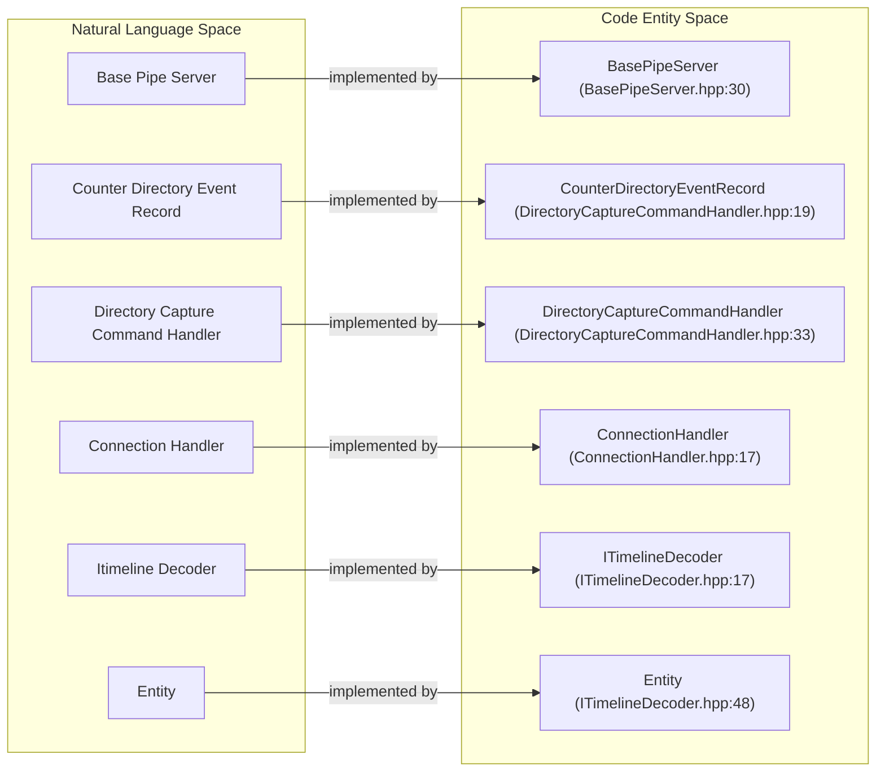
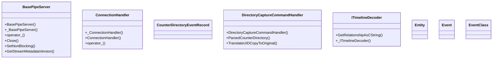
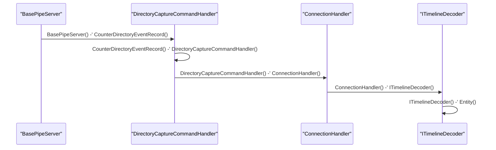

# Profiling Server

↑ [[6-developer-tools-and-platform-targets|Developer Tools and Platform Targets]]

> Profiling Server subsystem (`profiling/server`), covering 13 files and 77 symbols. Key symbols include `ParseData`, `ReceivePacket`, `ReadCategoryRecords`, `ParseData`.

<details>
<summary>Relevant source files</summary>

The following files were used as context for generating this wiki page:

- [profiling/server/include/basePipeServer/BasePipeServer.hpp](profiling/server/include/basePipeServer/BasePipeServer.hpp)
- [profiling/server/include/timelineDecoder/DirectoryCaptureCommandHandler.hpp](profiling/server/include/timelineDecoder/DirectoryCaptureCommandHandler.hpp)
- [profiling/server/include/timelineDecoder/ITimelineDecoder.hpp](profiling/server/include/timelineDecoder/ITimelineDecoder.hpp)
- [profiling/server/include/basePipeServer/ConnectionHandler.hpp](profiling/server/include/basePipeServer/ConnectionHandler.hpp)
- [profiling/server/include/timelineDecoder/TimelineCaptureCommandHandler.hpp](profiling/server/include/timelineDecoder/TimelineCaptureCommandHandler.hpp)
- [profiling/server/src/basePipeServer/BasePipeServer.cpp](profiling/server/src/basePipeServer/BasePipeServer.cpp)
- [profiling/server/include/timelineDecoder/TimelineDecoder.hpp](profiling/server/include/timelineDecoder/TimelineDecoder.hpp)
- [profiling/server/src/timelineDecoder/TimelineDecoder.cpp](profiling/server/src/timelineDecoder/TimelineDecoder.cpp)
- [profiling/server/include/timelineDecoder/TimelineDirectoryCaptureCommandHandler.hpp](profiling/server/include/timelineDecoder/TimelineDirectoryCaptureCommandHandler.hpp)
- [profiling/server/src/timelineDecoder/DirectoryCaptureCommandHandler.cpp](profiling/server/src/timelineDecoder/DirectoryCaptureCommandHandler.cpp)
- [profiling/server/src/timelineDecoder/TimelineCaptureCommandHandler.cpp](profiling/server/src/timelineDecoder/TimelineCaptureCommandHandler.cpp)
- [profiling/server/src/timelineDecoder/TimelineDirectoryCaptureCommandHandler.cpp](profiling/server/src/timelineDecoder/TimelineDirectoryCaptureCommandHandler.cpp)
- [profiling/server/src/basePipeServer/ConnectionHandler.cpp](profiling/server/src/basePipeServer/ConnectionHandler.cpp)

</details>

## Purpose and Scope

Profiling Server subsystem (`profiling/server`), covering 13 files and 77 symbols. Key symbols include `ParseData`, `ReceivePacket`, `ReadCategoryRecords`, `ParseData`.

Primary code entities analyzed on this page include `BasePipeServer` ([profiling/server/include/basePipeServer/BasePipeServer.hpp:30-112]()), `CounterDirectoryEventRecord` ([profiling/server/include/timelineDecoder/DirectoryCaptureCommandHandler.hpp:19-31]()), `DirectoryCaptureCommandHandler` ([profiling/server/include/timelineDecoder/DirectoryCaptureCommandHandler.hpp:33-86]()), `ConnectionHandler` ([profiling/server/include/basePipeServer/ConnectionHandler.hpp:17-45]()), `ITimelineDecoder` ([profiling/server/include/timelineDecoder/ITimelineDecoder.hpp:17-88]()).

For the parent architectural layer, see [[6-developer-tools-and-platform-targets|Developer Tools and Platform Targets]]. Related sibling subsystems: [[6.1-profiling-common|Profiling Common]], [[6.2-profiling-client|Profiling Client]], [[6.4-profiling|Profiling]].

Sources: [profiling/server/include/basePipeServer/BasePipeServer.hpp:30-112](), [profiling/server/include/timelineDecoder/DirectoryCaptureCommandHandler.hpp:19-31](), [profiling/server/include/timelineDecoder/DirectoryCaptureCommandHandler.hpp:33-86](), [profiling/server/include/basePipeServer/ConnectionHandler.hpp:17-45]()

---

## 1. High-Level Architecture and Data Flow

### Natural Language Space to Code Entity Space Mapping

The following diagram maps domain concepts in this subsystem to their concrete code entities:



### Subsystem Component & Dependency Flow

```mermaid
flowchart TD
  subgraph sub_this["Profiling Server"]
    subgraph sg_0["profiling/server/include/basePipeServer"]
      n_profiling_server_include_basePipeServer_BasePipe["BasePipeServer (BasePipeServer.hpp)"]
      n_profiling_server_include_basePipeServer_Connecti["ConnectionHandler (ConnectionHandler.hpp)"]
    end
    subgraph sg_1["profiling/server/include/timelineDecoder"]
      n_profiling_server_include_timelineDecoder_Directo["CounterDirectoryEventRecord (DirectoryCaptureCommandHandler.hpp)"]
      n_profiling_server_include_timelineDecoder_ITimeli["ITimelineDecoder (ITimelineDecoder.hpp)"]
      n_profiling_server_include_timelineDecoder_Timelin["TimelineCaptureCommandHandler (TimelineCaptureCommandHandler.hpp)"]
    end
    subgraph sg_2["profiling/server/src/basePipeServer"]
      n_profiling_server_src_basePipeServer_BasePipeServ["ReceivePacket (BasePipeServer.cpp)"]
      n_profiling_server_src_basePipeServer_ConnectionHa["ConnectionHandler (ConnectionHandler.cpp)"]
    end
    subgraph sg_3["profiling/server/src/timelineDecoder"]
      n_profiling_server_src_timelineDecoder_TimelineDec["print (TimelineDecoder.cpp)"]
      n_profiling_server_src_timelineDecoder_DirectoryCa["ParseData (DirectoryCaptureCommandHandler.cpp)"]
      n_profiling_server_src_timelineDecoder_TimelineCap["ParseData (TimelineCaptureCommandHandler.cpp)"]
      n_profiling_server_src_timelineDecoder_TimelineDir["ParseData (TimelineDirectoryCaptureCommandHandler.cpp)"]
    end
  end
  n_page_2_build_system_and_infrastructure(["Build System and Infrastructure"])
  n_page_6_1_profiling_common(["Profiling Common"])
  n_page_6_2_profiling_client(["Profiling Client"])
  n_page_6_developer_tools_and_platform_targets(["Developer Tools and Platform Targets"])
  n_profiling_server_src_timelineDecoder_TimelineCap -.-> n_page_6_2_profiling_client
  n_profiling_server_include_timelineDecoder_Timelin -.-> n_page_6_1_profiling_common
  n_profiling_server_src_timelineDecoder_DirectoryCa -.-> n_page_6_2_profiling_client
  n_profiling_server_src_basePipeServer_BasePipeServ -.-> n_page_6_1_profiling_common
  n_profiling_server_include_timelineDecoder_ITimeli --> n_profiling_server_include_timelineDecoder_Timelin
  n_profiling_server_include_timelineDecoder_Timelin --> n_profiling_server_src_timelineDecoder_TimelineDec
  n_profiling_server_include_timelineDecoder_Directo -.-> n_page_6_1_profiling_common
  n_profiling_server_include_basePipeServer_BasePipe -.-> n_page_6_1_profiling_common
  n_profiling_server_src_timelineDecoder_TimelineDec -.-> n_page_6_1_profiling_common
  n_profiling_server_src_timelineDecoder_TimelineDec -.-> n_page_2_build_system_and_infrastructure
  n_profiling_server_src_timelineDecoder_TimelineCap -.-> n_page_6_developer_tools_and_platform_targets
  n_profiling_server_src_basePipeServer_ConnectionHa -.-> n_page_6_1_profiling_common
  n_profiling_server_include_timelineDecoder_Timelin --> n_profiling_server_src_timelineDecoder_TimelineDir
  n_profiling_server_src_timelineDecoder_TimelineDir -.-> n_page_2_build_system_and_infrastructure
  n_profiling_server_src_basePipeServer_BasePipeServ -.-> n_page_6_developer_tools_and_platform_targets
  n_profiling_server_src_timelineDecoder_TimelineDir -.-> n_page_6_1_profiling_common
  n_profiling_server_include_timelineDecoder_Directo --> n_profiling_server_src_timelineDecoder_DirectoryCa
  n_profiling_server_src_basePipeServer_BasePipeServ -.-> n_page_2_build_system_and_infrastructure
  n_profiling_server_src_basePipeServer_ConnectionHa -.-> n_page_2_build_system_and_infrastructure
  n_profiling_server_include_timelineDecoder_Directo -.-> n_page_6_2_profiling_client
  n_profiling_server_src_timelineDecoder_TimelineDir -.-> n_page_6_2_profiling_client
```



Cross-subsystem call and import edges connect **Profiling Server** with [[6.1-profiling-common|Profiling Common]] (coupling `62.0`), [[2-build-system-and-infrastructure|Build System and Infrastructure]] (coupling `31.0`), [[2.1-build-infrastructure|Build Infrastructure]] (coupling `31.0`), [[6.2-profiling-client|Profiling Client]] (coupling `21.0`), [[6-developer-tools-and-platform-targets|Developer Tools and Platform Targets]] (coupling `21.0`).

| Module Directory | Files | Primary Code Entities | Source Citations |
|---|---|---|---|
| `profiling/server/include/timelineDecoder` | 5 | `CounterDirectoryEventRecord`, `DirectoryCaptureCommandHandler`, `ITimelineDecoder`, `Entity` | [profiling/server/include/timelineDecoder/DirectoryCaptureCommandHandler.hpp:19-31]() [profiling/server/include/timelineDecoder/DirectoryCaptureCommandHandler.hpp:33-86]() |
| `profiling/server/src/timelineDecoder` | 4 | `ParseData`, `ReadCategoryRecords`, `print`, `printEvents` | [profiling/server/src/timelineDecoder/DirectoryCaptureCommandHandler.cpp:23-148]() [profiling/server/src/timelineDecoder/DirectoryCaptureCommandHandler.cpp:150-206]() |
| `profiling/server/include/basePipeServer` | 2 | `BasePipeServer`, `ConnectionHandler`, `Close`, `SetNonBlocking` | [profiling/server/include/basePipeServer/BasePipeServer.hpp:30-112]() [profiling/server/include/basePipeServer/ConnectionHandler.hpp:17-45]() |
| `profiling/server/src/basePipeServer` | 2 | `ReceivePacket`, `EchoPacket`, `ReadFromSocket`, `WaitForPacket` | [profiling/server/src/basePipeServer/BasePipeServer.cpp:174-201]() [profiling/server/src/basePipeServer/BasePipeServer.cpp:248-276]() |

Sources: [profiling/server/include/basePipeServer/BasePipeServer.hpp:30-112](), [profiling/server/include/timelineDecoder/DirectoryCaptureCommandHandler.hpp:19-31](), [profiling/server/include/timelineDecoder/DirectoryCaptureCommandHandler.hpp:33-86](), [profiling/server/include/basePipeServer/ConnectionHandler.hpp:17-45](), [profiling/server/include/timelineDecoder/ITimelineDecoder.hpp:17-88]()

---

## 2. Core Data Structures and Implementation Details

### Class and Entity Relationship Diagram



### `BasePipeServer` (Class)

- **Source Location**: [profiling/server/include/basePipeServer/BasePipeServer.hpp:30-112]()
- **Declaration**: `Class BasePipeServer`
- **Graph Centrality**: fan-in `0` callers, fan-out `0` callees

```cpp
// profiling/server/include/basePipeServer/BasePipeServer.hpp:30-45
class BasePipeServer
{

public:

    BasePipeServer(arm::pipe::Socket clientConnection, bool echoPackets)
            : m_ClientConnection(clientConnection)
            , m_EchoPackets(echoPackets)
            {}

    ~BasePipeServer()
    {
        // We have set SOCK_CLOEXEC on this socket but we'll close it to be good citizens.
        arm::pipe::Close(m_ClientConnection);
    }
```

### `CounterDirectoryEventRecord` (Class)

- **Source Location**: [profiling/server/include/timelineDecoder/DirectoryCaptureCommandHandler.hpp:19-31]()
- **Declaration**: `Class CounterDirectoryEventRecord`
- **Graph Centrality**: fan-in `0` callers, fan-out `0` callees

```cpp
// profiling/server/include/timelineDecoder/DirectoryCaptureCommandHandler.hpp:19-31
struct CounterDirectoryEventRecord
{
    uint16_t m_CounterClass;
    std::string m_CounterDescription;
    uint16_t m_CounterInterpolation;
    double m_CounterMultiplier;
    std::string m_CounterName;
    uint16_t m_CounterSetUid;
    uint16_t m_CounterUid;
    arm::pipe::Optional<std::string> m_CounterUnits;
    uint16_t m_DeviceUid;
    uint16_t m_MaxCounterUid;
};
```

### `DirectoryCaptureCommandHandler` (Class)

- **Source Location**: [profiling/server/include/timelineDecoder/DirectoryCaptureCommandHandler.hpp:33-86]()
- **Declaration**: `Class DirectoryCaptureCommandHandler`
- **Graph Centrality**: fan-in `0` callers, fan-out `0` callees

```cpp
// profiling/server/include/timelineDecoder/DirectoryCaptureCommandHandler.hpp:33-48
class DirectoryCaptureCommandHandler : public arm::pipe::CommandHandlerFunctor
{

public:
    DirectoryCaptureCommandHandler(const std::string& applicationName,
                                   uint32_t familyId,
                                   uint32_t packetId,
                                   uint32_t version,
                                   bool quietOperation = true)
        : CommandHandlerFunctor(familyId, packetId, version)
        , m_ApplicationName(applicationName)
        , m_QuietOperation(quietOperation)
        , m_AlreadyParsed(false)
    {}

    void operator()(const arm::pipe::Packet& packet) override;
```

### `ConnectionHandler` (Class)

- **Source Location**: [profiling/server/include/basePipeServer/ConnectionHandler.hpp:17-45]()
- **Declaration**: `Class ConnectionHandler`
- **Graph Centrality**: fan-in `0` callers, fan-out `0` callees

### `ITimelineDecoder` (Class)

- **Source Location**: [profiling/server/include/timelineDecoder/ITimelineDecoder.hpp:17-88]()
- **Declaration**: `Class ITimelineDecoder`
- **Graph Centrality**: fan-in `0` callers, fan-out `0` callees

### `TranslateUIDCopyToOriginal` (Method)

- **Source Location**: [profiling/server/include/timelineDecoder/DirectoryCaptureCommandHandler.hpp:63-66]()
- **Declaration**: `(uint16_t copyUid)`
- **Graph Centrality**: fan-in `1` callers, fan-out `0` callees
- **Responsibility**: /** * Given a Uid that came from a copy of the counter directory translate it to the original. * * @param copyUid * @return the original Uid that the copy maps to. */

Sources: [profiling/server/include/basePipeServer/BasePipeServer.hpp:30-112](), [profiling/server/include/timelineDecoder/DirectoryCaptureCommandHandler.hpp:19-31](), [profiling/server/include/timelineDecoder/DirectoryCaptureCommandHandler.hpp:33-86](), [profiling/server/include/basePipeServer/ConnectionHandler.hpp:17-45](), [profiling/server/include/timelineDecoder/ITimelineDecoder.hpp:17-88]()

---

## 3. Execution and Call Flow

The sequence diagram below traces the runtime/compile-time call chain across components in this module:



Sources: [profiling/server/include/basePipeServer/BasePipeServer.hpp:30-112](), [profiling/server/include/timelineDecoder/DirectoryCaptureCommandHandler.hpp:19-31](), [profiling/server/include/timelineDecoder/DirectoryCaptureCommandHandler.hpp:33-86](), [profiling/server/include/basePipeServer/ConnectionHandler.hpp:17-45](), [profiling/server/include/timelineDecoder/ITimelineDecoder.hpp:17-88]()

---

## 4. Key API and Symbol Reference

| Code Entity | Kind | Location | Fan-In / Out | Role & Signature |
|---|---|---|---|---|
| `BasePipeServer` | Class | [profiling/server/include/basePipeServer/BasePipeServer.hpp:30-112]() | `0` / `0` | — |
| `CounterDirectoryEventRecord` | Class | [profiling/server/include/timelineDecoder/DirectoryCaptureCommandHandler.hpp:19-31]() | `0` / `0` | — |
| `DirectoryCaptureCommandHandler` | Class | [profiling/server/include/timelineDecoder/DirectoryCaptureCommandHandler.hpp:33-86]() | `0` / `0` | — |
| `ConnectionHandler` | Class | [profiling/server/include/basePipeServer/ConnectionHandler.hpp:17-45]() | `0` / `0` | — |
| `ITimelineDecoder` | Class | [profiling/server/include/timelineDecoder/ITimelineDecoder.hpp:17-88]() | `0` / `0` | — |
| `Entity` | Class | [profiling/server/include/timelineDecoder/ITimelineDecoder.hpp:48-51]() | `0` / `0` | — |
| `Event` | Class | [profiling/server/include/timelineDecoder/ITimelineDecoder.hpp:59-64]() | `0` / `0` | — |
| `EventClass` | Class | [profiling/server/include/timelineDecoder/ITimelineDecoder.hpp:53-57]() | `0` / `0` | — |
| `Label` | Class | [profiling/server/include/timelineDecoder/ITimelineDecoder.hpp:66-70]() | `0` / `0` | — |
| `Relationship` | Class | [profiling/server/include/timelineDecoder/ITimelineDecoder.hpp:72-79]() | `0` / `0` | — |
| `TimelineCaptureCommandHandler` | Class | [profiling/server/include/timelineDecoder/TimelineCaptureCommandHandler.hpp:19-59]() | `0` / `0` | — |
| `TimelineDecoder` | Class | [profiling/server/include/timelineDecoder/TimelineDecoder.hpp:19-76]() | `0` / `0` | — |
| `Model` | Class | [profiling/server/include/timelineDecoder/TimelineDecoder.hpp:24-31]() | `0` / `0` | — |
| `TimelineDirectoryCaptureCommandHandler` | Class | [profiling/server/include/timelineDecoder/TimelineDirectoryCaptureCommandHandler.hpp:18-46]() | `0` / `0` | — |
| `TranslateUIDCopyToOriginal` | Method | [profiling/server/include/timelineDecoder/DirectoryCaptureCommandHandler.hpp:63-66]() | `1` / `0` | /** |
| `Close` | Method | [profiling/server/include/basePipeServer/BasePipeServer.hpp:54-57]() | `0` / `1` | /// Close the client connection |
| `SetNonBlocking` | Method | [profiling/server/include/basePipeServer/BasePipeServer.hpp:65-68]() | `0` / `1` | /// Set the client socket to nonblocking |
| `ReceivePacket` | Method | [profiling/server/src/basePipeServer/BasePipeServer.cpp:174-201]() | `1` / `7` | () |
| `EchoPacket` | Method | [profiling/server/src/basePipeServer/BasePipeServer.cpp:248-276]() | `4` / `0` | (PacketDirection direction, uint8_t* packet, size_t lengthInBytes) |
| `ParseData` | Method | [profiling/server/src/timelineDecoder/DirectoryCaptureCommandHandler.cpp:23-148]() | `1` / `8` | (const arm::pipe::Packet& packet) |
| `ReadFromSocket` | Method | [profiling/server/src/basePipeServer/BasePipeServer.cpp:22-42]() | `3` / `1` | (uint8_t* packetData, uint32_t expectedLength) |
| `WaitForPacket` | Method | [profiling/server/src/basePipeServer/BasePipeServer.cpp:111-172]() | `0` / `7` | (uint32_t timeoutMs) |

Sources: [profiling/server/include/basePipeServer/BasePipeServer.hpp:30-112](), [profiling/server/include/timelineDecoder/DirectoryCaptureCommandHandler.hpp:19-31](), [profiling/server/include/timelineDecoder/DirectoryCaptureCommandHandler.hpp:33-86](), [profiling/server/include/basePipeServer/ConnectionHandler.hpp:17-45](), [profiling/server/include/timelineDecoder/ITimelineDecoder.hpp:17-88](), [profiling/server/include/timelineDecoder/ITimelineDecoder.hpp:48-51]()

---

## 5. Official Documentation and Design Context

The following linked documentation sections from `llm-wiki` (`raw/`) provide additional architectural context, tutorials, and design invariants for this subsystem:

- **Developer Tools and Platform Targets** ([wiki/6-developer-tools-and-platform-targets.md](), score `143.2147`) (sections: `Developer Tools and Platform Targets`, `Purpose and Scope`, `System Mapping: Natural Language Space to Code Entity Space`, `1. Profiling Common`): # Developer Tools and Platform Targets > Architectural overview of Developer Tools and Platform Targets, spanning 70 source files and 662 code symbols across 4 subsystems. <details> <summary>Relevant source files</summary> The following files were used as context for generating this wiki page: - [profiling/common/include/ProfilingException.hpp](profiling/common/include/ProfilingException.hpp) - [profiling/common/incl
- **Profiling Client** ([wiki/6.2-profiling-client.md](), score `97.9277`) (sections: `Profiling Client`, `Purpose and Scope`, `1. High-Level Architecture and Data Flow`, `Natural Language Space to Code Entity Space Mapping`): # Profiling Client ↑ [[6-developer-tools-and-platform-targets|Developer Tools and Platform Targets]] > Profiling Client subsystem (`profiling/client`), covering 28 files and 340 symbols. Key symbols include `ReadUint32`, `GetCurrentState`, `WriteUint32`, `GetNextGuid`. <details> <summary>Relevant source files</summary> The following files were used as context for generating this wiki page: - [profiling/client/include
- **Profiling Common** ([wiki/6.1-profiling-common.md](), score `78.7039`) (sections: `Profiling Common`, `Purpose and Scope`, `1. High-Level Architecture and Data Flow`, `Natural Language Space to Code Entity Space Mapping`): # Profiling Common ↑ [[6-developer-tools-and-platform-targets|Developer Tools and Platform Targets]] > Profiling Common subsystem (`profiling/common`), covering 28 files and 244 symbols. Key symbols include `IgnoreUnused`, `ProfilingException`, `CentreAlignFormatting`, `InvalidArgumentException`. <details> <summary>Relevant source files</summary> The following files were used as context for generating this wiki page:
- **ArmNN DeepWiki** ([wiki/index.md](), score `54.8408`) (sections: `ArmNN DeepWiki`, `Pages`): # ArmNN DeepWiki Generated from `home-jason-Project-deepwiki-armnn` at commit `2b61cecc9df7` (2026-11-14T15:13:53+00:00). ## Pages - [[1-overview|Overview]] — End-to-end architecture overview of ArmNN: core subsystems, compilation/execution pipeline, entry points, and cross-module dependencies. - [[2-build-system-and-infrastructure|Build System and Infrastructure]] — Architectural overview of Build System and Infrast

Sources: [wiki/6-developer-tools-and-platform-targets.md](), [wiki/6.2-profiling-client.md](), [wiki/6.1-profiling-common.md](), [wiki/index.md]()

## Related pages

- [[6-developer-tools-and-platform-targets|Developer Tools and Platform Targets]]
- [[3-backend-delegation-and-hardware-providers|Backend Delegation and Hardware Providers]]
- [[3.1-backends-backendscommon|Backends Backendscommon]]
- [[3.2-backends-reference|Backends Reference]]
- [[3.3-backends-opencl|Backends OpenCL]]
- [[3.4-backends-aclcommon|Backends Aclcommon]]
- [[3.6-other-backends|Other Backends]]
- [[5-runtime-execution-and-kernel-dispatch|Runtime Execution and Kernel Dispatch]]

## Related documents

- `wiki/6-developer-tools-and-platform-targets.md` — Developer Tools and Platform Targets (score 143.2147, via bm25)
- `wiki/6.2-profiling-client.md` — Profiling Client (score 97.9277, via bm25)
- `wiki/6.1-profiling-common.md` — Profiling Common (score 78.7039, via bm25)
- `wiki/index.md` — ArmNN DeepWiki (score 54.8408, via bm25)
- `wiki/1-overview.md` — Overview (score 52.6343, via bm25)

## Sources

- [`profiling/server/include/basePipeServer/BasePipeServer.hpp`](https://github.com/ARM-software/armnn/blob/branches/armnn_24_11/profiling/server/include/basePipeServer/BasePipeServer.hpp)
- [`profiling/server/include/timelineDecoder/DirectoryCaptureCommandHandler.hpp`](https://github.com/ARM-software/armnn/blob/branches/armnn_24_11/profiling/server/include/timelineDecoder/DirectoryCaptureCommandHandler.hpp)
- [`profiling/server/include/timelineDecoder/ITimelineDecoder.hpp`](https://github.com/ARM-software/armnn/blob/branches/armnn_24_11/profiling/server/include/timelineDecoder/ITimelineDecoder.hpp)
- [`profiling/server/include/basePipeServer/ConnectionHandler.hpp`](https://github.com/ARM-software/armnn/blob/branches/armnn_24_11/profiling/server/include/basePipeServer/ConnectionHandler.hpp)
- [`profiling/server/include/timelineDecoder/TimelineCaptureCommandHandler.hpp`](https://github.com/ARM-software/armnn/blob/branches/armnn_24_11/profiling/server/include/timelineDecoder/TimelineCaptureCommandHandler.hpp)
- [`profiling/server/src/basePipeServer/BasePipeServer.cpp`](https://github.com/ARM-software/armnn/blob/branches/armnn_24_11/profiling/server/src/basePipeServer/BasePipeServer.cpp)
- [`profiling/server/include/timelineDecoder/TimelineDecoder.hpp`](https://github.com/ARM-software/armnn/blob/branches/armnn_24_11/profiling/server/include/timelineDecoder/TimelineDecoder.hpp)
- [`profiling/server/src/timelineDecoder/TimelineDecoder.cpp`](https://github.com/ARM-software/armnn/blob/branches/armnn_24_11/profiling/server/src/timelineDecoder/TimelineDecoder.cpp)
- [`profiling/server/include/timelineDecoder/TimelineDirectoryCaptureCommandHandler.hpp`](https://github.com/ARM-software/armnn/blob/branches/armnn_24_11/profiling/server/include/timelineDecoder/TimelineDirectoryCaptureCommandHandler.hpp)
- [`profiling/server/src/timelineDecoder/DirectoryCaptureCommandHandler.cpp`](https://github.com/ARM-software/armnn/blob/branches/armnn_24_11/profiling/server/src/timelineDecoder/DirectoryCaptureCommandHandler.cpp)
- [`profiling/server/src/timelineDecoder/TimelineCaptureCommandHandler.cpp`](https://github.com/ARM-software/armnn/blob/branches/armnn_24_11/profiling/server/src/timelineDecoder/TimelineCaptureCommandHandler.cpp)
- [`profiling/server/src/timelineDecoder/TimelineDirectoryCaptureCommandHandler.cpp`](https://github.com/ARM-software/armnn/blob/branches/armnn_24_11/profiling/server/src/timelineDecoder/TimelineDirectoryCaptureCommandHandler.cpp)
- [`profiling/server/src/basePipeServer/ConnectionHandler.cpp`](https://github.com/ARM-software/armnn/blob/branches/armnn_24_11/profiling/server/src/basePipeServer/ConnectionHandler.cpp)


## Dynamic Knowledge Links (Code Graph ↔ LLM-Wiki / RAG)

### Linked Architecture & Design Documents

| Document | Match Channel | Score | Shared Code Symbols |
|---|---|---|---|
| [[6-developer-tools-and-platform-targets|Developer Tools and Platform Targets]] | `bm25+entity(6)` | `152.215` | `BasePipeServer`, `ParseData`, `ReadCategoryRecords`, `ReceivePacket`, `TranslateUIDCopyToOriginal` |
| [[6.2-profiling-client|Profiling Client]] | `bm25+entity(3)` | `102.428` | `ParseData`, `ReadCategoryRecords`, `ReceivePacket` |
| [[6.4-profiling|Profiling]] | `wikilink:6.3-profiling-server+entity(1)` | `81.145` | `Entity` |
| [[2-build-system-and-infrastructure|Build System and Infrastructure]] | `wikilink:6.3-profiling-server+entity(1)` | `81.145` | `Entity` |
| [[2.1-build-infrastructure|Build Infrastructure]] | `wikilink:6.3-profiling-server` | `79.645` | *(lexical/graph match)* |
| [[6.1-profiling-common|Profiling Common]] | `bm25` | `78.704` | *(lexical/graph match)* |

### High-Centrality Bridge Symbols (CBM Graph)

| Symbol | Kind | Source Location | Fan-In / Fan-Out |
|---|---|---|---|
| `BasePipeServer` | Class | [profiling/server/include/basePipeServer/BasePipeServer.hpp:30-112]() | in: `0` / out: `0` |
| `CounterDirectoryEventRecord` | Class | [profiling/server/include/timelineDecoder/DirectoryCaptureCommandHandler.hpp:19-31]() | in: `0` / out: `0` |
| `DirectoryCaptureCommandHandler` | Class | [profiling/server/include/timelineDecoder/DirectoryCaptureCommandHandler.hpp:33-86]() | in: `0` / out: `0` |
| `ConnectionHandler` | Class | [profiling/server/include/basePipeServer/ConnectionHandler.hpp:17-45]() | in: `0` / out: `0` |
| `ITimelineDecoder` | Class | [profiling/server/include/timelineDecoder/ITimelineDecoder.hpp:17-88]() | in: `0` / out: `0` |
| `Entity` | Class | [profiling/server/include/timelineDecoder/ITimelineDecoder.hpp:48-51]() | in: `0` / out: `0` |

Sources: [profiling/server/include/basePipeServer/BasePipeServer.hpp:30-112](), [profiling/server/include/timelineDecoder/DirectoryCaptureCommandHandler.hpp:19-31](), [profiling/server/include/timelineDecoder/DirectoryCaptureCommandHandler.hpp:33-86](), [profiling/server/include/basePipeServer/ConnectionHandler.hpp:17-45]()

### Cross-Subsystem Coupling

- [[6.1-profiling-common|Profiling Common]] — call/import coupling weight `62.0`
- [[2-build-system-and-infrastructure|Build System and Infrastructure]] — call/import coupling weight `31.0`
- [[2.1-build-infrastructure|Build Infrastructure]] — call/import coupling weight `31.0`
- [[6.2-profiling-client|Profiling Client]] — call/import coupling weight `21.0`
- [[6-developer-tools-and-platform-targets|Developer Tools and Platform Targets]] — call/import coupling weight `21.0`
- [[7-glossary|Glossary]] — call/import coupling weight `16.0`
