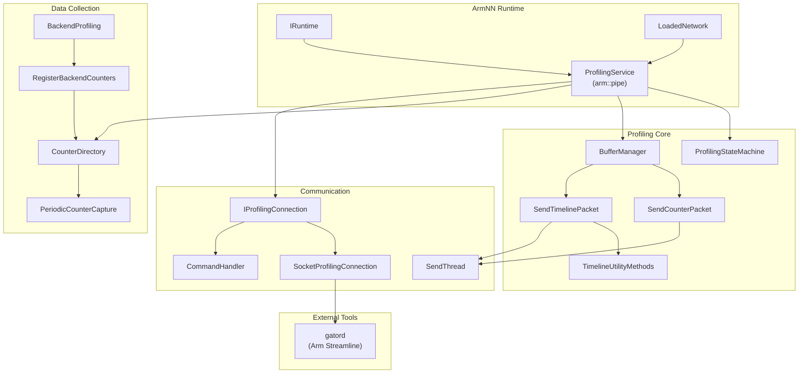
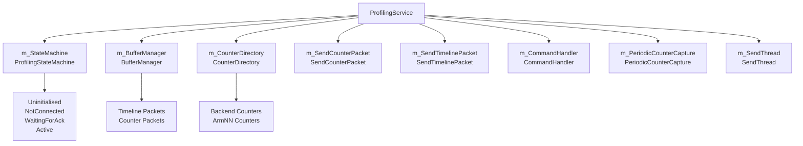
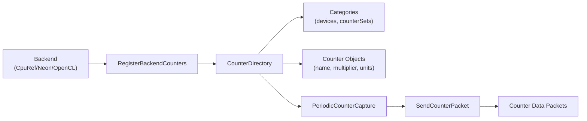
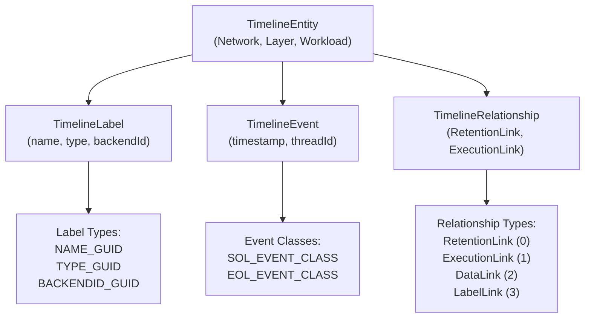
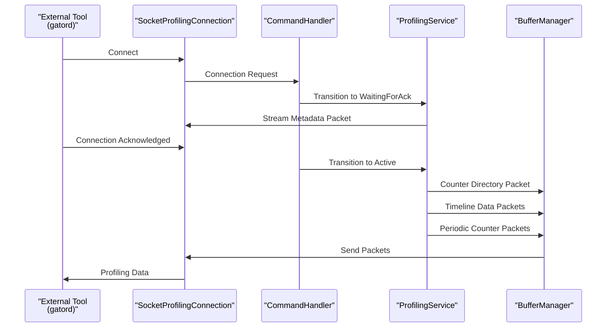

# Profiling System

<details>
<summary>Relevant source files</summary>

The following files were used as context for generating this wiki page:

- [src/armnn/test/RuntimeTests.cpp](src/armnn/test/RuntimeTests.cpp)
- [src/profiling/test/ProfilingGuidTest.cpp](src/profiling/test/ProfilingGuidTest.cpp)
- [src/profiling/test/ProfilingTestUtils.cpp](src/profiling/test/ProfilingTestUtils.cpp)
- [src/profiling/test/ProfilingTestUtils.hpp](src/profiling/test/ProfilingTestUtils.hpp)
- [src/profiling/test/ProfilingTests.cpp](src/profiling/test/ProfilingTests.cpp)
- [src/profiling/test/ProfilingTests.hpp](src/profiling/test/ProfilingTests.hpp)
- [src/profiling/test/SendCounterPacketTests.cpp](src/profiling/test/SendCounterPacketTests.cpp)
- [src/profiling/test/SendCounterPacketTests.hpp](src/profiling/test/SendCounterPacketTests.hpp)
- [src/profiling/test/SendTimelinePacketTests.cpp](src/profiling/test/SendTimelinePacketTests.cpp)
- [src/profiling/test/TimelinePacketTests.cpp](src/profiling/test/TimelinePacketTests.cpp)
- [src/profiling/test/TimelineUtilityMethodsTests.cpp](src/profiling/test/TimelineUtilityMethodsTests.cpp)

</details>


The ArmNN Profiling System provides comprehensive performance monitoring and timeline analysis capabilities for neural network execution. It enables real-time collection of performance counters, execution timeline data, and network structure information that can be consumed by external profiling tools like Arm Streamline.

For information about specific backend performance optimizations, see [[7-advanced-topics|Advanced Topics]]. For build configuration of profiling features, see [[6.1-build-system|Build System]].

## Architecture Overview

The profiling system follows a packet-based communication model with external profiling tools, supporting both counter-based performance metrics and detailed timeline execution tracking.



**Sources:** [src/profiling/test/ProfilingTests.cpp:1-100](), [src/armnn/test/RuntimeTests.cpp:376-396](), [src/profiling/test/ProfilingTestUtils.hpp:74-98]()

## Core Components

### ProfilingService

The `ProfilingService` class is the central orchestrator of all profiling activities, managing the lifecycle of profiling data collection and communication with external tools.



**Sources:** [src/profiling/test/ProfilingTests.cpp:666-708](), [src/profiling/test/ProfilingTestUtils.cpp:130-137](), [src/armnn/test/RuntimeTests.cpp:364-372]()

### State Management

The profiling system operates through a state machine that controls data collection and communication:

| State | Description | Transitions |
|-------|-------------|-------------|
| `Uninitialised` | Initial state, no profiling active | → `NotConnected` |
| `NotConnected` | Ready to connect to external tools | → `WaitingForAck` |
| `WaitingForAck` | Waiting for connection acknowledgment | → `Active`, `NotConnected` |
| `Active` | Actively collecting and sending data | → `NotConnected` |

**Sources:** [src/profiling/test/ProfilingTests.cpp:487-559](), [src/profiling/test/SendCounterPacketTests.cpp:37-96]()

## Counter Profiling

Counter profiling collects numeric performance metrics from backends and the ArmNN runtime, such as inference counts and execution times.

### Counter Registration and Management



**Sources:** [src/profiling/test/ProfilingTests.cpp:682-708](), [src/profiling/test/SendCounterPacketTests.cpp:152-221]()

### Counter Data Collection

The system supports both absolute and delta counter values with thread-safe access:

- `IncrementCounterValue()` - Atomic increment operations
- `GetAbsoluteCounterValue()` - Current total value
- `GetDeltaCounterValue()` - Change since last read
- `SetCounterValue()` - Direct value assignment

**Sources:** [src/profiling/test/ProfilingTests.cpp:710-822]()

## Timeline Profiling

Timeline profiling captures the execution structure and timing of neural network operations, providing detailed insight into layer execution and data flow.

### Timeline Data Model



**Sources:** [src/profiling/test/TimelineUtilityMethodsTests.cpp:84-214](), [src/profiling/test/TimelinePacketTests.cpp:18-121]()

### Timeline Packet Structure

Timeline data is transmitted as binary packets with specific declaration IDs:

| Declaration ID | Packet Type | Contents |
|----------------|-------------|----------|
| 0 | Label | GUID + string label |
| 1 | Entity | GUID |
| 2 | EventClass | GUID + name GUID |
| 3 | Relationship | type + relationship GUID + head GUID + tail GUID + attribute GUID |
| 4 | Event | timestamp + thread ID + event GUID |

**Sources:** [src/profiling/test/TimelinePacketTests.cpp:80-266](), [src/profiling/test/SendTimelinePacketTests.cpp:35-160]()

## Communication Protocol

The profiling system communicates with external tools via a socket-based protocol using structured packet formats.

### Packet Communication Flow



**Sources:** [src/profiling/test/ProfilingTests.cpp:142-275](), [src/profiling/test/SendCounterPacketTests.cpp:309-460]()

### Key Packet Types

#### Stream Metadata Packet
Contains version information and supported packet types for protocol negotiation.

#### Counter Directory Packet  
Describes available counters, devices, and counter sets with their metadata.

#### Timeline Message Directory Packet
Defines the timeline data format and supported timeline message types.

#### Periodic Counter Capture Packet
Contains timestamp and counter value pairs for performance monitoring.

**Sources:** [src/profiling/test/SendCounterPacketTests.cpp:309-460](), [src/profiling/test/SendTimelinePacketTests.cpp:35-160]()

## Integration with Runtime

The profiling system integrates seamlessly with the ArmNN runtime through the `IRuntime::CreationOptions` configuration:

```cpp
// Enable profiling in runtime options
IRuntime::CreationOptions options;
options.m_ProfilingOptions.m_EnableProfiling = true;
options.m_ProfilingOptions.m_TimelineEnabled = true;
options.m_ProfilingOptions.m_OutgoingCaptureFile = "capture.armnn";
```

When profiling is enabled, the system automatically:
- Registers backend-specific counters
- Creates timeline entities for networks and layers  
- Captures execution events during inference
- Manages memory buffers for profiling data
- Handles communication with external profiling tools

**Sources:** [src/armnn/test/RuntimeTests.cpp:376-422](), [src/profiling/test/ProfilingTestUtils.cpp:371-388]()

## Backend Integration

Each backend can register custom counters and participate in timeline profiling through the `BackendProfiling` interface. Backend-specific workloads automatically generate timeline events when profiling is active.

**Sources:** [src/profiling/test/ProfilingTestUtils.cpp:559-709](), [src/armnn/test/RuntimeTests.cpp:563-598]()

## Related Wiki Pages

- [[6-development-guide|Development Guide]]
- [[7-advanced-topics|Advanced Topics]]
- [[6.1-build-system|Build System]]


## Dynamic Knowledge Links (Code Graph ↔ LLM-Wiki / RAG)

### Linked Architecture & Design Documents

| Document | Match Channel | Score | Shared Code Symbols |
|---|---|---|---|
| [[7-advanced-topics|7 Advanced Topics]] | `wikilink:6.3-profiling-system` | `91.962` | *(lexical/graph match)* |
| [[6.1-build-system|6.1 Build System]] | `wikilink:6.3-profiling-system` | `91.962` | *(lexical/graph match)* |
| [[1-armnn-overview|1 ArmNN Overview]] | `wikilink:6.3-profiling-system` | `91.962` | *(lexical/graph match)* |
| [[1.1-getting-started|1.1 Getting Started]] | `bm25+entity(3)` | `80.378` | `GetDeltaCounterValue`, `NotifyBackendsForTimelineReporting`, `SetCounterValue` |
| `raw/armnn/05_04_runtimeoptions.dox` (05_04_runtimeoptions) | `bm25` | `48.575` | *(lexical/graph match)* |
| [[6-development-guide|6 Development Guide]] | `bm25` | `47.513` | *(lexical/graph match)* |

### High-Centrality Bridge Symbols (CBM Graph)

| Symbol | Kind | Source Location | Fan-In / Fan-Out |
|---|---|---|---|
| `VerifyPostOptimisationStructureTestImpl` | Function | [src/profiling/test/ProfilingTestUtils.cpp:371-1490]() | in: `0` / out: `30` |
| `VerifyTimelineEventBinaryPacket` | Function | [src/profiling/test/ProfilingTestUtils.cpp:311-369]() | in: `1` / out: `8` |
| `VerifyTimelineLabelBinaryPacketData` | Function | [src/profiling/test/ProfilingTestUtils.cpp:105-153]() | in: `1` / out: `8` |
| `VerifyTimelineEntityBinaryPacketData` | Function | [src/profiling/test/ProfilingTestUtils.cpp:277-309]() | in: `1` / out: `5` |
| `VerifyTimelineRelationshipBinaryPacketData` | Function | [src/profiling/test/ProfilingTestUtils.cpp:183-275]() | in: `1` / out: `5` |
| `StringToSwTraceStringTestHelper` | Function | [src/profiling/test/ProfilingTests.cpp:2265-2286]() | in: `0` / out: `5` |

Sources: [src/profiling/test/ProfilingTestUtils.cpp:371-1490](), [src/profiling/test/ProfilingTestUtils.cpp:311-369](), [src/profiling/test/ProfilingTestUtils.cpp:105-153](), [src/profiling/test/ProfilingTestUtils.cpp:277-309]()

### Cross-Subsystem Coupling

- [[1-armnn-overview|1 ArmNN Overview]] — call/import coupling weight `41.0`
- [[2.3-runtime-and-execution|2.3 Runtime and Execution]] — call/import coupling weight `23.0`
- [[2-core-architecture|2 Core Architecture]] — call/import coupling weight `22.0`
- [[2.1-network-and-graph-system|2.1 Network and Graph System]] — call/import coupling weight `22.0`
- [[1.1-getting-started|1.1 Getting Started]] — call/import coupling weight `15.0`
- [[6-development-guide|6 Development Guide]] — call/import coupling weight `15.0`
