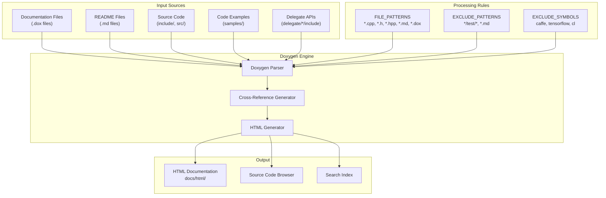
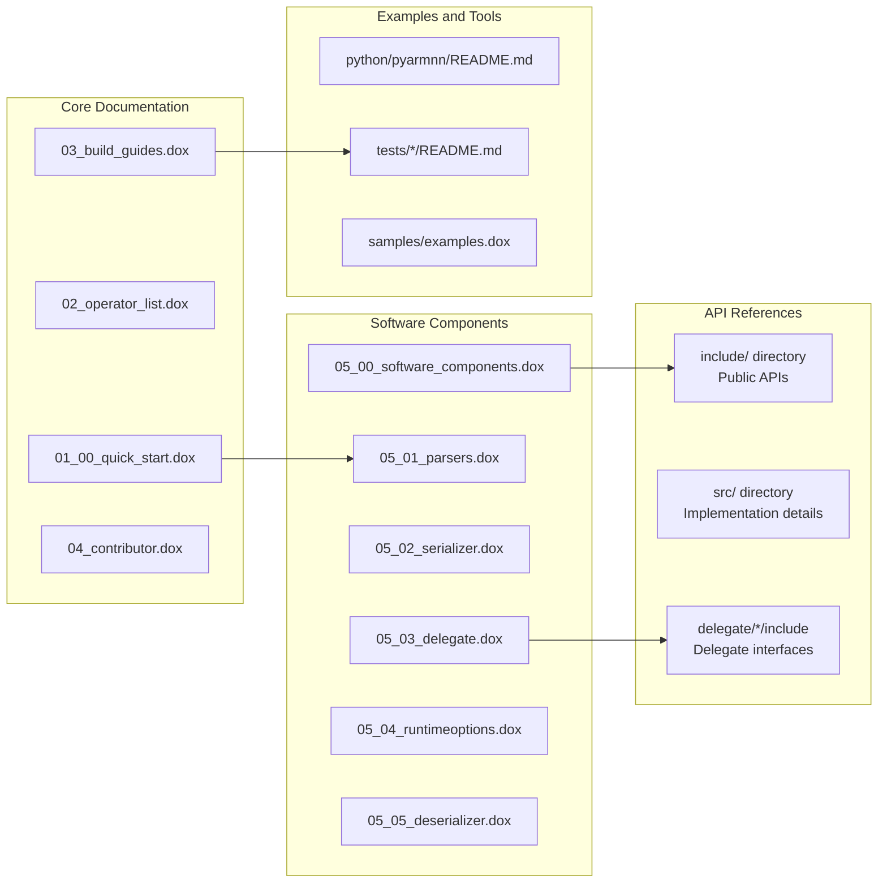
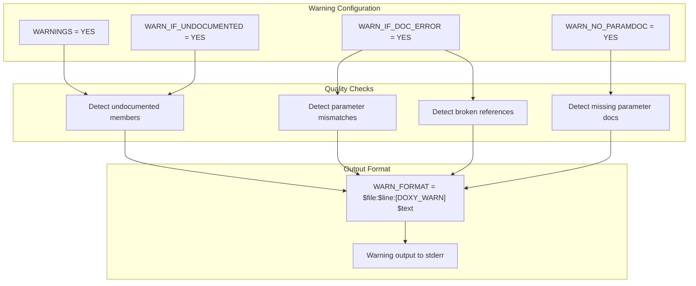
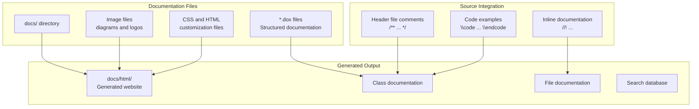

# Documentation Generation

Relevant source files

The following files were used as context for generating this wiki page:

- [docs/Arm_NN_horizontal_blue.png](docs/Arm_NN_horizontal_blue.png)
- [docs/Doxyfile](docs/Doxyfile)
- [src/armnnTfLiteParser/test/SplitV.cpp](src/armnnTfLiteParser/test/SplitV.cpp)

This document covers ArmNN's automated API documentation generation system using Doxygen. It explains the configuration, build process, and maintenance of the project's comprehensive documentation, which includes API references, code examples, and developer guides.

For information about building the project itself, see [[6.1-build-system|Build System]]. For details about the testing infrastructure, see [[6.2-testing-framework|Testing Framework]].

## Overview

ArmNN uses Doxygen to automatically generate comprehensive HTML documentation from source code comments, standalone documentation files, and README files throughout the codebase. The system produces a unified documentation website that combines API references with narrative documentation and examples.

**Sources:** [docs/Doxyfile:1-2000]()

## Doxygen Configuration

The documentation generation is controlled by the main Doxygen configuration file, which defines project metadata, input sources, output formats, and processing rules.

### Project Configuration

The core project settings establish the documentation identity and versioning:

| Setting | Value | Purpose |
|---------|-------|---------|
| `PROJECT_NAME` | "Arm NN" | Display name in generated documentation |
| `PROJECT_NUMBER` | 25.02 | Version number shown in headers |
| `PROJECT_LOGO` | ./docs/Arm_NN_horizontal_blue.png | Branding logo |
| `OUTPUT_DIRECTORY` | docs/ | Root directory for generated files |

The configuration enables comprehensive documentation extraction with `EXTRACT_ALL = YES`, ensuring all public APIs are documented even without explicit documentation comments.

**Sources:** [docs/Doxyfile:58-84]()

### Input Sources and Processing

The documentation system processes multiple types of input files across the codebase:

**Sources:** [docs/Doxyfile:816-847](), [docs/Doxyfile:871-877](), [docs/Doxyfile:910-922]()

### Documentation Structure

The input configuration defines a comprehensive documentation scope covering all major ArmNN components:

**Sources:** [docs/Doxyfile:816-846]()

## HTML Output Configuration

The documentation system generates a modern, navigable HTML website with extensive customization options.

### Styling and Branding

The HTML output includes custom styling and branding elements:

- **Custom Header**: [docs/header.html]() provides branded page headers
- **Custom Stylesheet**: [docs/customdoxygen.css]() defines ArmNN-specific styling
- **Source Browser**: Enabled with syntax highlighting and cross-references
- **Search Functionality**: Built-in search index for all documented entities

### Navigation Features

The configuration enables several navigation aids:

| Feature | Setting | Purpose |
|---------|---------|---------|
| Source Browser | `SOURCE_BROWSER = YES` | Browse source code with syntax highlighting |
| Cross References | `REFERENCES_RELATION = YES` | Show function call relationships |
| Alphabetical Index | `ALPHABETICAL_INDEX = YES` | Searchable class/function index |
| Tree View | `GENERATE_TREEVIEW = YES` | Hierarchical navigation |

**Sources:** [docs/Doxyfile:1017-1050](), [docs/Doxyfile:1120-1127](), [docs/Doxyfile:1179-1214]()

## Warning and Quality Control

The configuration includes comprehensive warning settings to maintain documentation quality:

**Sources:** [docs/Doxyfile:759-798]()

## Exclusion Rules

The system applies selective exclusion rules to focus documentation on relevant content:

### Directory Exclusions

- **Test Directories**: All paths matching `*/test/*` are excluded to focus on production code
- **Test Utilities**: The `./include/armnnTestUtils` directory is excluded
- **General Tests**: The entire `./tests/` directory is excluded

### Symbol Exclusions

Certain symbols are excluded from documentation to reduce noise:
- `caffe`: Caffe framework internals
- `tensorflow`: TensorFlow implementation details  
- `cl`: OpenCL low-level symbols
- `armcomputetensorutils`: Internal utility symbols

**Sources:** [docs/Doxyfile:893-922]()

## Documentation Maintenance

### File Organization

The documentation system expects a specific file organization pattern:

### Version Management

The documentation version is controlled by the `PROJECT_NUMBER` setting and should be updated with each release. The current version is set to 25.02, indicating the documentation tracks the ArmNN release cycle.

**Sources:** [docs/Doxyfile:64](), [docs/Doxyfile:77-84]()

## Related Wiki Pages

- [[6-development-guide|Development Guide]]
- [[6.1-build-system|Build System]]
- [[6.2-testing-framework|Testing Framework]]

## Dynamic Knowledge Links (Code Graph ↔ LLM-Wiki / RAG)

### Linked Architecture & Design Documents

| Document | Match Channel | Score | Shared Code Symbols |
|---|---|---|---|
| [[6.1-build-system|6.1 Build System]] | `wikilink:6.4-documentation-generation` | `106.132` | *(lexical/graph match)* |
| [[6.2-testing-framework|6.2 Testing Framework]] | `wikilink:6.4-documentation-generation` | `106.132` | *(lexical/graph match)* |
| [[5.2-tensorflow-lite-delegate|5.2 TensorFlow Lite Delegate]] | `wikilink:6.4-documentation-generation` | `106.132` | *(lexical/graph match)* |
| [[3.1-tensorflow-lite-parser|3.1 TensorFlow Lite Parser]] | `bm25` | `100.398` | *(lexical/graph match)* |
| `raw/armnn/05_01_parsers.dox` (Note: Arm NN will be dropping support for Onnx Parser in 24.08.) | `bm25` | `53.776` | *(lexical/graph match)* |
| [[6-development-guide|6 Development Guide]] | `bm25` | `43.285` | *(lexical/graph match)* |

### High-Centrality Bridge Symbols (CBM Graph)

| Symbol | Kind | Source Location | Fan-In / Fan-Out |
|---|---|---|---|
| `SplitVFixture` | Method | [src/armnnTfLiteParser/test/SplitV.cpp:13-110]() | in: `0` / out: `1` |
| `SimpleSplitVAxisFourFixture` | Class | [src/armnnTfLiteParser/test/SplitV.cpp:183-189]() | in: `0` / out: `0` |
| `SimpleSplitVAxisFourFixture` | Method | [src/armnnTfLiteParser/test/SplitV.cpp:185-188]() | in: `0` / out: `0` |
| `SimpleSplitVAxisOneFixture` | Class | [src/armnnTfLiteParser/test/SplitV.cpp:117-123]() | in: `0` / out: `0` |
| `SimpleSplitVAxisOneFixture` | Method | [src/armnnTfLiteParser/test/SplitV.cpp:119-122]() | in: `0` / out: `0` |
| `SimpleSplitVAxisThreeFixture` | Class | [src/armnnTfLiteParser/test/SplitV.cpp:161-167]() | in: `0` / out: `0` |

Sources: [src/armnnTfLiteParser/test/SplitV.cpp:13-110](), [src/armnnTfLiteParser/test/SplitV.cpp:183-189](), [src/armnnTfLiteParser/test/SplitV.cpp:185-188](), [src/armnnTfLiteParser/test/SplitV.cpp:117-123]()
