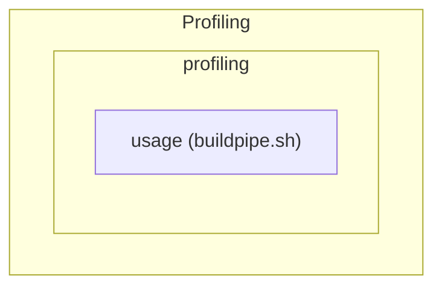
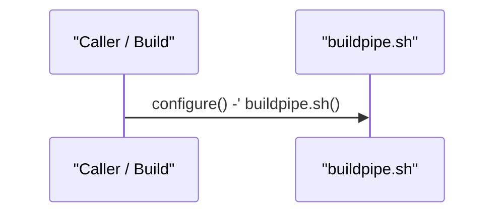

# Profiling

↑ [[6-developer-tools-and-platform-targets|Developer Tools and Platform Targets]]

> Profiling subsystem (`profiling`), covering 1 files and 1 symbols. Key symbols include `usage`.

<details>
<summary>Relevant source files</summary>

The following files were used as context for generating this wiki page:

- [profiling/buildpipe.sh](profiling/buildpipe.sh)

</details>

## Purpose and Scope

Profiling subsystem (`profiling`), covering 1 files and 1 symbols. Key symbols include `usage`.

Primary code entities analyzed on this page include `usage` ([profiling/buildpipe.sh:23-30]()).

For the parent architectural layer, see [[6-developer-tools-and-platform-targets|Developer Tools and Platform Targets]]. Related sibling subsystems: [[6.1-profiling-common|Profiling Common]], [[6.2-profiling-client|Profiling Client]], [[6.3-profiling-server|Profiling Server]].

Sources: [profiling/buildpipe.sh:23-30]()

---

## 1. High-Level Architecture and Data Flow

### Subsystem Component & Dependency Flow



| Module Directory | Files | Primary Code Entities | Source Citations |
|---|---|---|---|
| `profiling` | 1 | `usage` | [profiling/buildpipe.sh:23-30]() |

Sources: [profiling/buildpipe.sh:23-30]()

---

## 2. Core Data Structures and Implementation Details

### `usage` (Function)

- **Source Location**: [profiling/buildpipe.sh:23-30]()
- **Declaration**: `Function usage`
- **Graph Centrality**: fan-in `0` callers, fan-out `0` callees

```bash
// profiling/buildpipe.sh:23-30
usage() {
  echo "Usage: $CMD [options]"
  echo "Options:        -t(type) <Debug or Release>"
  echo "                -c(lean) build"
  echo "                -s(tatic libraries) <1 or 0>"
  echo "                -w(indows) build"
  exit 1
}
```

Sources: [profiling/buildpipe.sh:23-30]()

---

## 3. Execution and Call Flow

The sequence diagram below traces the runtime/compile-time call chain across components in this module:



Sources: [profiling/buildpipe.sh:23-30]()

---

## 4. Key API and Symbol Reference

| Code Entity | Kind | Location | Fan-In / Out | Role & Signature |
|---|---|---|---|---|
| `usage` | Function | [profiling/buildpipe.sh:23-30]() | `0` / `0` | — |

Sources: [profiling/buildpipe.sh:23-30]()

---

## 5. Official Documentation and Design Context

The following linked documentation sections from `llm-wiki` (`raw/`) provide additional architectural context, tutorials, and design invariants for this subsystem:

- **ArmNN DeepWiki** ([wiki/index.md](), score `18.524`) (sections: `ArmNN DeepWiki`, `Pages`): # ArmNN DeepWiki Generated from `home-jason-Project-deepwiki-armnn` at commit `2b61cecc9df7` (2026-11-14T15:13:53+00:00). ## Pages - [[1-overview|Overview]] — End-to-end architecture overview of ArmNN: core subsystems, compilation/execution pipeline, entry points, and cross-module dependencies. - [[2-build-system-and-infrastructure|Build System and Infrastructure]] — Architectural overview of Build System and Infrast
- **Overview** ([wiki/1-overview.md](), score `18.0789`) (sections: `Overview`, `1. Architecture Overview & System Component Map`, `Core Concept to Code Entity Mapping`, `Core Compilation & Runtime Class Hierarchy`): # Overview > End-to-end architecture overview of ArmNN: core subsystems, compilation/execution pipeline, entry points, and cross-module dependencies. <details> <summary>Relevant source files</summary> The following files were used as context for generating this wiki page: - [src/armnn/Tensor.cpp](src/armnn/Tensor.cpp) - [include/armnn/Exceptions.hpp](include/armnn/Exceptions.hpp) - [include/armnn/Tensor.hpp](include/
- **Developer Tools and Platform Targets** ([wiki/6-developer-tools-and-platform-targets.md](), score `18.0305`) (sections: `Developer Tools and Platform Targets`, `Purpose and Scope`, `System Mapping: Natural Language Space to Code Entity Space`, `1. Profiling Common`): # Developer Tools and Platform Targets > Architectural overview of Developer Tools and Platform Targets, spanning 70 source files and 662 code symbols across 4 subsystems. <details> <summary>Relevant source files</summary> The following files were used as context for generating this wiki page: - [profiling/common/include/ProfilingException.hpp](profiling/common/include/ProfilingException.hpp) - [profiling/common/incl
- **Profiling Client** ([wiki/6.2-profiling-client.md](), score `12.1737`) (sections: `Profiling Client`, `Purpose and Scope`, `1. High-Level Architecture and Data Flow`, `Natural Language Space to Code Entity Space Mapping`): # Profiling Client ↑ [[6-developer-tools-and-platform-targets|Developer Tools and Platform Targets]] > Profiling Client subsystem (`profiling/client`), covering 28 files and 340 symbols. Key symbols include `ReadUint32`, `GetCurrentState`, `WriteUint32`, `GetNextGuid`. <details> <summary>Relevant source files</summary> The following files were used as context for generating this wiki page: - [profiling/client/include

Sources: [wiki/index.md](), [wiki/1-overview.md](), [wiki/6-developer-tools-and-platform-targets.md](), [wiki/6.2-profiling-client.md]()

## Related pages

- [[6-developer-tools-and-platform-targets|Developer Tools and Platform Targets]]

## Related documents

- `wiki/index.md` — ArmNN DeepWiki (score 18.524, via bm25)
- `wiki/1-overview.md` — Overview (score 18.0789, via bm25)
- `wiki/6-developer-tools-and-platform-targets.md` — Developer Tools and Platform Targets (score 18.0305, via bm25)
- `wiki/6.2-profiling-client.md` — Profiling Client (score 12.1737, via bm25)
- `wiki/6.3-profiling-server.md` — Profiling Server (score 12.1157, via bm25)

## Sources

- [`profiling/buildpipe.sh`](https://github.com/ARM-software/armnn/blob/branches/armnn_24_11/profiling/buildpipe.sh)


## Dynamic Knowledge Links (Code Graph ↔ LLM-Wiki / RAG)

### Linked Architecture & Design Documents

| Document | Match Channel | Score | Shared Code Symbols |
|---|---|---|---|
| [[index|ArmNN DeepWiki]] | `bm25` | `18.524` | *(lexical/graph match)* |
| [[1-overview|Overview]] | `bm25` | `18.079` | *(lexical/graph match)* |
| [[6-developer-tools-and-platform-targets|Developer Tools and Platform Targets]] | `bm25` | `18.03` | *(lexical/graph match)* |
| [[6.2-profiling-client|Profiling Client]] | `bm25` | `12.174` | *(lexical/graph match)* |
| [[6.3-profiling-server|Profiling Server]] | `bm25` | `12.116` | *(lexical/graph match)* |
| [[6.1-profiling-common|Profiling Common]] | `wikilink:6.4-profiling` | `10.64` | *(lexical/graph match)* |

### High-Centrality Bridge Symbols (CBM Graph)

| Symbol | Kind | Source Location | Fan-In / Fan-Out |
|---|---|---|---|
| `usage` | Function | [profiling/buildpipe.sh:23-30]() | in: `0` / out: `0` |

Sources: [profiling/buildpipe.sh:23-30]()
