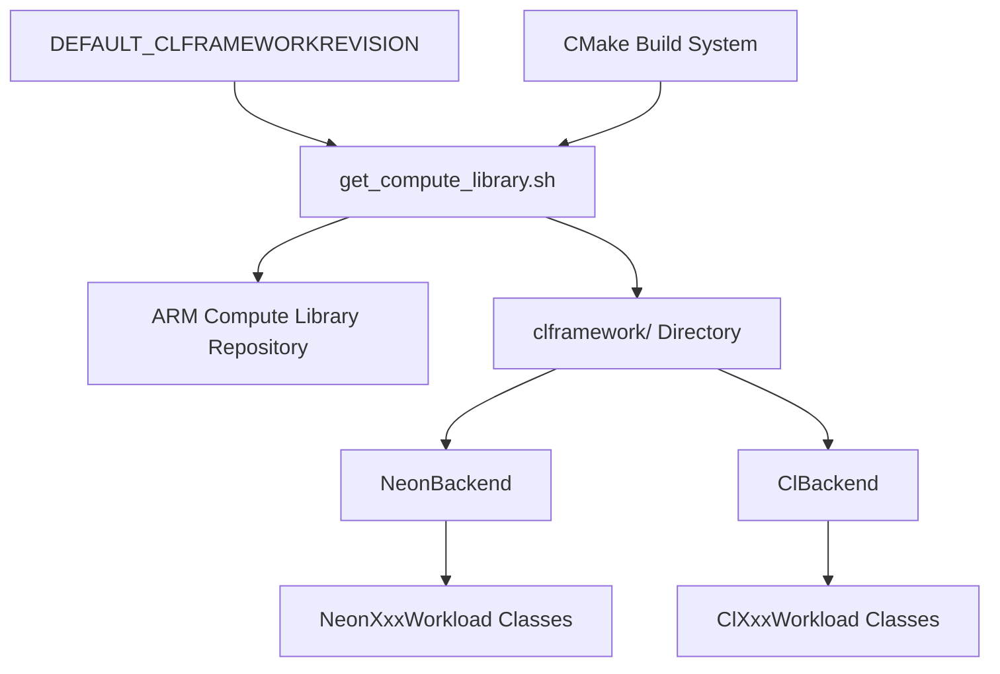
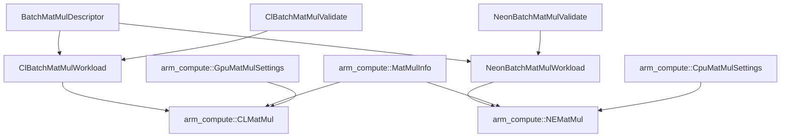
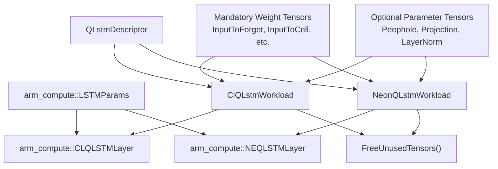
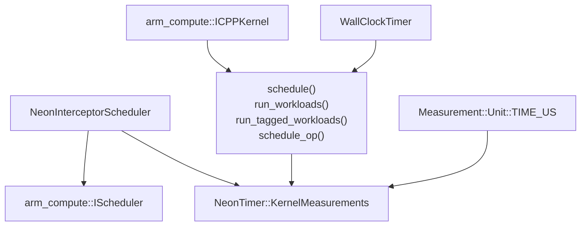
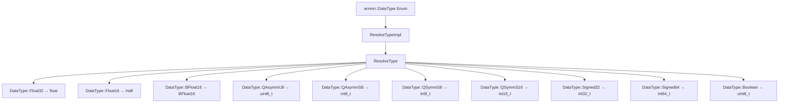

# Advanced Topics

Relevant source files

The following files were used as context for generating this wiki page:

- [delegate/test/BatchMatMulTest.cpp](delegate/test/BatchMatMulTest.cpp)
- [scripts/get_compute_library.sh](scripts/get_compute_library.sh)
- [src/armnn/ResolveType.hpp](src/armnn/ResolveType.hpp)
- [src/backends/backendsCommon/test/JsonPrinterTestImpl.cpp](src/backends/backendsCommon/test/JsonPrinterTestImpl.cpp)
- [src/backends/backendsCommon/test/layerTests/BatchMatMulTestImpl.cpp](src/backends/backendsCommon/test/layerTests/BatchMatMulTestImpl.cpp)
- [src/backends/cl/workloads/ClBatchMatMulWorkload.cpp](src/backends/cl/workloads/ClBatchMatMulWorkload.cpp)
- [src/backends/cl/workloads/ClBatchMatMulWorkload.hpp](src/backends/cl/workloads/ClBatchMatMulWorkload.hpp)
- [src/backends/cl/workloads/ClQLstmWorkload.cpp](src/backends/cl/workloads/ClQLstmWorkload.cpp)
- [src/backends/neon/NeonInterceptorScheduler.cpp](src/backends/neon/NeonInterceptorScheduler.cpp)
- [src/backends/neon/NeonInterceptorScheduler.hpp](src/backends/neon/NeonInterceptorScheduler.hpp)
- [src/backends/neon/workloads/NeonBatchMatMulWorkload.cpp](src/backends/neon/workloads/NeonBatchMatMulWorkload.cpp)
- [src/backends/neon/workloads/NeonBatchMatMulWorkload.hpp](src/backends/neon/workloads/NeonBatchMatMulWorkload.hpp)
- [src/backends/neon/workloads/NeonQLstmWorkload.cpp](src/backends/neon/workloads/NeonQLstmWorkload.cpp)

This section covers advanced features and specialized use cases in ArmNN that require deeper understanding of the framework's internal architecture. The material here focuses on complex workload implementations, performance optimization techniques, integration with external compute libraries, and sophisticated testing methodologies.

For basic model execution and standard layer operations, see [[2.3-runtime-and-execution|Runtime and Execution]]. For backend-specific optimizations, see [[4-compute-backends|Compute Backends]]. For development workflows and standard testing practices, see [[6-development-guide|Development Guide]].

## ARM Compute Library Integration

ArmNN's performance capabilities are largely enabled through integration with ARM Compute Library (ACL), which provides optimized kernels for ARM processors. The integration involves version management, build-time configuration, and runtime kernel dispatch.

### Dependency Management

The `get_compute_library.sh` script manages ACL versions and ensures compatibility between ArmNN and ACL releases. The script maintains a pinned revision to guarantee stable operation.

**ARM Compute Library Version Management**

Sources: [scripts/get_compute_library.sh:1-112]()

The revision pinning system ensures that ArmNN works with tested ACL versions. The script handles both SHA-based pins for development and branch-based pins for releases.

## Advanced Workload Implementations

Complex operations like `BatchMatMul` and `QLstm` demonstrate sophisticated workload patterns that involve extensive parameter management, memory optimization, and backend-specific kernel configuration.

### BatchMatMul Workload Architecture

BatchMatMul operations showcase advanced tensor manipulation capabilities with support for broadcasting, transposition, and multiple data layouts.

**BatchMatMul Implementation Pattern**

Sources: [src/backends/cl/workloads/ClBatchMatMulWorkload.cpp:1-114](), [src/backends/neon/workloads/NeonBatchMatMulWorkload.cpp:1-108](), [src/backends/cl/workloads/ClBatchMatMulWorkload.hpp:1-31](), [src/backends/neon/workloads/NeonBatchMatMulWorkload.hpp:1-33]()

### QLstm Workload Complexity

The Quantized LSTM implementation demonstrates the most complex workload pattern in ArmNN, with optional parameter management and extensive tensor initialization.

**QLstm Parameter Management Pattern**

Sources: [src/backends/cl/workloads/ClQLstmWorkload.cpp:1-427](), [src/backends/neon/workloads/NeonQLstmWorkload.cpp:1-423]()

The QLstm workloads handle conditional parameter initialization based on descriptor flags (`m_PeepholeEnabled`, `m_ProjectionEnabled`, `m_LayerNormEnabled`, `m_CifgEnabled`) and implement memory optimization through `FreeUnusedTensors()`.

## Performance Profiling and Instrumentation

Advanced performance analysis requires kernel-level timing and execution flow monitoring. ArmNN provides sophisticated profiling capabilities through interceptor patterns and JSON output formatting.

### NEON Kernel Interception

The `NeonInterceptorScheduler` demonstrates advanced profiling by intercepting ARM Compute Library kernel execution.

**Kernel Timing Interception Pattern**

Sources: [src/backends/neon/NeonInterceptorScheduler.hpp:1-45](), [src/backends/neon/NeonInterceptorScheduler.cpp:1-69]()

The interceptor wraps all ACL kernel execution calls with timing measurements, collecting microsecond-precision performance data for analysis.

### JSON Profiling Output

The profiling system generates structured JSON output for performance analysis, with validation ensuring proper formatting and completeness.

| Component | Purpose | Key Functions |
|-----------|---------|---------------|
| `JsonPrinterTestImpl` | JSON output validation | `AreParenthesesMatching()`, `ExtractMeasurements()` |
| `GetSoftmaxProfilerJson()` | Test profile generation | Network creation, execution, data extraction |
| `ValidateProfilerJson()` | Output verification | Measurement validation, structure checking |

Sources: [src/backends/backendsCommon/test/JsonPrinterTestImpl.cpp:1-276]()

## Data Type Resolution System

ArmNN's template-based data type system enables compile-time type resolution for optimal performance across different numeric precisions.

### ResolveType Template System

**Template-Based Type Resolution**

Sources: [src/armnn/ResolveType.hpp:1-81]()

The `ResolveType` system enables writing generic algorithms that work across all supported data types while maintaining compile-time type safety and optimization.

## Testing and Validation Infrastructure

Advanced testing patterns demonstrate sophisticated validation techniques for complex operations across multiple backends and data types.

### Template Test Generation

The `BatchMatMulTestImpl` system showcases advanced testing patterns with template-based test generation for multiple data types and dimensionalities.

```mermaid
graph TB
    BatchMatMulTestImpl["BatchMatMulTestImpl<ArmnnType, T, NumDims>"]
    
    TestVariants["Test Variants"]
    BatchMatMul2DSimpleTest["BatchMatMul2DSimpleTest<DataType>"]
    BatchMatMul3DSimpleTest["BatchMatMul3DSimpleTest<DataType>"]
    BatchMatMulNCHWSimpleTest["BatchMatMulNCHWSimpleTest<DataType>"]
    BatchMatMulNHWCSimpleTest["BatchMatMulNHWCSimpleTest<DataType>"]
    
    DataTypes["Supported Data Types"]
    BFloat16Type["DataType::BFloat16"]
    Float32Type["DataType::Float32"]
    Float16Type["DataType::Float16"]
    QAsymmS8Type["DataType::QAsymmS8"]
    QAsymmU8Type["DataType::QAsymmU8"]
    QSymmS16Type["DataType::QSymmS16"]
    
    WorkloadFactory["IWorkloadFactory"]
    LayerTestResult["LayerTestResult<T, NumDims>"]
    
    BatchMatMulTestImpl --> TestVariants
    TestVariants --> BatchMatMul2DSimpleTest
    TestVariants --> BatchMatMul3DSimpleTest
    TestVariants --> BatchMatMulNCHWSimpleTest
    TestVariants --> BatchMatMulNHWCSimpleTest
    
    DataTypes --> BFloat16Type
    DataTypes --> Float32Type
    DataTypes --> Float16Type
    DataTypes --> QAsymmS8Type
    DataTypes --> QAsymmU8Type
    DataTypes --> QSymmS16Type
    
    BatchMatMulTestImpl --> WorkloadFactory
    BatchMatMulTestImpl --> LayerTestResult
```

**Advanced Test Pattern Generation**

Sources: [src/backends/backendsCommon/test/layerTests/BatchMatMulTestImpl.cpp:1-1400](), [delegate/test/BatchMatMulTest.cpp:1-389]()

The testing system generates comprehensive test coverage through template instantiation, ensuring all data type and backend combinations are validated with identical test logic.

## Related Wiki Pages

- [[7.1-quantization|Quantization]]
- [[7.2-workload-system|Workload System]]
- [[2.3-runtime-and-execution|Runtime and Execution]]
- [[4-compute-backends|Compute Backends]]
- [[6-development-guide|Development Guide]]

## Dynamic Knowledge Links (Code Graph ↔ LLM-Wiki / RAG)

### Linked Architecture & Design Documents

| Document | Match Channel | Score | Shared Code Symbols |
|---|---|---|---|
| [[4.2-neon-backend|4.2 NEON Backend]] | `bm25+entity(7)` | `90.433` | `AreParenthesesMatching`, `BatchMatMulTestImpl`, `ClBatchMatMulWorkload`, `ClQLstmWorkload`, `ExtractMeasurements` |
| [[7.2-workload-system|7.2 Workload System]] | `bm25+entity(4)` | `90.1` | `AreParenthesesMatching`, `BatchMatMulTestImpl`, `ExtractMeasurements`, `GetSoftmaxProfilerJson` |
| [[4-compute-backends|4 Compute Backends]] | `bm25+entity(4)` | `82.474` | `AreParenthesesMatching`, `BatchMatMulTestImpl`, `ExtractMeasurements`, `GetSoftmaxProfilerJson` |
| [[4.3-opencl-backend|4.3 OpenCL Backend]] | `bm25+entity(4)` | `82.089` | `AreParenthesesMatching`, `BatchMatMulTestImpl`, `ExtractMeasurements`, `GetSoftmaxProfilerJson` |
| [[2.2-backend-system|2.2 Backend System]] | `bm25+entity(3)` | `78.602` | `AreParenthesesMatching`, `BatchMatMulTestImpl`, `ExtractMeasurements` |
| [[2.3-runtime-and-execution|2.3 Runtime and Execution]] | `wikilink:7-advanced-topics` | `55.538` | *(lexical/graph match)* |

### High-Centrality Bridge Symbols (CBM Graph)

| Symbol | Kind | Source Location | Fan-In / Fan-Out |
|---|---|---|---|
| `BatchMatMulTestImpl` | Function | [src/backends/backendsCommon/test/layerTests/BatchMatMulTestImpl.cpp:20-80]() | in: `13` / out: `16` |
| `ClQLstmWorkloadValidate` | Function | [src/backends/cl/workloads/ClQLstmWorkload.cpp:247-395]() | in: `0` / out: `22` |
| `NeonQLstmWorkloadValidate` | Function | [src/backends/neon/workloads/NeonQLstmWorkload.cpp:243-391]() | in: `0` / out: `22` |
| `GetSoftmaxProfilerJson` | Function | [src/backends/backendsCommon/test/JsonPrinterTestImpl.cpp:120-203]() | in: `1` / out: `19` |
| `ResolveTypeImpl<DataType::BFloat16>` | Class | [src/armnn/ResolveType.hpp:73-76]() | in: `6` / out: `0` |
| `ValidateProfilerJson` | Function | [src/backends/backendsCommon/test/JsonPrinterTestImpl.cpp:205-249]() | in: `1` / out: `10` |

Sources: [src/backends/backendsCommon/test/layerTests/BatchMatMulTestImpl.cpp:20-80](), [src/backends/cl/workloads/ClQLstmWorkload.cpp:247-395](), [src/backends/neon/workloads/NeonQLstmWorkload.cpp:243-391](), [src/backends/backendsCommon/test/JsonPrinterTestImpl.cpp:120-203]()

### Cross-Subsystem Coupling

- [[3.3-model-serialization|3.3 Model Serialization]] — call/import coupling weight `15.0`
- [[2-core-architecture|2 Core Architecture]] — call/import coupling weight `12.0`
- [[2.1-network-and-graph-system|2.1 Network and Graph System]] — call/import coupling weight `12.0`
- [[1-armnn-overview|1 ArmNN Overview]] — call/import coupling weight `9.0`
- [[2.3-runtime-and-execution|2.3 Runtime and Execution]] — call/import coupling weight `5.0`
- [[4.1-reference-backend|4.1 Reference Backend]] — call/import coupling weight `4.0`
