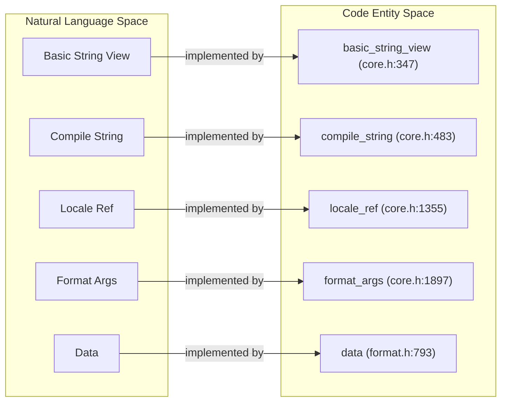
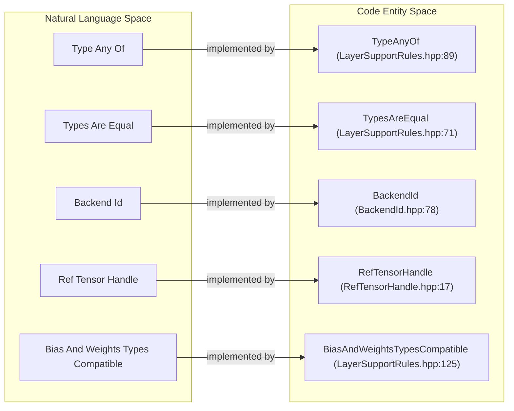
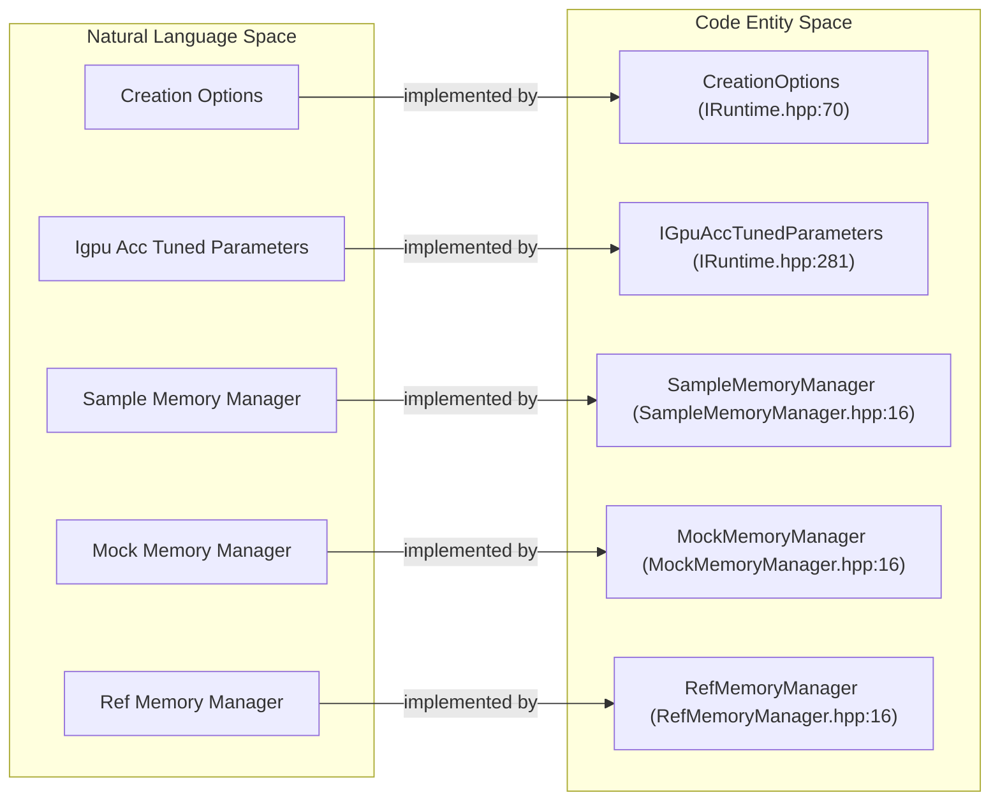

# Glossary

> Definitions and technical context for ArmNN domain terms, acronyms, file formats, and core code entities.

Relevant source files

The following files were used as context for generating this wiki page:

- [src/armnn/Tensor.cpp](src/armnn/Tensor.cpp)
- [include/armnn/Exceptions.hpp](include/armnn/Exceptions.hpp)
- [include/armnn/Tensor.hpp](include/armnn/Tensor.hpp)
- [third-party/fmt/format.h](third-party/fmt/format.h)
- [src/armnn/Layer.cpp](src/armnn/Layer.cpp)
- [third-party/fmt/core.h](third-party/fmt/core.h)
- [include/armnn/BackendId.hpp](include/armnn/BackendId.hpp)
- [src/armnn/Descriptors.cpp](src/armnn/Descriptors.cpp)
- [src/backends/backendsCommon/LayerSupportRules.hpp](src/backends/backendsCommon/LayerSupportRules.hpp)
- [third-party/cxxopts/cxxopts.hpp](third-party/cxxopts/cxxopts.hpp)
- [src/backends/reference/workloads/BaseIterator.hpp](src/backends/reference/workloads/BaseIterator.hpp)
- [src/backends/backendsCommon/TensorHandleFactoryRegistry.cpp](src/backends/backendsCommon/TensorHandleFactoryRegistry.cpp)
- [src/backends/reference/workloads/Broadcast.hpp](src/backends/reference/workloads/Broadcast.hpp)
- [profiling/common/include/ProfilingException.hpp](profiling/common/include/ProfilingException.hpp)
- [src/backends/backendsCommon/DynamicBackendUtils.cpp](src/backends/backendsCommon/DynamicBackendUtils.cpp)
- [src/backends/reference/RefTensorHandle.hpp](src/backends/reference/RefTensorHandle.hpp)
- [tests/CMakeLists.txt](tests/CMakeLists.txt)

## Purpose and Scope

This page provides definitions and technical context for codebase-specific terms, jargon, abbreviations, file formats, and domain concepts used throughout the repository. Every concept is mapped directly to its concrete implementation in the **Code Entity Space**.

---

## 1. Core Compilation, IR & Graph Concepts

Intermediate representations, graph lowering managers, dialect verifiers, and serialization formats.

### `compile_string` (Compile String)

// A base class for compile-time strings. It is defined in the fmt namespace to // make formatting functions visible via ADL, e.g. format(FMT_STRING("{}"), 42).

**Code Entities:**
- `compile_string` (`Class compile_string`): [third-party/fmt/core.h:483-483]() (fan-in `0`, fan-out `0`).

### `locale_ref` (Locale Ref)

// A type-erased reference to an std::locale to avoid heavy <locale> include.

**Code Entities:**
- `locale_ref` (`Class locale_ref`): [third-party/fmt/core.h:1355-1366]() (fan-in `0`, fan-out `0`).

### `format_args` (Format Args)

/** An alias to ``basic_format_args<context>``. */

**Code Entities:**
- `format_args` (`Class format_args`): [third-party/fmt/core.h:1897-1900]() (fan-in `0`, fan-out `0`).

### `data` (Data)

// This is a struct rather than an alias to avoid shadowing warnings in gcc.

**Code Entities:**
- `data` (`Class data`): [third-party/fmt/format.h:793-793]() (fan-in `0`, fan-out `0`).

### `utf8_to_utf16` (Utf8 To Utf16)

// A converter from UTF-8 to UTF-16.

**Code Entities:**
- `utf8_to_utf16` (`Class utf8_to_utf16`): [third-party/fmt/format.h:996-1006]() (fan-in `0`, fan-out `0`).

### `format_int` (Format Int)

/** Fast integer formatter. */

**Code Entities:**
- `format_int` (`Class format_int`): [third-party/fmt/format.h:3042-3099]() (fan-in `0`, fan-out `0`).

### Diagram: Natural Language Space to Code Entity Space (Core Compilation)

Sources: [third-party/fmt/core.h:483-483](), [third-party/fmt/core.h:1355-1366](), [third-party/fmt/core.h:1897-1900](), [third-party/fmt/format.h:793-793](), [third-party/fmt/format.h:996-1006]()

---

## 2. Backend Delegation, Partitioning & Hardware Formats

Graph partitioning interfaces, capability specifications, and hardware accelerator delegates.

### `TypeAnyOf` (Type Any Of)

Core class defined in `src/backends/backendsCommon/LayerSupportRules.hpp`.

**Code Entities:**
- `TypeAnyOf` (`Class TypeAnyOf`): [src/backends/backendsCommon/LayerSupportRules.hpp:89-99]() (fan-in `64`, fan-out `0`).

### `TypesAreEqual` (Types Are Equal)

Core class defined in `src/backends/backendsCommon/LayerSupportRules.hpp`.

**Code Entities:**
- `TypesAreEqual` (`Class TypesAreEqual`): [src/backends/backendsCommon/LayerSupportRules.hpp:71-78]() (fan-in `49`, fan-out `0`).

### `BackendId` (Backend Id)

Core class defined in `include/armnn/BackendId.hpp`.

**Code Entities:**
- `BackendId` (`Class BackendId`): [include/armnn/BackendId.hpp:78-148]() (fan-in `48`, fan-out `0`).

### `RefTensorHandle` (Ref Tensor Handle)

// An implementation of ITensorHandle with simple "bump the pointer" memory-management behaviour

**Code Entities:**
- `RefTensorHandle` (`Class RefTensorHandle`): [src/backends/reference/RefTensorHandle.hpp:17-82]() (fan-in `0`, fan-out `0`).

### `BiasAndWeightsTypesCompatible` (Bias And Weights Types Compatible)

Core class defined in `src/backends/backendsCommon/LayerSupportRules.hpp`.

**Code Entities:**
- `BiasAndWeightsTypesCompatible` (`Class BiasAndWeightsTypesCompatible`): [src/backends/backendsCommon/LayerSupportRules.hpp:125-135]() (fan-in `1`, fan-out `0`).

### `hash<armnn::BackendId>` (Hash<Armnn::Backend Id>)

Core class defined in `include/armnn/BackendId.hpp`.

**Code Entities:**
- `hash<armnn::BackendId>` (`Class hash<armnn::BackendId>`): [include/armnn/BackendId.hpp:159-166]() (fan-in `0`, fan-out `0`).

### Diagram: Natural Language Space to Code Entity Space (Backend Delegation)

Sources: [src/backends/backendsCommon/LayerSupportRules.hpp:89-99](), [src/backends/backendsCommon/LayerSupportRules.hpp:71-78](), [include/armnn/BackendId.hpp:78-148](), [src/backends/reference/RefTensorHandle.hpp:17-82](), [src/backends/backendsCommon/LayerSupportRules.hpp:125-135]()

---

## 3. Runtime Execution, Memory & Serialization Entities

On-device execution engines, tagged value unions, memory allocators, data loaders, and profiling tools.

### `CreationOptions` (Creation Options)

Core class defined in `include/armnn/IRuntime.hpp`.

**Code Entities:**
- `CreationOptions` (`Class CreationOptions`): [include/armnn/IRuntime.hpp:70-183]() (fan-in `14`, fan-out `0`).

### `SampleMemoryManager` (Sample Memory Manager)

// An implementation of IMemoryManager to be used with SampleTensorHandle

**Code Entities:**
- `SampleMemoryManager` (`Class SampleMemoryManager`): [src/dynamic/sample/SampleMemoryManager.hpp:16-57]() (fan-in `0`, fan-out `0`).

### `RefMemoryManager` (Ref Memory Manager)

// An implementation of IMemoryManager to be used with RefTensorHandle

**Code Entities:**
- `RefMemoryManager` (`Class RefMemoryManager`): [src/backends/reference/RefMemoryManager.hpp:16-57]() (fan-in `0`, fan-out `0`).

### `MockMemoryManager` (Mock Memory Manager)

// An implementation of IMemoryManager to be used with MockTensorHandle

**Code Entities:**
- `MockMemoryManager` (`Class MockMemoryManager`): [include/armnnTestUtils/MockMemoryManager.hpp:16-57]() (fan-in `0`, fan-out `0`).

### `SingleAxisPriorityList` (Single Axis Priority List)

/// SingleAxisPriorityList sorts the MemBlocks according to some priority, /// then trys to place them into as few bins as possible

**Code Entities:**
- `SingleAxisPriorityList` (`Class SingleAxisPriorityList`): [src/backends/backendsCommon/memoryOptimizerStrategyLibrary/strategies/SingleAxisPriorityList.hpp:20-48]() (fan-in `0`, fan-out `0`).

### `ConstantMemoryStrategy` (Constant Memory Strategy)

// ConstLayerMemoryOptimizer: Create a unique MemBin for each MemBlock and assign it an offset of 0

**Code Entities:**
- `ConstantMemoryStrategy` (`Class ConstantMemoryStrategy`): [src/backends/backendsCommon/memoryOptimizerStrategyLibrary/strategies/ConstantMemoryStrategy.hpp:13-29]() (fan-in `0`, fan-out `0`).

### Diagram: Natural Language Space to Code Entity Space (Runtime Execution)

Sources: [include/armnn/IRuntime.hpp:70-183](), [src/dynamic/sample/SampleMemoryManager.hpp:16-57](), [src/backends/reference/RefMemoryManager.hpp:16-57](), [include/armnnTestUtils/MockMemoryManager.hpp:16-57](), [src/backends/backendsCommon/memoryOptimizerStrategyLibrary/strategies/SingleAxisPriorityList.hpp:20-48]()

## Related pages

- [[1-overview|Overview]]
- [[3-backend-delegation-and-hardware-providers|Backend Delegation and Hardware Providers]]
- [[3.1-backends-backendscommon|Backends Backendscommon]]
- [[3.2-backends-reference|Backends Reference]]
- [[3.3-backends-opencl|Backends OpenCL]]
- [[3.4-backends-aclcommon|Backends Aclcommon]]
- [[3.6-other-backends|Other Backends]]
- [[5-runtime-execution-and-kernel-dispatch|Runtime Execution and Kernel Dispatch]]

## Related documents

- `wiki/1-overview.md` — Overview (score 58.94, via bm25)
- `wiki/index.md` — ArmNN DeepWiki (score 49.5086, via bm25)
- `wiki/5.2-armnn.md` — ArmNN (score 47.6383, via bm25)
- `wiki/5-runtime-execution-and-kernel-dispatch.md` — Runtime Execution and Kernel Dispatch (score 41.5135, via bm25)
- `wiki/3-backend-delegation-and-hardware-providers.md` — Backend Delegation and Hardware Providers (score 40.2655, via bm25)

## Sources

- [`src/armnn/Tensor.cpp`](https://github.com/ARM-software/armnn/blob/branches/armnn_24_11/src/armnn/Tensor.cpp)
- [`include/armnn/Exceptions.hpp`](https://github.com/ARM-software/armnn/blob/branches/armnn_24_11/include/armnn/Exceptions.hpp)
- [`include/armnn/Tensor.hpp`](https://github.com/ARM-software/armnn/blob/branches/armnn_24_11/include/armnn/Tensor.hpp)
- [`third-party/fmt/format.h`](https://github.com/ARM-software/armnn/blob/branches/armnn_24_11/third-party/fmt/format.h)
- [`src/armnn/Layer.cpp`](https://github.com/ARM-software/armnn/blob/branches/armnn_24_11/src/armnn/Layer.cpp)
- [`third-party/fmt/core.h`](https://github.com/ARM-software/armnn/blob/branches/armnn_24_11/third-party/fmt/core.h)
- [`include/armnn/BackendId.hpp`](https://github.com/ARM-software/armnn/blob/branches/armnn_24_11/include/armnn/BackendId.hpp)
- [`src/armnn/Descriptors.cpp`](https://github.com/ARM-software/armnn/blob/branches/armnn_24_11/src/armnn/Descriptors.cpp)
- [`src/backends/backendsCommon/LayerSupportRules.hpp`](https://github.com/ARM-software/armnn/blob/branches/armnn_24_11/src/backends/backendsCommon/LayerSupportRules.hpp)
- [`third-party/cxxopts/cxxopts.hpp`](https://github.com/ARM-software/armnn/blob/branches/armnn_24_11/third-party/cxxopts/cxxopts.hpp)
- [`src/backends/reference/workloads/BaseIterator.hpp`](https://github.com/ARM-software/armnn/blob/branches/armnn_24_11/src/backends/reference/workloads/BaseIterator.hpp)
- [`src/backends/backendsCommon/TensorHandleFactoryRegistry.cpp`](https://github.com/ARM-software/armnn/blob/branches/armnn_24_11/src/backends/backendsCommon/TensorHandleFactoryRegistry.cpp)
- [`src/backends/reference/workloads/Broadcast.hpp`](https://github.com/ARM-software/armnn/blob/branches/armnn_24_11/src/backends/reference/workloads/Broadcast.hpp)
- [`profiling/common/include/ProfilingException.hpp`](https://github.com/ARM-software/armnn/blob/branches/armnn_24_11/profiling/common/include/ProfilingException.hpp)
- [`src/backends/backendsCommon/DynamicBackendUtils.cpp`](https://github.com/ARM-software/armnn/blob/branches/armnn_24_11/src/backends/backendsCommon/DynamicBackendUtils.cpp)
- [`src/backends/reference/RefTensorHandle.hpp`](https://github.com/ARM-software/armnn/blob/branches/armnn_24_11/src/backends/reference/RefTensorHandle.hpp)
- [`tests/CMakeLists.txt`](https://github.com/ARM-software/armnn/blob/branches/armnn_24_11/tests/CMakeLists.txt)

## Dynamic Knowledge Links (Code Graph ↔ LLM-Wiki / RAG)

### Linked Architecture & Design Documents

| Document | Match Channel | Score | Shared Code Symbols |
|---|---|---|---|
| [[1-overview|Overview]] | `bm25+entity(7)` | `69.44` | `Exception`, `InvalidArgumentException`, `LayerValidationException`, `NullPointerException`, `ParseException` |
| [[5.2-armnn|ArmNN]] | `bm25+entity(13)` | `67.138` | `BackendId`, `ConstTensor`, `Exception`, `InvalidArgumentException`, `LayerValidationException` |
| [[5-runtime-execution-and-kernel-dispatch|Runtime Execution and Kernel Dispatch]] | `bm25+entity(10)` | `56.514` | `BackendId`, `ConstTensor`, `Exception`, `InvalidArgumentException`, `NullPointerException` |
| [[index|ArmNN DeepWiki]] | `bm25+entity(2)` | `52.509` | `Exception`, `InvalidArgumentException` |
| [[3-backend-delegation-and-hardware-providers|Backend Delegation and Hardware Providers]] | `bm25+entity(5)` | `47.766` | `Exception`, `InvalidArgumentException`, `TensorInfo`, `TypeAnyOf`, `TypesAreEqual` |
| [[3.1-backends-backendscommon|Backends Backendscommon]] | `wikilink:7-glossary+entity(4)` | `38.399` | `ConstTensor`, `TensorInfo`, `TypeAnyOf`, `TypesAreEqual` |

### High-Centrality Bridge Symbols (CBM Graph)

| Symbol | Kind | Source Location | Fan-In / Fan-Out |
|---|---|---|---|
| `InvalidArgumentException` | Class | [include/armnn/Exceptions.hpp:80-84]() | in: `273` / out: `0` |
| `Exception` | Class | [include/armnn/Exceptions.hpp:46-65]() | in: `181` / out: `0` |
| `TensorInfo` | Class | [include/armnn/Tensor.hpp:152-274]() | in: `121` / out: `0` |
| `NullPointerException` | Class | [include/armnn/Exceptions.hpp:146-150]() | in: `101` / out: `0` |
| `ParseException` | Class | [include/armnn/Exceptions.hpp:92-96]() | in: `98` / out: `0` |
| `LayerValidationException` | Class | [include/armnn/Exceptions.hpp:105-108]() | in: `73` / out: `0` |

Sources: [include/armnn/Exceptions.hpp:80-84](), [include/armnn/Exceptions.hpp:46-65](), [include/armnn/Tensor.hpp:152-274](), [include/armnn/Exceptions.hpp:146-150]()

### Cross-Subsystem Coupling

- [[4.1-tests|Tests]] — call/import coupling weight `554.0`
- [[5.6-other-runtime-components|Other Runtime Components]] — call/import coupling weight `552.0`
- [[2.1-build-infrastructure|Build Infrastructure]] — call/import coupling weight `411.0`
- [[3-backend-delegation-and-hardware-providers|Backend Delegation and Hardware Providers]] — call/import coupling weight `409.0`
- [[5.1-armnn|ArmNN]] — call/import coupling weight `403.0`
- [[5-runtime-execution-and-kernel-dispatch|Runtime Execution and Kernel Dispatch]] — call/import coupling weight `367.0`
