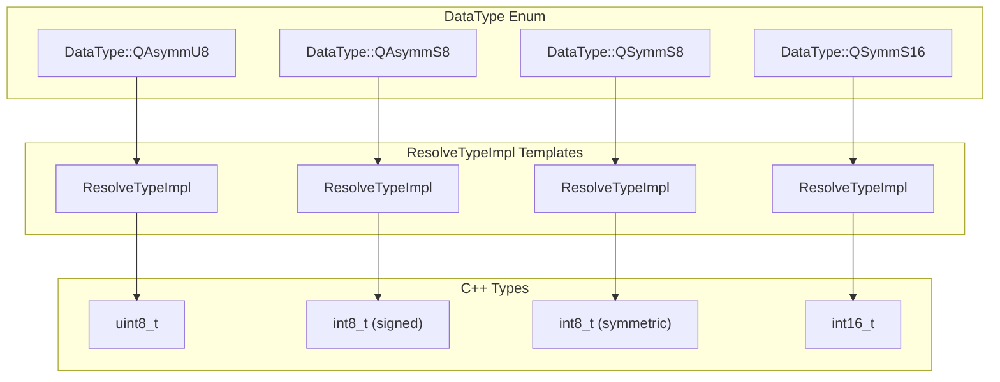
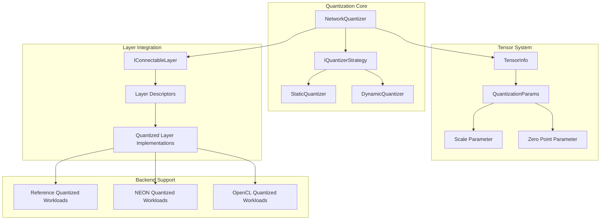
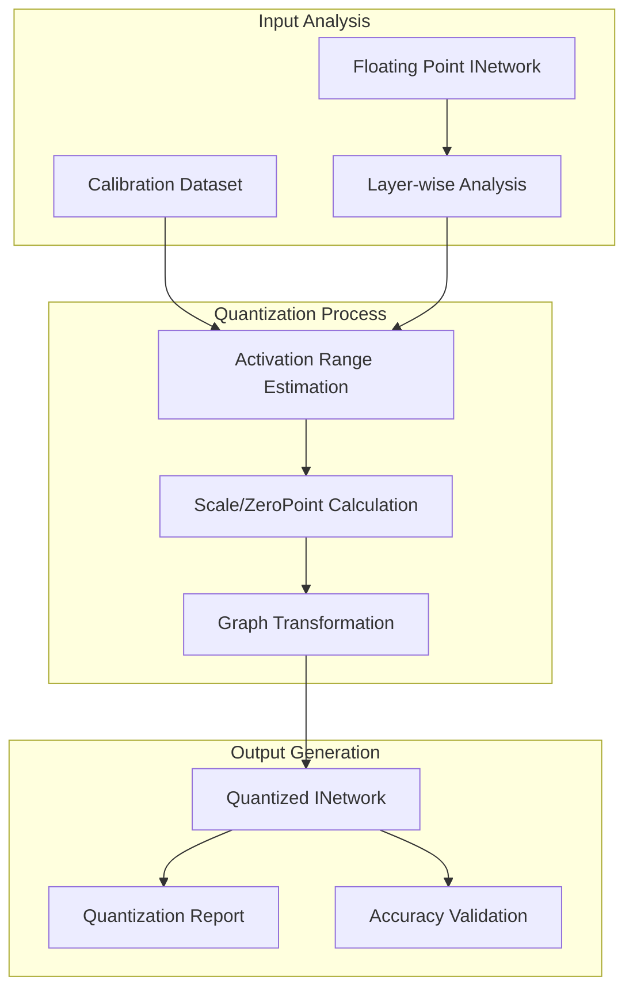
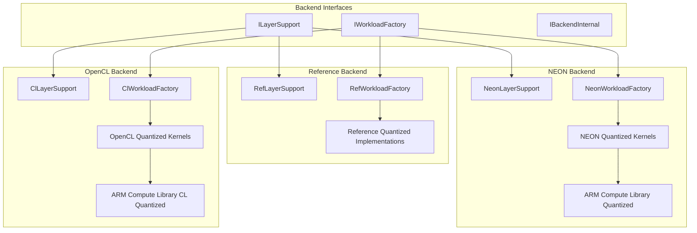
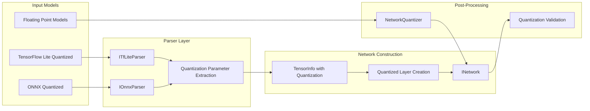

# Quantization

Relevant source files

The following files were used as context for generating this wiki page:

- [src/armnn/ResolveType.hpp](src/armnn/ResolveType.hpp)

This document covers ArmNN's quantization system, which enables model optimization through reduced precision arithmetic. Quantization converts floating-point models to use integer representations, reducing memory usage and improving inference performance on hardware that supports integer operations.

The quantization system includes support for multiple quantized data types, the `NetworkQuantizer` for post-training quantization, and integration across all compute backends. For information about data type resolution and backend-specific implementations, see the [[7.2-workload-system|Workload System]].

## Quantized Data Types

ArmNN supports several quantized data types that map floating-point values to integer representations using scale and zero-point parameters. The type resolution system provides the underlying C++ types for each quantized format.

### Supported Quantized Types

| DataType | C++ Type | Bit Width | Signedness | Symmetry |
|----------|----------|-----------|------------|----------|
| `QAsymmU8` | `uint8_t` | 8-bit | Unsigned | Asymmetric |
| `QAsymmS8` | `int8_t` | 8-bit | Signed | Asymmetric |
| `QSymmS8` | `int8_t` | 8-bit | Signed | Symmetric |
| `QSymmS16` | `int16_t` | 16-bit | Signed | Symmetric |

### Data Type Resolution System

The `ResolveType` template system maps ArmNN's `DataType` enums to their corresponding C++ types, enabling compile-time type resolution for quantized operations.

Sources: [src/armnn/ResolveType.hpp:15-81]()

## Quantization System Architecture

ArmNN's quantization system operates at multiple levels within the framework, from model import through backend execution. The system handles both pre-quantized models and post-training quantization.

### Quantization Pipeline

```mermaid
graph LR
    subgraph "Model Input"
        FloatModel["Floating Point Model"]
        QuantModel["Pre-quantized Model"]
    end
    
    subgraph "ArmNN Core"
        INetwork["INetwork Interface"]
        NetworkQuantizer["NetworkQuantizer"]
        QuantizationParams["QuantizationParams"]
        TensorInfo["TensorInfo with Scale/ZeroPoint"]
    end
    
    subgraph "Backend Processing"
        ILayerSupport["ILayerSupport::IsLayerSupported"]
        WorkloadFactory["IWorkloadFactory"]
        QuantizedWorkload["Quantized Workloads"]
    end
    
    subgraph "Execution"
        BackendExecute["Backend-specific Execution"]
        QuantizedKernels["Quantized Compute Kernels"]
    end
    
    FloatModel --> NetworkQuantizer
    QuantModel --> INetwork
    NetworkQuantizer --> INetwork
    INetwork --> QuantizationParams
    QuantizationParams --> TensorInfo
    
    TensorInfo --> ILayerSupport
    ILayerSupport --> WorkloadFactory
    WorkloadFactory --> QuantizedWorkload
    QuantizedWorkload --> BackendExecute
    BackendExecute --> QuantizedKernels
```

### Core Quantization Components

The quantization system integrates with ArmNN's layer and backend architecture:

Sources: Based on ArmNN quantization system architecture

## NetworkQuantizer Implementation

The `NetworkQuantizer` provides post-training quantization capabilities, converting floating-point networks to quantized representations. This system analyzes activation ranges and determines optimal quantization parameters.

### Quantization Strategies

The quantization system supports multiple strategies for determining quantization parameters:

| Strategy | Description | Use Case |
|----------|-------------|----------|
| Static | Uses pre-computed statistics | Production inference |
| Dynamic | Computes statistics during calibration | Development/validation |
| Mixed Precision | Selective layer quantization | Performance optimization |

### Quantization Workflow

Sources: Based on ArmNN NetworkQuantizer system design

## Backend Integration

All ArmNN compute backends support quantized operations, with backend-specific optimizations for quantized arithmetic. The backend system handles quantized workloads through specialized implementations.

### Backend Quantization Support

### Quantized Operation Support

Each backend implements quantized versions of supported operations:

| Operation Category | Reference | NEON | OpenCL | Notes |
|-------------------|-----------|------|--------|-------|
| Convolution | ✓ | ✓ | ✓ | Full int8 support |
| Fully Connected | ✓ | ✓ | ✓ | Optimized GEMM |
| Pooling | ✓ | ✓ | ✓ | Max/Average pooling |
| Activation | ✓ | ✓ | ✓ | ReLU, ReLU6 |
| Element-wise | ✓ | ✓ | ✓ | Add, Mul operations |

Sources: Based on ArmNN backend quantization support

## Model Import and Quantization

ArmNN supports importing pre-quantized models from TensorFlow Lite and ONNX, as well as applying quantization to floating-point models during import.

### Parser Quantization Support

Sources: Based on ArmNN parser quantization integration

## Quantization Performance Considerations

Quantization provides significant performance benefits but requires careful consideration of accuracy trade-offs and hardware capabilities.

### Performance Benefits

| Metric | Floating Point | Quantized (int8) | Improvement |
|--------|---------------|------------------|-------------|
| Memory Usage | 4 bytes/weight | 1 byte/weight | 4x reduction |
| Model Size | Baseline | 25% of original | 4x smaller |
| Inference Speed | Baseline | 2-4x faster | Platform dependent |
| Cache Efficiency | Lower | Higher | Better locality |

### Accuracy Considerations

The quantization system provides tools for monitoring and validating accuracy:

- **Quantization Error Analysis**: Layer-by-layer accuracy assessment
- **Calibration Dataset Requirements**: Representative data for range estimation
- **Mixed Precision Support**: Selective quantization for accuracy-critical layers
- **Validation Metrics**: Automated accuracy validation against reference

Sources: Based on ArmNN quantization performance characteristics

## Related Wiki Pages

- [[7-advanced-topics|Advanced Topics]]
- [[7.2-workload-system|Workload System]]

## Dynamic Knowledge Links (Code Graph ↔ LLM-Wiki / RAG)

### Linked Architecture & Design Documents

| Document | Match Channel | Score | Shared Code Symbols |
|---|---|---|---|
| [[7-advanced-topics|7 Advanced Topics]] | `bm25` | `185.194` | *(lexical/graph match)* |
| [[2.3-runtime-and-execution|2.3 Runtime and Execution]] | `wikilink:7-advanced-topics` | `92.597` | *(lexical/graph match)* |
| [[4-compute-backends|4 Compute Backends]] | `wikilink:7-advanced-topics` | `92.597` | *(lexical/graph match)* |
| [[6-development-guide|6 Development Guide]] | `wikilink:7-advanced-topics` | `92.597` | *(lexical/graph match)* |
| [[3.1-tensorflow-lite-parser|3.1 TensorFlow Lite Parser]] | `bm25` | `86.67` | *(lexical/graph match)* |
| [[4.4-tosa-backend|4.4 TOSA Backend]] | `bm25` | `82.302` | *(lexical/graph match)* |

### High-Centrality Bridge Symbols (CBM Graph)

| Symbol | Kind | Source Location | Fan-In / Fan-Out |
|---|---|---|---|
| `ResolveTypeImpl<DataType::BFloat16>` | Class | [src/armnn/ResolveType.hpp:73-76]() | in: `6` / out: `0` |
| `ResolveTypeImpl<DataType::Boolean>` | Class | [src/armnn/ResolveType.hpp:67-70]() | in: `0` / out: `0` |
| `ResolveTypeImpl<DataType::Float16>` | Class | [src/armnn/ResolveType.hpp:19-22]() | in: `0` / out: `0` |
| `ResolveTypeImpl<DataType::Float32>` | Class | [src/armnn/ResolveType.hpp:25-28]() | in: `0` / out: `0` |
| `ResolveTypeImpl<DataType::QAsymmS8>` | Class | [src/armnn/ResolveType.hpp:37-40]() | in: `0` / out: `0` |
| `ResolveTypeImpl<DataType::QAsymmU8>` | Class | [src/armnn/ResolveType.hpp:31-34]() | in: `0` / out: `0` |

Sources: [src/armnn/ResolveType.hpp:73-76](), [src/armnn/ResolveType.hpp:67-70](), [src/armnn/ResolveType.hpp:19-22](), [src/armnn/ResolveType.hpp:25-28]()

### Cross-Subsystem Coupling

- [[2.3-runtime-and-execution|2.3 Runtime and Execution]] — call/import coupling weight `2.0`
- [[4.1-reference-backend|4.1 Reference Backend]] — call/import coupling weight `2.0`
- [[4.4-tosa-backend|4.4 TOSA Backend]] — call/import coupling weight `2.0`
- [[6-development-guide|6 Development Guide]] — call/import coupling weight `2.0`
- [[6.2-testing-framework|6.2 Testing Framework]] — call/import coupling weight `2.0`
