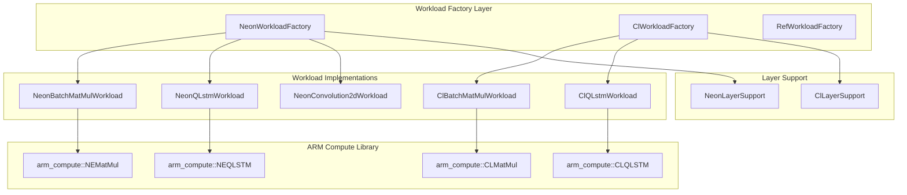
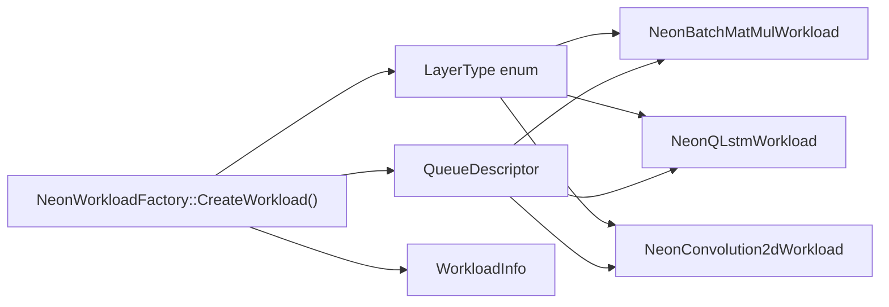
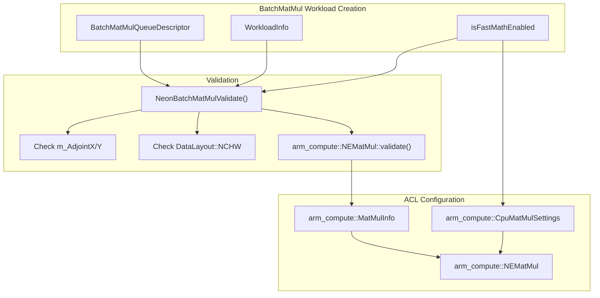
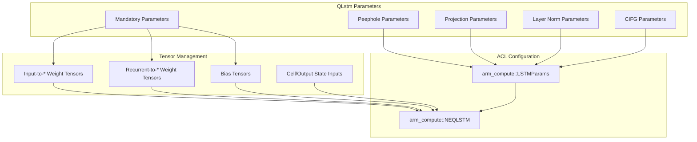
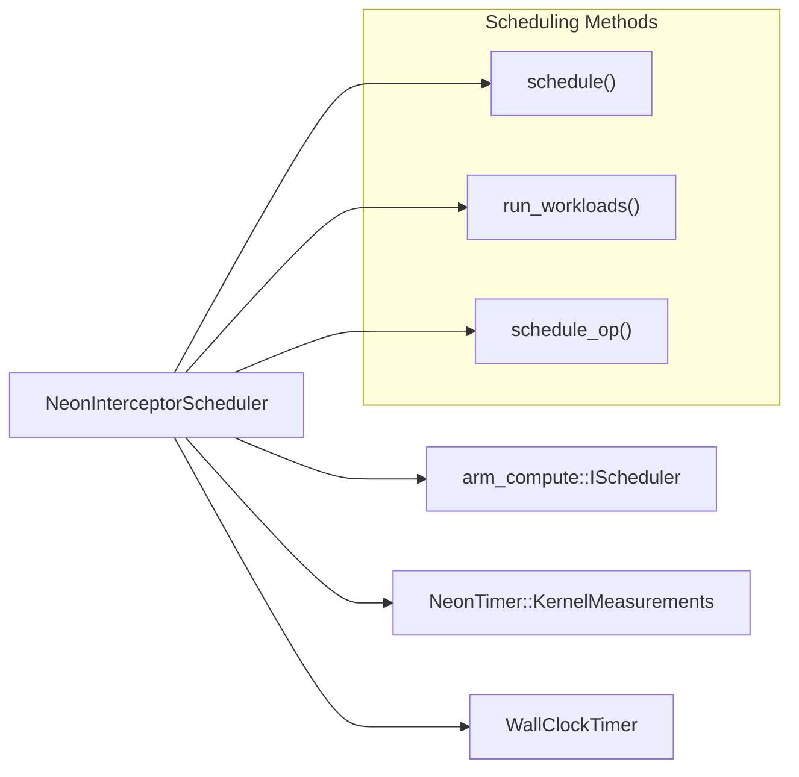
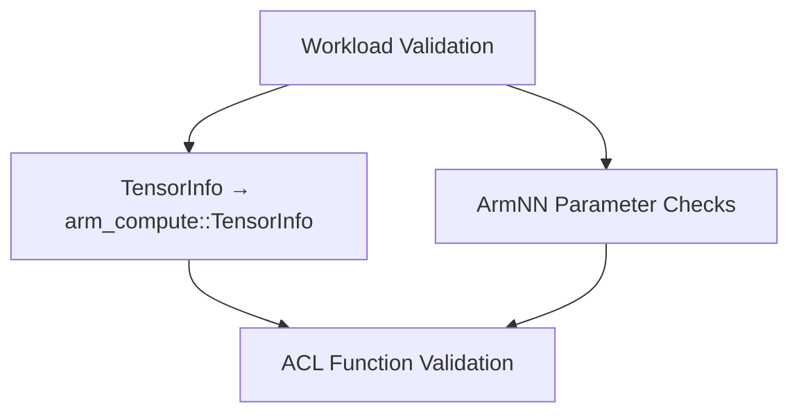

# Workload System

Relevant source files

The following files were used as context for generating this wiki page:

- [delegate/test/BatchMatMulTest.cpp](delegate/test/BatchMatMulTest.cpp)
- [scripts/get_compute_library.sh](scripts/get_compute_library.sh)
- [src/backends/backendsCommon/test/JsonPrinterTestImpl.cpp](src/backends/backendsCommon/test/JsonPrinterTestImpl.cpp)
- [src/backends/backendsCommon/test/layerTests/BatchMatMulTestImpl.cpp](src/backends/backendsCommon/test/layerTests/BatchMatMulTestImpl.cpp)
- [src/backends/cl/workloads/ClBatchMatMulWorkload.cpp](src/backends/cl/workloads/ClBatchMatMulWorkload.cpp)
- [src/backends/cl/workloads/ClBatchMatMulWorkload.hpp](src/backends/cl/workloads/ClBatchMatMulWorkload.hpp)
- [src/backends/cl/workloads/ClQLstmWorkload.cpp](src/backends/cl/workloads/ClQLstmWorkload.cpp)
- [src/backends/neon/NeonInterceptorScheduler.cpp](src/backends/neon/NeonInterceptorScheduler.cpp)
- [src/backends/neon/NeonInterceptorScheduler.hpp](src/backends/neon/NeonInterceptorScheduler.hpp)
- [src/backends/neon/NeonLayerSupport.cpp](src/backends/neon/NeonLayerSupport.cpp)
- [src/backends/neon/NeonLayerSupport.hpp](src/backends/neon/NeonLayerSupport.hpp)
- [src/backends/neon/NeonWorkloadFactory.cpp](src/backends/neon/NeonWorkloadFactory.cpp)
- [src/backends/neon/NeonWorkloadFactory.hpp](src/backends/neon/NeonWorkloadFactory.hpp)
- [src/backends/neon/backend.mk](src/backends/neon/backend.mk)
- [src/backends/neon/test/NeonCreateWorkloadTests.cpp](src/backends/neon/test/NeonCreateWorkloadTests.cpp)
- [src/backends/neon/test/NeonLayerTests.cpp](src/backends/neon/test/NeonLayerTests.cpp)
- [src/backends/neon/workloads/CMakeLists.txt](src/backends/neon/workloads/CMakeLists.txt)
- [src/backends/neon/workloads/NeonBatchMatMulWorkload.cpp](src/backends/neon/workloads/NeonBatchMatMulWorkload.cpp)
- [src/backends/neon/workloads/NeonBatchMatMulWorkload.hpp](src/backends/neon/workloads/NeonBatchMatMulWorkload.hpp)
- [src/backends/neon/workloads/NeonQLstmWorkload.cpp](src/backends/neon/workloads/NeonQLstmWorkload.cpp)
- [src/backends/neon/workloads/NeonWorkloads.hpp](src/backends/neon/workloads/NeonWorkloads.hpp)

The Workload System is ArmNN's core execution engine that implements individual neural network operations for specific compute backends. This system bridges the high-level graph representation with low-level hardware-optimized kernels, providing backend-specific implementations for operations like convolution, matrix multiplication, and LSTM layers.

This document covers the workload implementation architecture, factory patterns, and backend-specific optimizations. For information about network graph construction and layer management, see [[2.1-network-and-graph-system|Network and Graph System]]. For backend architecture and registration, see [[2.2-backend-system|Backend System]].

## Architecture Overview

The workload system follows a factory pattern where each backend provides its own `WorkloadFactory` that creates backend-specific `Workload` implementations. Each workload encapsulates the logic to execute a single operation on the target hardware.

Sources: [src/backends/neon/NeonWorkloadFactory.cpp:134-556](), [src/backends/neon/NeonLayerSupport.cpp:1-2059]()

## Workload Factory System

### NeonWorkloadFactory

The `NeonWorkloadFactory` is responsible for creating NEON-optimized workloads and managing memory allocation. It implements the factory pattern to instantiate the appropriate workload based on the layer type.

The factory supports over 50 different layer types, each mapped to a specific workload implementation:

| Layer Type | Workload Class | ACL Function |
|------------|----------------|--------------|
| `LayerType::BatchMatMul` | `NeonBatchMatMulWorkload` | `arm_compute::NEMatMul` |
| `LayerType::QLstm` | `NeonQLstmWorkload` | `arm_compute::NEQLSTM` |
| `LayerType::Convolution2d` | `NeonConvolution2dWorkload` | `arm_compute::NEConvolutionLayer` |
| `LayerType::Pooling2d` | `NeonPooling2dWorkload` | `arm_compute::NEPoolingLayer` |

Sources: [src/backends/neon/NeonWorkloadFactory.cpp:134-556](), [src/backends/neon/workloads/CMakeLists.txt:6-154]()

### Workload Creation Process

The workload creation follows this sequence:

1. **Layer Support Validation**: Check if the operation is supported on the backend
2. **Queue Descriptor Setup**: Configure input/output tensors and operation parameters  
3. **Workload Instantiation**: Create backend-specific workload with ACL function
4. **Memory Allocation**: Set up tensor handles and memory management

Sources: [src/backends/neon/NeonWorkloadFactory.cpp:34-47](), [src/backends/neon/NeonLayerSupport.cpp:175-183]()

## Individual Workload Implementations

### NeonBatchMatMulWorkload

The `NeonBatchMatMulWorkload` implements matrix multiplication operations using ARM Compute Library's `NEMatMul` function. It supports various data types and provides optimizations through fast math settings.

Key implementation details:

- **Transpose Support**: Configures `MatMulInfo.adj_lhs()` and `MatMulInfo.adj_rhs()` for input transposition
- **Fast Math**: Uses `CpuMatMulSettings.fast_math()` for performance optimization
- **Dynamic Inputs**: Sets `are_values_constant(false)` for runtime tensor shapes
- **Validation**: Throws exceptions for unsupported adjoint operations and non-NCHW layouts

Sources: [src/backends/neon/workloads/NeonBatchMatMulWorkload.cpp:19-108](), [src/backends/neon/workloads/NeonBatchMatMulWorkload.hpp:14-33]()

### NeonQLstmWorkload

The `NeonQLstmWorkload` implements quantized LSTM operations with comprehensive parameter management for optional features like peephole connections, projection, and layer normalization.

The workload manages multiple tensor categories:

- **Mandatory Tensors**: Input-to-forget/cell/output weights, recurrent weights, biases
- **Optional Tensors**: Conditionally created based on descriptor flags
- **Parameter Scaling**: Handles quantization scales for intermediate calculations
- **Memory Management**: Uses `std::unique_ptr` for ACL tensor lifecycle

Sources: [src/backends/neon/workloads/NeonQLstmWorkload.cpp:17-225](), [src/backends/cl/workloads/ClQLstmWorkload.cpp:17-244]()

## Backend-Specific Optimizations

### NEON Backend Optimizations

The NEON backend provides several optimization mechanisms:

#### Fast Math Configuration
Fast math can be enabled through model context options, affecting operations like convolution and matrix multiplication:

#### Thread Management
The `NeonWorkloadFactory` configures thread counts based on model context settings with bounds checking (1-64 threads):

Sources: [src/backends/neon/NeonWorkloadFactory.cpp:54-71](), [src/backends/neon/NeonWorkloadFactory.cpp:155-170]()

### Memory Management

The workload system integrates with ArmNN's memory management through:

- **Inter-layer Memory**: Shared across workloads via `NeonMemoryManager`
- **Intra-layer Memory**: Temporary buffers for individual operations
- **Tensor Handles**: Backend-specific tensor handle implementations

Sources: [src/backends/neon/NeonWorkloadFactory.cpp:73-84](), [src/backends/neon/NeonWorkloadFactory.cpp:236-240]()

## Profiling and Scheduling

### NeonInterceptorScheduler

The NEON backend includes a profiling scheduler that intercepts ACL kernel execution to collect timing measurements:

The scheduler wraps kernel execution with timing measurements and forwards calls to the real scheduler while collecting profiling data.

Sources: [src/backends/neon/NeonInterceptorScheduler.cpp:10-69](), [src/backends/neon/NeonInterceptorScheduler.hpp:17-45]()

## Integration with ARM Compute Library

### ACL Function Mapping

Each workload wraps a corresponding ARM Compute Library function:

| ArmNN Workload | ACL Function | Purpose |
|----------------|--------------|---------|
| `NeonBatchMatMulWorkload` | `arm_compute::NEMatMul` | Matrix multiplication |
| `NeonQLstmWorkload` | `arm_compute::NEQLSTM` | Quantized LSTM |
| `ClBatchMatMulWorkload` | `arm_compute::CLMatMul` | GPU matrix multiplication |
| `ClQLstmWorkload` | `arm_compute::CLQLSTM` | GPU quantized LSTM |

### Validation Pipeline

Workloads implement validation through ACL's validation functions:

The validation ensures compatibility between ArmNN's tensor format and ACL's requirements before workload creation.

Sources: [src/backends/neon/workloads/NeonBatchMatMulWorkload.cpp:19-55](), [src/backends/cl/workloads/ClBatchMatMulWorkload.cpp:24-55]()

### Dependency Management

ACL dependencies are managed through the build system and version pinning:

- **Version Pinning**: ACL version locked via SHA in `get_compute_library.sh`
- **Build Integration**: CMake configuration links appropriate ACL libraries
- **Feature Flags**: Conditional compilation based on ACL availability

Sources: [scripts/get_compute_library.sh:13-111](), [src/backends/neon/backend.mk:10-142]()

## Related Wiki Pages

- [[7-advanced-topics|Advanced Topics]]
- [[2.1-network-and-graph-system|Network and Graph System]]
- [[2.2-backend-system|Backend System]]

## Dynamic Knowledge Links (Code Graph ↔ LLM-Wiki / RAG)

### Linked Architecture & Design Documents

| Document | Match Channel | Score | Shared Code Symbols |
|---|---|---|---|
| [[7-advanced-topics|7 Advanced Topics]] | `bm25+entity(6)` | `78.426` | `AreParenthesesMatching`, `BatchMatMulTestImpl`, `ExtractMeasurements`, `GetSoftmaxProfilerJson`, `ValidateProfilerJson` |
| [[4.2-neon-backend|4.2 NEON Backend]] | `bm25+entity(9)` | `78.084` | `AreParenthesesMatching`, `BatchMatMulTestImpl`, `ClBatchMatMulWorkload`, `ExtractMeasurements`, `GetSoftmaxProfilerJson` |
| [[2.2-backend-system|2.2 Backend System]] | `bm25+entity(4)` | `74.436` | `AreParenthesesMatching`, `BatchMatMulTestImpl`, `ExtractMeasurements`, `NeonWorkloadFactory` |
| [[4.3-opencl-backend|4.3 OpenCL Backend]] | `bm25+entity(4)` | `70.289` | `AreParenthesesMatching`, `BatchMatMulTestImpl`, `ExtractMeasurements`, `GetSoftmaxProfilerJson` |
| [[4-compute-backends|4 Compute Backends]] | `bm25+entity(5)` | `66.176` | `AreParenthesesMatching`, `BatchMatMulTestImpl`, `ExtractMeasurements`, `GetSoftmaxProfilerJson`, `NeonWorkloadFactory` |
| [[2.3-runtime-and-execution|2.3 Runtime and Execution]] | `wikilink:7-advanced-topics` | `34.713` | *(lexical/graph match)* |

### High-Centrality Bridge Symbols (CBM Graph)

| Symbol | Kind | Source Location | Fan-In / Fan-Out |
|---|---|---|---|
| `IsNeonBackendSupported` | Function | [src/backends/neon/NeonLayerSupport.cpp:124-134]() | in: `64` / out: `2` |
| `IsLayerTypeSupported` | Function | [src/backends/neon/NeonLayerSupport.cpp:185-729]() | in: `1` / out: `78` |
| `BatchMatMulTestImpl` | Function | [src/backends/backendsCommon/test/layerTests/BatchMatMulTestImpl.cpp:20-80]() | in: `13` / out: `16` |
| `TestNeonTensorHandleInfo` | Function | [src/backends/neon/test/NeonCreateWorkloadTests.cpp:32-63]() | in: `17` / out: `2` |
| `ClQLstmWorkloadValidate` | Function | [src/backends/cl/workloads/ClQLstmWorkload.cpp:247-395]() | in: `0` / out: `22` |
| `NeonQLstmWorkloadValidate` | Function | [src/backends/neon/workloads/NeonQLstmWorkload.cpp:243-391]() | in: `0` / out: `22` |

Sources: [src/backends/neon/NeonLayerSupport.cpp:124-134](), [src/backends/neon/NeonLayerSupport.cpp:185-729](), [src/backends/backendsCommon/test/layerTests/BatchMatMulTestImpl.cpp:20-80](), [src/backends/neon/test/NeonCreateWorkloadTests.cpp:32-63]()

### Cross-Subsystem Coupling

- [[2-core-architecture|2 Core Architecture]] — call/import coupling weight `24.0`
- [[2.1-network-and-graph-system|2.1 Network and Graph System]] — call/import coupling weight `24.0`
- [[3.3-model-serialization|3.3 Model Serialization]] — call/import coupling weight `15.0`
- [[2.2-backend-system|2.2 Backend System]] — call/import coupling weight `11.0`
- [[4-compute-backends|4 Compute Backends]] — call/import coupling weight `11.0`
- [[1-armnn-overview|1 ArmNN Overview]] — call/import coupling weight `9.0`
